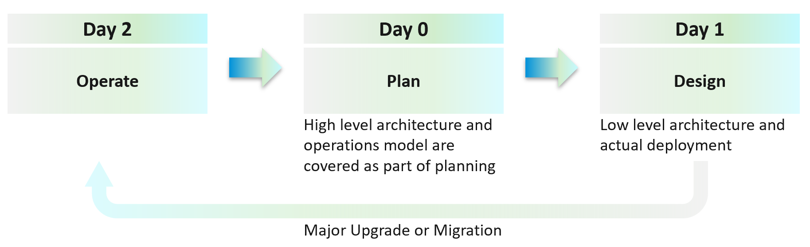

# Purpose-driven architecture: Day 2 first, business context, automation last, two sides of VCF

## Goals come from what is sold
- Architecture goals are business results seen by those who pay for the system and those who pay for the service. Design considerations (availability and performance practice) come after.
- The goals depend on what is sold: an application or infrastructure.
- **SaaS**: software as a service; no on-premises install. ISVs use it to avoid outdated installs.
- **DBaaS**: two variants.
  - Shared binary: one patch updates every instance; all share one maintenance window.
  - Dedicated binary: each customer has its own version, patch level and downtime schedule.
- **PaaS**: a set of common services used by business applications (login, payment).
- **DaaS**: desktops as a service. Goal: desktop experience at a low price per user.
  - Desktops run the same software, so a change in it moves every desktop at once. A 10% CPU increase in the browser, on a heavily overcommitted host, can breach the Performance SLA. Application teams must be involved.
- **K8aaS**: Kubernetes as a service; dedicated cluster or shared cluster.
- **IaaS**: three variants (VM, resource pool, hardware): `operations-management/performance/iaas-business`.

## Day 2 → Day 0 → Day 1
- Day 0: plan. Business plan, high-level architecture, operations model.
- Day 1: design and build. Low-level architecture, deployment, commissioning.
- Day 2: operate. It starts at go-live and lasts the life of the platform.
- The order of thinking is 2 → 0 → 1, not 0 → 1 → 2. The end state (how the platform is sold and operated) drives the plan; the plan drives the architecture.
- A major upgrade or migration starts the cycle again from Day 2.

- Example 1: the class of service and the average VM profile fix the ESXi host specification (`operations-management/capacity/host-spec-from-class-of-service`).
- Example 2: business continuity caps cluster size.
  - Policy: one cluster failure may affect at most N production VMs. Book example: 300.
  - Then the cluster is sized so that its VMs stay under N. A cluster built larger cannot be filled without breaking the policy.
  - Seen in the field: 32-node production clusters running 1,000-2,000 VMs.
  - Gold offers availability zones because it hosts mission-critical services.

## Reflect the business in the platform
- The infrastructure team works business-application-centric: it must know the business context and impact of each object.
- CIO view: live information on how IT serves each business unit and its critical applications. The platform must map business units and applications to their VMs.
- Tenant view: customers check their own VM health and how the platform serves their VMs. The platform must associate each tenant with its VMs; at least a structure to browse or find applications and VMs.
- One model fits every business application, because the infrastructure metrics are the same for all (IaaS metrics are horizontal: `operations-management/performance/realms-and-layers`).

## Crown jewels
- Mission-critical business applications: a small share of the VMs, essential to revenue, profit or image. Bank: internet banking. E-commerce: the online portal.
- Monitor them several times a day, not once each morning. The application team watches its system all day.
- The question to answer: is the infrastructure causing the application's problem? Usually performance; sometimes availability or security.

## Health of an application tier
- A tier scales out: web and application servers behind load balancers; microservices as pods per function (payments, shipping).
- Tier health is the average health of its members, not the minimum. Work inside a tier runs in parallel, not in sequence: a tier is not a convoy. A good load balancer balances both performance and availability.
- Spare members (4 or 5 web servers where 3 carry the load):
  - Availability: count the spare. One member down does not reduce tier availability while the remaining members carry the load.
  - Performance: average all members, spare included. Every member serves requests, so a slow one slows its share of them.

## Automation after operations
- Do not architect what you are not willing to troubleshoot. Real problems happen on Day 2, when business workloads run revenue transactions.
- Plan the roles and skills to operate the architecture. Give visibility into each component, and define what health means for it.
- Automation is a feature of the architecture, as fly-by-wire is a feature of a plane. Operations is getting passengers to the destination safely and on time.
- Do not automate what you cannot operate. Automation on ungoverned operations makes the problem happen faster. In the transformation, automation comes last.
- Maturity: reactive and manual (remediating issues not seen coming) → predictive and proactive (the system warns, fewer alerts, more insights) → intelligent and automated (the system is trusted to fix; the team works on improvement).

## Two sides of VCF
- VCF is an SDDC: software on commodity hardware that builds a private cloud on premises.
- Platform side: VCF as the customer's IaaS. The application team cares about it.
- Product side: VCF as a Broadcom software product. The infrastructure team cares about it. Two forms:
  - virtual appliances: vCenter, NSX Edge;
  - kernel software: ESXi VMkernel, vSAN and NSX kernel modules.
- Workload means the customers' VMs. VCF appliances and other infrastructure appliances also run as VMs on the platform.
- Product-side work: compatibility, patch and upgrade; configuration maximums; templates; users and roles; certificates; licenses; log analysis.
- Pillars across both sides: availability, performance, security, compliance, capacity, configuration, inventory.
- The two sides depend on each other, so they are managed as one. Example: an expired vCenter certificate (product) stops vCenter; DRS stops balancing while vCenter is down, so VM contention can rise (platform). vSphere HA keeps working without vCenter.

- Two layers: consumer and provider.
  - Consumer: where VMs and containers run. Three sublayers: application, Guest OS, VM.
  - Provider: the virtualized platform: compute, storage, network.
- VCF scope ends at the VM (virtual motherboard and BIOS) and VMware Tools. The Guest OS is largely outside VCF's influence (`vsphere/foundations/vm-vs-guest-os`).

## Traps
- "Plan first, then design, then work out how to operate it" → Day 2 drives Day 0, which drives Day 1. The class of service and the operations model fix the hardware and cluster design.
- "Automate first; automation is the transformation" → automation is a feature of the architecture. Automating operations that are not governed speeds up the problem.
- "Tier health is the worst member" → work in a tier runs in parallel; tier health is the average of its members.
- "Tier performance can leave out the spare node, since N+1 covers it" → the spare counts for availability only. For performance every member serves requests and is averaged.
- "A larger cluster is always more efficient" → a cap on VMs affected by one cluster failure caps the cluster size.
- "The application team needs the latest VCF version" → the VCF version is a product-side decision. The application team sees the platform side: its VMs and their service level.
- "VCF is responsible for the Guest OS" → VCF scope ends at the VM and VMware Tools.
- "vCenter certificates are an infrastructure matter with no effect on VMs" → product-side failures reach the platform side: without vCenter, DRS stops balancing.

## Metadata
```yaml
id: operations-management/performance/purpose-driven-architecture
retriever_guide: how-it-works
scope: operations-management
technology:
- system
pillar:
- availability
- performance
- capacity
- security
product:
- vsphere
- vsan
- nsx
- vcf-operations
- kubernetes
object:
- VirtualMachine
- ClusterComputeResource
internal_derive:
- operations-management/performance/iaas-business
related:
- operations-management/capacity/host-spec-from-class-of-service
- operations-management/performance/alerts-and-insights
- operations-management/performance/realms-and-layers
- vsphere/foundations/vm-vs-guest-os
- vsphere/object-types/cluster/concepts/drs-overview
images:
  - path: images/day2-day0-day1-sequence-diagram.png
    product: [vsphere]
    object: [HostSystem, ClusterComputeResource]
    topic: 'Day 2 (operate) drives Day 0 (plan), which drives Day 1 (design)'
    image_type: diagram
  - path: images/vcf-platform-vs-product-pillars-diagram.png
    product: [vsphere, vsan, nsx]
    object: [VirtualMachine, VCenterServer, HostSystem]
    topic: 'Two sides of VCF: IaaS platform of the customer and software product of Broadcom, across seven pillars'
    image_type: diagram
source:
  document: PART 1 - Concepts of Operations Management.docx
  path: 'Your Private Cloud > Purpose-Driven Architecture (Begin with The End in Mind: The Crown Jewel, Day 0 | Day 1 | Day 2; Automate | Operate; The 2 Sides of VCF) (pp. 11-22)'
corrections: []
review_notes:
- 'Section ''Goals come from what is sold'', DaaS: reason (same software on every desktop moves together) added by Claude.'
- 'Section ''Day 2 → Day 0 → Day 1'', Example 2: the book does not say whether 32-node clusters with 1,000-2,000 VMs are a counter-example to the cap (Q087 d).'
- 'Section ''Health of an application tier'': the reason in the performance bullet (each member serves its share of requests) is Claude''s. Health across tiers (in sequence) and of an active/passive database tier: Q092.'
- 'Section ''Two sides of VCF'': the book text says workload means the customers'' VMs; its diagram lists IT appliances under Workloads (Q091). Pillar list differs from the pillar tag values (Q091).'
- 'Section ''Two sides of VCF'', certificate example (DRS needs vCenter, vSphere HA does not): Claude''s own knowledge, vSphere 9.1 availability documentation.'
- 'Not copied: the application tier diagram (three-tier vs microservices pods) and the maturity diagram; their content is in the text.'
status: draft
```
