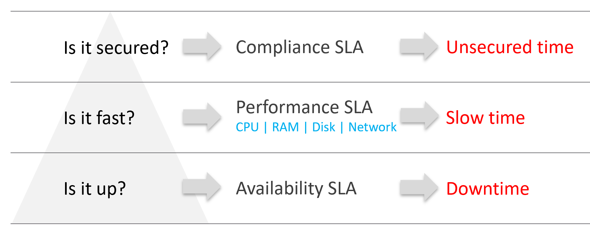
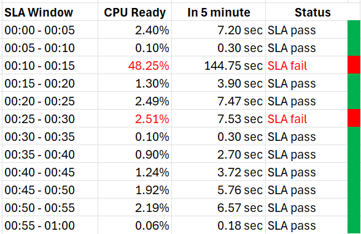

# IaaS SLAs

## SLA in the contract
- An SLA is one section of a business contract between a consuming entity (pays) and a providing entity (supplies). The contract also holds clauses, context and other agreements (confidentiality, payment terms, non-compete, marketing).
- The SLA section holds the metrics and their numbers. A financial penalty makes the provider accountable; certifications and architecture claims do not.
- The SLA (what is delivered) comes before the process and architecture (how it is delivered).
- A private cloud has no use for an SLO. It is a goal, not a peer of the SLA; public cloud providers use it because they offer their own customers no SLA on the workload. SLA and SLI are enough.
- SLI means SLA leading indicator, not a peer of the SLA (`operations-management/performance/kpi-vs-sla`).

## Four SLAs of IaaS
- Public providers commit to availability only: it is binary and the easiest to measure. For IaaS that is incomplete: up is not fast, and fast is not secure.
- Each SLA measures time in a bad state and expresses the month as 0-100%, 100% being perfect against the contract.

| SLA | Question | Measures |
|---|---|---|
| Availability | Is it up? | Downtime |
| Performance | Is it fast? | Slow time, from CPU, RAM, disk and network |
| Compliance | Is it secure? | Unsecured time |
| Service | Is the human and portal service delivered? | Response, provisioning, support |


- Availability, performance and compliance cover the workload. The Service SLA covers the human side (tenant, application team) and has a secondary role.
- Availability is largely a given: whatever the agreed number, a down VM is restored at once.
- The Performance SLA carries more value: it ends complaint-based operations by defining fast with a number.
- The Compliance SLA is also called Security SLA (preferred term: `knowledge/glossary.md`). Customers and providers assume 100%; promising 100% without a contract number leads to disappointment.

## VM and Guest OS scope
- VM and Guest OS are two objects with a permanent 1:1 relationship. An IaaS provider often covers both. If the Guest OS is in scope, Windows or Linux is in the SLA.
- **Availability**
  - VM: powered on, BIOS running. The Guest OS is not in the VM SLA.
  - Guest OS: Windows or Linux running, including basic services such as security agents. The application is not in the SLA.
- **Performance**
  - VM: gets the CPU, memory, disk and network it demands.
  - Guest OS: Windows or Linux counters within expectation.
- **Security**
  - VM: protected per the vSphere hardening guide or industry regulation.
  - Guest OS: protected per its vendor or industry regulation.
- Windows and Linux performance metrics are less complete: their performance modelling is less mature.

## Availability SLA
- Definition: the Guest OS answers ping. A VM that runs but is isolated fails.
- The ping source is set by the IaaS provider, not the customer. It pings the VM, not a process: IaaS is not web server as a service.
- Uptime covers the Guest OS only. Application start-up (loading files, starting services) is not counted.
- Included: crashes caused by VMware Tools or by drivers and agents the infrastructure team owns.
- Excluded:
  - unscheduled downtime caused by the customer, such as an application crash;
  - reboots by the VM owner, after a software install or to fix a problem. Windows does not fully trap this event, so tracking it is hard;
  - work inside the scheduled downtime: Guest OS upgrade, patch reboot, VMware Tools and VM hardware upgrade.
- The cause of a downtime takes time to find, so the metric must be recalculable after the month.
- Recovery time counts: Windows or Linux may boot in 1 minute and then run fsck before the application can start. That time is downtime. It affects availability, not performance.
- Two metrics, because vendors exclude scheduled downtime and can claim 99.999% while users see less:
  - Actual Availability (%): down is down, whatever the time, owner or cause. Easy to measure.
  - Operational Availability (%): excludes scheduled downtime and customer-caused downtime. Harder to measure. The SLA uses it.

```text
Actual Availability (%)      = (minutes in month - all downtime minutes) / minutes in month × 100
Operational Availability (%) = (minutes in month - downtime minutes counted by the SLA) / minutes in month × 100
```
- Example: weekly patch window Sunday 00:00-02:00. In June (30 days, 720 hours) a database VM is patched 3 times inside the window: each time the Guest OS is down 15 minutes and the database takes 45 minutes to be fully restored.
  - Operational Availability: 100%. All three are inside the scheduled window.
  - Actual Availability counting the Guest OS only: 45 minutes, 99.90%.
  - Actual Availability counting until the database is restored: 3 × 60 minutes = 3 hours, 717 / 720 = 99.58%.
- Supporting offers that justify a higher class: application-level backup and self-service file restore; application-level HA monitoring, boot order, VM-host affinity; lower RPO and RTO with a yearly real DR test; longer and larger snapshots; patch deferral and custom patch sets; deferral of VMware Tools and VM hardware updates.

## Performance SLA
- No scheduled slow time exists: an infrastructure upgrade is no excuse for slow VMs. The margin sits in the SLA percentage, not in a window.
- Slow is a spectrum from no contention to as good as dead. Disk latency and CPU Ready never read 0, so the threshold sits above 0.
- Four counters, one per resource:

| Resource | VM counter | Breach when |
|---|---|---|
| CPU | Ready | above 2.5% |
| Memory | Contention | above 1% |
| Disk | Latency | above 10 ms |
| Network | Transmit dropped packets | above 0% |

- Measured at VM level, not per vCPU or per virtual disk. Disk latency is the average of read and write.
- Averaged over 300 seconds. A 1-minute average is too tight: it forces either a higher cost or a lower threshold.
- Excluded:
  - received packets dropped: not reliable for a contract; a packet can be dropped because it was not for the VM (`vsphere/technology/network/metrics/virtual-motherboard/packets-dropped`);
  - CPU Overlap, CPU Other Wait, vMotion stun: too granular for a contract; tracked by KPIs;
  - CPU Contention (VCF Operations): it can reach 37.5% with no degradation the application notices, because it includes the Hyper-Threading effect;
  - CPU Co-stop.
- Keep the thresholds as they are:
  - raising one (CPU Ready 2.5% to 5%) changes what each nine means; profile the environment first;
  - a common value lets you compare with peers and between classes (mission-critical vs test and development).
- If an SLA is too strict for a class, lower its percentage, not the threshold. To see how bad reality is, use the KPI.

### What the numbers mean
- CPU Ready 2.5% over 300 seconds = 7.5 seconds of ready state. It is rarely one block; usually sub-second waits spread over the 300,000 ms.
- Ready is not read against utilization in the SLA, but its impact depends on Run:
  - VM 1: Ready 10%, Run 90%. It ran most of the time it demanded.
  - VM 2: Ready 10%, Run 10%. It waited as long as it ran: half of the runtime it demanded was delayed.
- Memory Contention is a share of time a vCPU waits for a page fault to complete, not a share of memory space (`vsphere/technology/memory/metrics/virtual-motherboard/latency`).
- Disk latency: the average over 300 seconds of every IO. A VM at 1,000 IOPS issues 300,000 IOs in the interval. Each virtual disk has its own latency; the VM value is normalized across them.

## Compliance SLA
- Percentage of compliance against an agreed security policy or benchmark.
- Compliance is binary: compliant or not. The provider promises perfect compliance with its own benchmark, for every class.
- A window, usually ad hoc, allows investigation or maintenance that can make an object non-compliant for a while.
- Calculated from the infrastructure team's point of view.
- Included:
  - internal standards, usually adapted from VMware best practices and security hardening guides;
  - regulatory benchmarks: CIS, ISO, DISA, FISMA, PCI DSS, HIPAA. VCF Operations manages vSphere compliance against these and custom benchmarks;
  - the VM's surroundings: if its ESXi host, vSAN, distributed switch or storage is not secure, the VM's score reflects it.
- Excluded: what the provider does not control.
  - Guest OS in the service: compliance is managed in the guest (Group Policy, configuration management, security agents), and availability is measured by Guest OS ping.
  - Guest OS not in the service: no guest compliance, and availability is measured by VM power state.

## Service SLA
- IaaS is commodity hardware sold as a utility; the class of service is where providers differ.
- Provisioning time: matters where churn is high. Define provisioned: a bare OS, or the application and database loaded.
- Provisioning success: complex multi-tier applications with many VMs and integrations fail from time to time.
- Support: response time and escalation path. Do not promise resolution time unless it is fully in your control. Example: Gold alerted by email and messaging within 10 minutes.
- Technical account manager: one contact who represents the customer inside the provider.
- Monitoring: Gold VMs monitored proactively, not only by alerts; Gold sees lower-level metrics (vMotion stun time, VMkernel latency); self-service monitoring portal where customers can start their own scheduled downtime.
- Leave out metrics that serve no business purpose. Portal availability is one: the provider's office is open 24 x 7 x 365.

## Time window
- The SLA is monthly, on the calendar month. It averages the 5-minute values of the month: 8,640 in a 30-day month.
- Yearly: customers reject it; a year allows long outages. Daily: providers reject it; no room for error.
- Allowable downtime per period:

| SLA | 1 week | 1 month | 1 quarter | 1 year |
|---|---|---|---|---|
| 99.999% | 0.1 min | 0.4 min | 1.3 min | 5.3 min |
| 99.99% | 1.0 min | 4.3 min | 13.1 min | 52.6 min |
| 99.95% | 5.0 min | 21.6 min | 65.5 min | 263.0 min |
| 99.9% | 10.1 min | 43.2 min | 131.0 min | 526.0 min |

- 99.999% a year (5.3 min) allows more downtime than 99.95% a week (5.0 min).
- Each extra nine shrinks the window 10x and can call for a different architecture: 99.99% leaves 4.0-4.5 minutes a month to detect and remediate.
- Window by month length:

| SLA | Relative window | 28-day month | 30-day month | 31-day month |
|---|---|---|---|---|
| 99.999% | 1x | 0.4 min | 0.4 min | 0.4 min |
| 99.995% | 5x | 2.0 min | 2.2 min | 2.2 min |
| 99.990% | 10x | 4.0 min | 4.3 min | 4.5 min |
| 99.950% | 50x | 20.2 min | 21.6 min | 22.3 min |
| 99.900% | 100x | 40.3 min | 43.2 min | 44.6 min |

- Failure window in a 30-day month, counted in 5-minute intervals:

| SLA | Failure window | Failed intervals allowed |
|---|---|---|
| 99.99% | 4.3 min | 0 |
| 99.98% | 8.6 min | 1 |
| 99.97% | 13.0 min | 2 |
| 99.96% | 17.3 min | 3 |
| 99.95% | 21.6 min | 4 |
| 99.90% | 43.2 min | 8 |
| 99.80% | 86.4 min | 17 |

## Promise and reality
- Promise: what is sold. Several numbers, one per class of service: a higher price buys a higher SLA.
- Reality: what is delivered, calculated at month end. One number per VM, whatever its class. A Gold VM can fail its SLA while scoring higher than a Bronze VM that passes.

## SLA calculation
- The month's SLA is built from 5-minute values. The 5-minute value is the SLI (SLA leading indicator): it warns before the month ends.
- Every 5 minutes each counter passes or fails:

```text
CPU SLI     = 100% if VM CPU Ready <= 2.5%, else 0%
Memory SLI  = 100% if VM Memory Contention <= 1%, else 0%
Disk SLI    = 100% if VM Disk Latency <= 10 ms, else 0%
Network SLI = 100% if VM Network Transmit Dropped Packets = 0%, else 0%
VM SLI (%)  = average of the four          → 100, 75, 50, 25 or 0 every 5 minutes
VM Performance SLA (%) = average of the VM SLI over the calendar month
```
- Pass or fail is binary per interval. A breach at 48.25% CPU Ready and a breach at 2.51% count the same: there is no severe failure and no partial failure of one counter.
- Example, VM 007, one hour, CPU only: 12 intervals, 10 pass. 00:10-00:15 at 48.25% (144.75 s of Ready) fails; 00:25-00:30 at 2.51% (7.53 s) fails; 00:20-00:25 at 2.49% (7.47 s) passes.

- Why Gold is 99.9% and not 99.95%: in the shortest month (28 days) 0.1% is 40.3 minutes, 8 five-minute failures. 99.95% leaves 4. The difference matters operationally.
- Cluster SLA and SLI built from VM values: `vcf-operations/kpis/cluster-sla-sli`.

## Same threshold for every class
- Every class is measured against the same benchmark; the classes differ in how often they may miss it.
  - Availability: against no downtime.
  - Performance: against the same slow-time threshold.
  - Compliance: against perfect compliance.
  - Service: against the best possible service.
- A Silver VM expects to be denied what it demands more often than a Gold VM. More consistency costs more: move to Gold.
- Different thresholds per class fail in two ways. Example: Gold memory contention 0.5%, Silver 1.5%.
  - The gap cannot be explained: Silver gets a 3x looser threshold at half the price, not a proportional one.
  - Silver can score better than Gold, because its standard is lower.
- Production should score higher than development on the same threshold. How much higher is set by the nines per class: `operations-management/performance/class-of-service`.

## Traps
- "Our availability SLA is 99.999%, so users had 5 minutes of downtime a year" → the SLA excludes scheduled and customer-caused downtime. Actual Availability counts everything and is lower.
- "Application start-up after a reboot counts against the IaaS availability SLA" → IaaS uptime covers the Guest OS answering ping. fsck counts; application loading does not.
- "Schedule a maintenance window for slow time, as for downtime" → performance has no scheduled window. The margin is the SLA percentage.
- "A breach at 2.51% Ready is a minor failure, half a breach" → each interval is pass or fail. 2.51% and 48% count the same.
- "Bronze fails the performance SLA too often; raise its Ready threshold to 5%" → keep one threshold for every class and lower Bronze's nines. Changing the threshold changes what each nine means.
- "Put CPU Contention in the SLA; it covers Ready, Co-stop and more" → Contention includes the Hyper-Threading effect and reaches 37.5% with no visible degradation. The SLA uses Ready.
- "Count received dropped packets in the network SLA" → a VM can drop packets not meant for it. The SLA uses transmit drops only.
- "Ready 2.5% means the VM froze for 7.5 seconds" → 7.5 seconds in total over 300 seconds, mostly sub-second waits.
- "Ready 10% is equally bad for every VM" → read it against Run: 10% beside 90% Run is mild; 10% beside 10% Run delays half the demanded runtime.
- "Memory Contention 1% means 1% of the VM's memory is contended" → it is a share of time spent waiting on page faults.
- "Per-vCPU Ready above 2.5% breaches the SLA" → the SLA is measured at VM level over 300 seconds. Per-vCPU and 20-second peaks belong to KPIs.
- "A yearly SLA is easier on the customer" → a yearly window allows the longest single outage; 99.999% a year is more downtime than 99.95% a week.
- "A Gold VM that failed its SLA must have scored lower than every passing Bronze VM" → reality is one number per VM; the promise differs per class.
- "Set a tighter memory threshold for Gold than for Silver" → one threshold for all; classes differ in nines. Different thresholds let Silver outscore Gold.

## Metadata
```yaml
id: operations-management/performance/sla-metrics
retriever_guide: how-it-works
scope: operations-management
technology:
- cpu
- memory
- storage
- network
- system
pillar:
- availability
- performance
- security
product:
- vsphere
- vcf-operations
- windows
- linux
object:
- VirtualMachine
internal_derive:
- operations-management/performance/kpi-vs-sla
- vcf-operations/kpis/cluster-sla-sli
- vsphere/technology/memory/metrics/virtual-motherboard/latency
- vsphere/technology/network/metrics/virtual-motherboard/packets-dropped
related:
- operations-management/performance/class-of-service
- operations-management/performance/iaas-business
- vsphere/technology/cpu/metrics/virtual-motherboard/ready
- vsphere/technology/cpu/metrics/virtual-motherboard/co-stop
- vsphere/foundations/vm-vs-guest-os
- foundations/thresholds
images:
  - path: images/sla-availability-performance-compliance-what-each-measures-diagram.png
    product: [vsphere]
    object: [VirtualMachine]
    topic: 'Availability, Performance and Compliance SLA: question, SLA, what each measures'
    image_type: diagram
  - path: images/vm-cpu-ready-sla-pass-fail-per-5-minute-window-table.png
    product: [vcf-operations]
    object: [VirtualMachine]
    metric: [CPU Ready]
    topic: 'Pass or fail per 5-minute window, one hour of VM 007'
    image_type: table
    sample: 'one VM, 12 five-minute windows'
source:
  document: PART 1 - Concepts of Operations Management.docx
  path: 'Your Private Cloud > Service Level Agreement (The 4 SLAs of IaaS, VM vs Guest OS, Availability SLA, Performance SLA, Compliance SLA, Service SLA, The Metrics of SLAs, The Time Window, The 2 Sides of an SLA, SLA Calculation, Performance Quantification, Penalty Quantification, The Benchmark to Rule Them All) (pp. 23-35)'
corrections: []
review_notes:
- 'Section ''SLA calculation'': the book writes each counter as ''If VM CPU Ready > 2.5% then 100% else 0%'', which scores a breach as 100%. Written here as pass = 100%, so that the monthly mean reads 99.9% when good. Partial VM score (75%) vs binary failure vs ''a VM must pass all four'' in vcf-operations/kpis/cluster-sla-sli: Q095.'
- 'Section ''Availability SLA'', example: the book counts 3 hours (Guest OS plus database restore) = 99.58%; by the book''s own definition (Guest OS ping, application start-up not counted) it is 45 minutes = 99.90%. Both written as arithmetic; which the example means: Q096.'
- 'Section ''Availability SLA'', Operational Availability formula: written by Claude from the definition; the book has a Formula heading with no formula. Green zone (Q086) still undefined.'
- 'Section ''Performance SLA'', CPU Co-stop excluded: the book asks why Co-stop is excluded but gives the reason for CPU Contention only. ''Because it includes the Hyper-Threading effect'' is Claude''s reading of the 37.5% figure. Q097.'
- 'Section ''What the numbers mean'', Memory Contention: the book says it is relative to memory used and not measured across time; the author''s answer to Q015 says time (page-fault wait). Written as time. Q097.'
- 'Section ''Time window'': tables transcribed from the book images. The book table has 99.95% quarter 65.5 min (91-day quarter) and year 263.0 min (rounded); kept as the book gives them. ''Failed intervals allowed'' column: Claude converted the book''s ''< n times'' into whole 5-minute intervals.'
- 'Section ''Compliance SLA'': the recommended table gives 99.95% for all classes; the sample offering and this definition give 100% (perfect). Q098.'
- 'Section ''Four SLAs of IaaS'': the book names Google Cloud and AWS SLA scopes; not repeated (public pages not checked).'
status: draft
```
