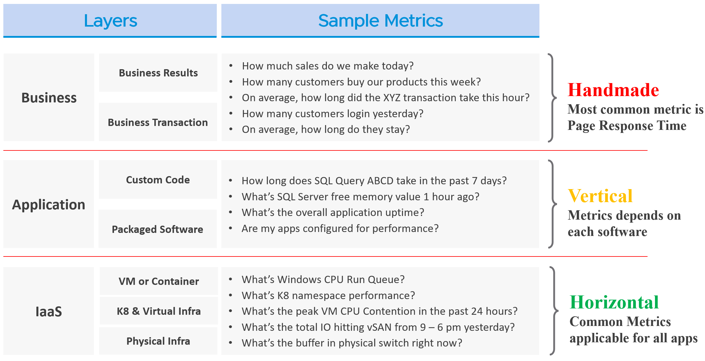
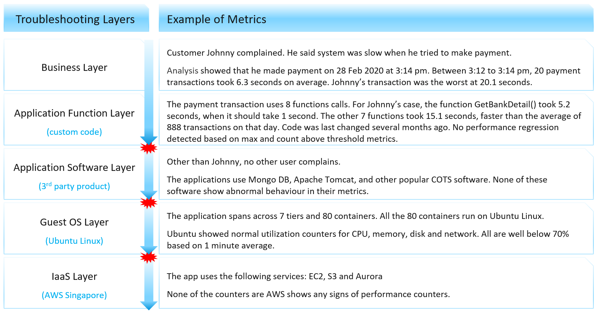
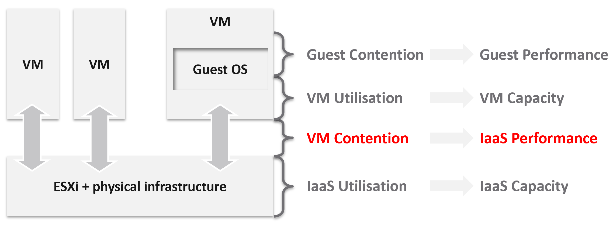
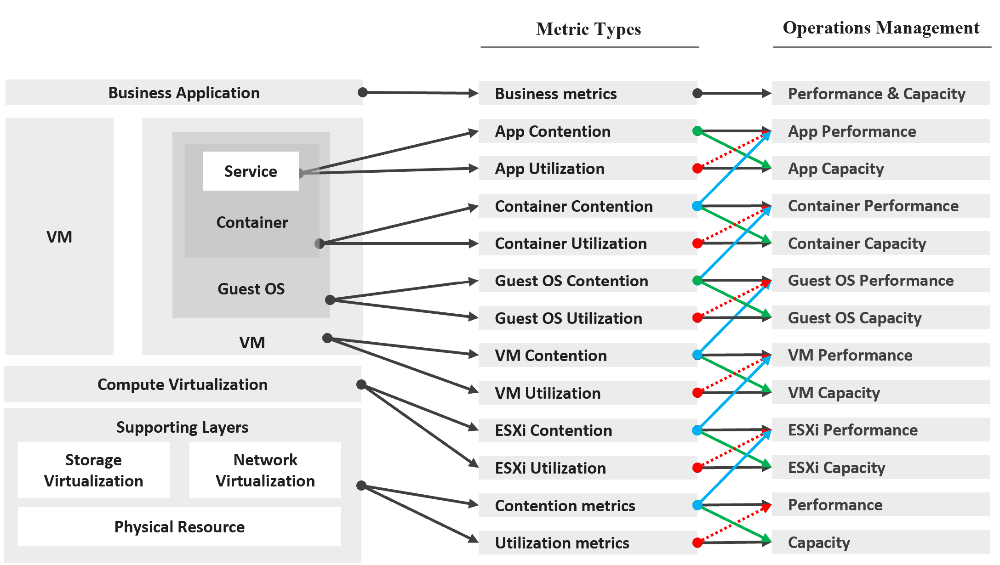

# Business, application and IaaS layers

## Three realms of IT
- Business, application and IaaS. Each has its own teams, responsibilities and skills.
- TOGAF mapping: business → business architecture; application → information systems architecture; IaaS → technology architecture.
- Disputes are usually between the application team and the infrastructure team: both are IT. Business users are the consumers and do not supply technical answers.
- Each realm has its own KPIs, with SLAs between realms (`operations-management/performance/kpi-vs-sla`).

| Realm | Owner | What can be observed |
|---|---|---|
| Business | Non-IT department owning the function (internet banking) | Response time of a business function (pay for a cart) |
| Application | IT application team | Software-specific metrics, usually through agents; no generic KPI |
| IaaS | IT infrastructure team | CPU, memory, disk, network: one universal KPI for all applications |

- Business metrics are handmade per function; application metrics are vertical, one set per software; IaaS metrics are horizontal, common to every application.


## Business KPIs
- Two kinds: based on IT software (business transactions), and not based on IT (revenue, margin, a competitor's discount).
- IT-based transactions: online (a user waits, OLTP, usually under a few seconds per transaction) or batch (background, many transactions, can take hours); user to system or system to system.
- The same transaction type varies with the data volume (a report over more records takes longer). Expected times per transaction must be set by the application architect; this does not scale to hundreds of applications.
- The only universal business-application metrics: page response time and error returns.

## Troubleshooting by elimination
- Performance troubleshooting eliminates layers: slice each layer and decide whether it causes the problem.
- That takes one metric per layer that says whether the layer performs: the KPI.
- Upper layers depend on lower ones, and the infrastructure layer is the usual source of contention. Check it first: it is horizontal and serves every application the same way.
- The impact of infrastructure latency on an application is unknown in advance. The same software (SQL Server 2019) is hit differently by batch and OLTP use.

## Context is lost at each layer boundary
- Business layer: each transaction has an id; which user and which transaction were slow is known, and custom code can be traced per function call.
- Packaged software (COTS): metrics no longer relate to users or transactions. A queue of 10,000 does not say whether the user's transaction was in it.
- Guest OS: every application is a process. Per-process CPU, memory, disk and network; deeper metrics are system-wide. Packet loss does not say which process lost packets.
- VM or EC2 instance to shared infrastructure: context is lost again. In public cloud, troubleshooting stops at the consumer layer.


## Four levels in IaaS
| Level | Metric | Serves |
|---|---|---|
| 1 | Guest OS contention | Guest OS performance; outside the platform's control |
| 2 | VM utilization | VM capacity: does the VM use its 8 vCPU? |
| 3 | VM contention | IaaS performance: does the platform serve the VM? |
| 4 | IaaS utilization | IaaS capacity; not the VM owner's concern |

- Level 2 can be read in the Guest OS or at the VM. The right one depends on the use case: each layer lacks visibility into the other (`vsphere/foundations/vm-vs-guest-os`).
- Level 3 is where the VM meets the provider. It is the IaaS performance measure.
- Level 4 belongs to capacity planners and troubleshooting specialists.


## Consumer and provider metric types
- Consumer:
  - business application: business metrics, spanning VMs, containers and functions; best at showing that the application performs, unable to say why not;
  - service: a process in Windows or Linux, usually called the application (a database server);
  - Guest OS: two kinds, the Windows or Linux layer and the driver layer (PVSCSI, vmxnet). A VMXNET3 ring-buffer drop is caused and fixed in the guest, so it is outside the IaaS SLA, although the hypervisor counts it too; the SLA covers the vNIC as the hypervisor sees it;
  - container: usually inside a VM; more than one container per VM makes operations harder;
  - VM.
- Provider:
  - compute virtualization (the hypervisor), where the VM or container runs;
  - storage and network virtualization: subsystems supporting the hypervisor; ideally with per-VM metrics, to trace one VM through the storage and network stack;
  - physical resources: with hyperconverged infrastructure, mainly network equipment, as interconnect.

### Drive by contention
- At every layer, contention is the primary metric for performance and utilization the primary metric for capacity.
- A consumer's contention metric is the performance metric of its provider. VM contention measures the ESXi host and cluster.
- Contention feeds capacity: a CPU queue says how much CPU to add.
- Contention flows upward: Guest OS disk latency reaches the application, and can ripple to the top layer.
- 100% utilization with 0 contention is maximum performance. Where contention cannot be measured, keep a buffer below 100%: queues tend to form at high utilization.
- Low utilization can still mean poor performance: many configuration errors cause it.
- Source of the phrase: Mark Achtemichuk, https://blogs.vmware.com/vsphere/2015/11/vcpu-to-pcpu-ratios-are-they-still-relevant.html.


## Why optimized performance is hard
- Best performance is at 100% utilization or throughput, when the system does the most work. Most loads have peaks, so the average sits well below 100%.
- Four dependencies stand in the way:
  - vertical: a lower-layer problem reaches the upper layer;
  - horizontal: CPU, memory, disk and network are not independent. When a vCPU is paused, the Guest OS clock moves on, so its memory and disk report latency it did not cause;
  - flow: an NSX Edge VM on the edge cluster can slow a business VM on another cluster, because the traffic passes through it;
  - version: drivers and firmware outside the interoperability matrix can show up as a performance problem.

## Traps
- "The application is slow, so find the slow infrastructure metric" → infrastructure metrics have no transaction or user context. Prove the layer with its KPI, then eliminate it.
- "Guest OS disk latency is high, so storage is slow" → a paused or stopped vCPU inflates Guest OS latency for disk and memory, because the guest clock keeps running. Check VM CPU contention first.
- "ESXi CPU utilization is the host's performance metric" → the host's performance is the contention of its VMs. Utilization is its capacity metric.
- "Low utilization rules out a performance problem" → limits, imbalance and configuration errors cause contention at low utilization.
- "A slow VM on cluster A has its cause on cluster A" → flow dependency: an NSX Edge on another cluster carries its traffic.

## Metadata
```yaml
id: operations-management/sp5-framework/realms-and-layers
retriever_guide: how-it-works
scope: operations-management
technology:
- cpu
- memory
- storage
- network
- system
pillar:
- performance
- capacity
product:
- vsphere
- nsx
object:
- VirtualMachine
- HostSystem
- ClusterComputeResource
internal_derive:
- vsphere/foundations/vm-vs-guest-os
- vsphere/foundations/provider-consumer
related:
- operations-management/sp5-framework/performance-vs-capacity
- operations-management/performance/kpi-vs-sla
- operations-management/performance/troubleshooting/vm-slow-triage
images:
  - path: images/three-realms-layers-sample-metrics-table.png
    product: [vsphere]
    object: [VirtualMachine]
    topic: 'Three realms: business, application, IaaS'
    image_type: table
  - path: images/troubleshooting-layers-loss-of-context-example-table.png
    product: [vsphere]
    object: [VirtualMachine]
    topic: 'Loss of context between troubleshooting layers'
    image_type: table
  - path: images/iaas-four-levels-contention-and-utilization-diagram.png
    product: [vsphere]
    object: [VirtualMachine, HostSystem]
    topic: 'Four levels in IaaS'
    image_type: diagram
  - path: images/consumer-provider-metric-types-to-operations-pillars-diagram.png
    product: [vsphere]
    object: [VirtualMachine, HostSystem]
    topic: 'Consumer and provider metric types; drive by contention'
    image_type: diagram
source:
  document: PART 1 - Concepts of Operations Management.docx
  path: 'Performance Management > The 3 Realms > The Layers in IT Systems; The Layers in IaaS > IaaS Metric Types; Optimized Performance (pp. 71-76)'
corrections:
- 'Section ''Consumer and provider metric types'': driver-layer metrics are guest-os layer, outside the IaaS SLA; the SLA covers the vNIC as the hypervisor sees it (author, Q070, 2026-11-06).'
- 'Realm means a world with a boundary, not an operations term: used both for business, application, IaaS and for VM vs Guest OS (author, Q071, 2026-11-06).'
review_notes:
- 'Image troubleshooting-layers-loss-of-context-example-table.png: 5.2 s + 15.1 s = 20.3 s, but the transaction is given as 20.1 s. Q072.'
- 'The book offers an improved Apdex formula. Q072.'
status: draft
```
