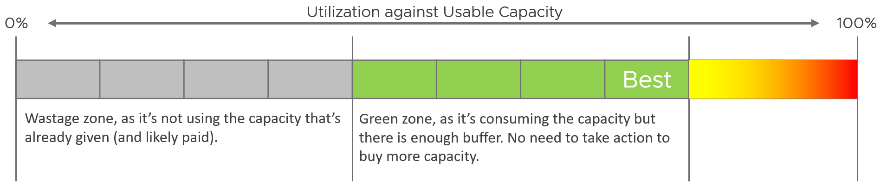

# Capacity dimensions

## Which model applies


- There are only 2 main models: overcommit or not-overcommit.
- Automated capacity management requires a model: for each dimension, a formula for total capacity, usable capacity and consumption (`sp5-framework/capacity/capacity-model`).
- The model follows the goal. Two questions pick it: overcommit or not, and one class of service or several.
- Multi-cluster load balancing: every member cluster has the same settings.

### No overcommit

- Simplest and most expensive model: consumer to provider 1:1. Used where the business value of the workload far exceeds the infrastructure cost.
- Utilization, reservation and contention do not matter: each VM gets the runtime and memory it demands, when it demands it.
- Allocation is the only input. Measure it against usable capacity, not total capacity: usable already holds HA and DR.
- The cluster is closed when allocation equals usable capacity.

### Overcommit: one class (Mono)

- All VMs are Gold, or all Silver, or all Bronze. No reservation or share settings: all VMs are equal.
- Plan utilization for the concurrent peak of the combined workload, not the peak of each VM.

### Overcommit: several classes (Mix)


| Stage | What is used | Why |
|---|---|---|
| Plan | Utilization, allocation, reservation | No real workload yet: a calculator simulates the combinations |
| Plan | Not contention | It does not exist before workload runs |
| Run | Share | DRS and ESXi must tell Gold from Silver from Bronze |
| Run | Not reservation | Absolute, with side effects |
| Run | Not allocation | Not in-line: the scheduler does not use it |
| Run | Not utilization | A result, not a setting |

- Most common case: overcommit, mixed classes, VMs given for free (no chargeback). The reason it is the most common is limtied budget and physical constraints.
- Planning fills the cluster to 100% of the first dimension reached: utilization, allocation or reservation.
- A cluster of mostly Gold VMs holds fewer VMs, have lower Risk (%) score and higher Performance (%) score.
- The same technique mixes Kubernetes and VMs as Kubernetes Node takes the shape of a vSphere VM.
- Gold VMs get higher shares under contention. Avoid absolute reservation at run time.

### VM price

- A price helps even for internal customers: money is the simplest way to value a service.
- VMs free of charge: VMs are added until someone complains. Put a Performance SLA in place to avoid complaint-based operations (`sp5-framework/performance/kpi-vs-sla`).
- VMs not free of charge: the allocation model justifies why a Gold vCPU costs more than a Bronze vCPU on the same hardware. Bronze costs 4x less because it is overcommitted 4x; cost is covered.

## Four dimensions


| Dimension | Role | Used for |
|---|---|---|
| Utilization | Primary metric | Against usable capacity, which holds availability and buffer |
| Contention | Override | Stop provisioning: the main input to closing the cluster |
| Allocation | Leading indicator | Protect the shared infrastructure from sudden demand |
| Reservation | Guarantee | Planning. At run time use it sparingly; use shares |

## Utilization

- Live use of the resource. High utilization means the cluster is full, even with overcommit ratio and reservation below target.
- Ideal: 100% utilization, 0% contention, 0% risk.
- Low utilization that stays low is wastage, unless the object is new and still growing, or holds DR protection.
- Accounting:
  - relative utilization, against usable capacity: exclude the HA host;
  - keep the hypervisor overhead of the other hosts: it is part of the load.




| Utilization against usable capacity | Zone | Meaning |
|---|---|---|
| 0-40% | Grey | Wastage: capacity given, and likely paid for, is not used |
| 40-80% | Green | Consumed with enough buffer: no purchase yet |
| 80% | Best | Target |
| 80-100% | Yellow to red | No values given by the source |

- Ten equal chunks of usable capacity: four grey, four green, two from yellow to red.

## Contention

- When the cluster cannot serve its current workload, remaining capacity is 0 in practice: provisioning stops.
- Two metrics:
  - Performance (%): the actual performance (`vsphere/object-types/cluster/kpis/cluster-performance`);
  - Stop Provisioning (yes or no): the cluster is closed for new VMs or pods, decided from Performance (%), Capacity Remaining (%) and Risk (%). Flow: `sp5-framework/capacity/health-check/can-cluster-take-more-vms`.
- A leading indicator would let VMs already in the queue be provisioned, or give a week of notice. Performance and risk do not project well: a projection of them can be wrong.

## Reservation and share

Reviewed together: each covers what the other lacks.


| Aspect | Reservation | Share |
|---|---|---|
| Nature | Absolute; a guarantee, so no overcommit | Relative; overcommit does not apply |
| Focus | Throughput: CPU cycles (Hz) | Runtime: CPU time slices; memory apportioned |
| Drawback | At VM level it affects HA and DRS | No guarantee |
| Use | Conservatively; not the full value | Aggressively: a wide Gold to Silver ratio |
| Stage | Planning | Running |
| Where | Indirectly: resource pool | Directly: VM |

- A reservation set on the VM changes HA admission control and HA restart: unreserved capacity left after host failures decides placement. Set it on a resource pool instead (Frank Denneman's recommendation, cited by the book).
- VM-level reservation leads to lower provider utilization and higher consumer contention: placement becomes unbalanced.
- Through a resource pool, a Gold VM may not get its reserved share on time: the DRS scheduler lags the ESXi scheduler.
- Turbo gives spare CPU at ESXi level above the reservable base clock (`vsphere/architecture/resource-controls`, section Reservation: CPU vs memory).
- Both add operational work: over time nobody knows which VM or pool has which reservation or share, or since when.
- No deterministic link to performance: doubling a VM's CPU reservation or shares does not halve its CPU Ready.
- Reservation adds complexity because it has two parts (allocated and used), and a resource pool and its child VMs carry independent settings.

## Demand

```text
Demand = Max (Utilization, Reservation)
```

- A reservation not yet consumed affects capacity, not performance.
- Example: a VM using 4 GHz with a 5 GHz reservation counts as 5 GHz: the extra 1 GHz is guaranteed to it.
- Compute per VM, then sum at the ESXi host. A sum of utilization and a sum of reservation taken separately gives a different, wrong number.
- Powered-on VMs only. Powered-off VMs can be started any time, but counting them gives an over-conservative capacity.
- Restaurant: two floors, the first full of diners, the second empty but booked and paid for a wedding. Is it full? For a wedding guest, no; for anyone else, yes. Can the diners be served well? Yes: the second floor is empty, staff serve the first. Capacity is full while performance is fine.
- Who holds a reservation not yet consumed:
  - compute: powered-on VMs below their reserved CPU or memory;
  - storage: thin-provisioned virtual disks below their configured size. Not called a reservation, but it acts as one.

## Allocation

- The metric used to sell capacity. Half price against full price → overcommit no higher than 2:1.
- Leading indicator: total demand can exceed visible demand, because part of the demand has no utilization yet.
- Not in-line: ESXi and vCenter do not schedule by allocation. So allocation can be overcommitted (`vsphere/architecture/resource-controls`, section Allocation vs reservation).
- Usable capacity applies here too: deduct the hypervisor (VMkernel, vSAN, NSX, vSphere Replication) from total capacity.
- Counted only for powered-on VMs.
- CPU: per thread, not per core. Mind the Hyper-Threading penalty; do not promise a GHz speed (`sp5-framework/capacity/capacity-model`, section Overcommit).
- Memory: overcommit is against physical DRAM. NVMe used by memory tiering is not counted as capacity (`vsphere/technology/memory/concepts/memory-tiering`).

### Invisible demand


| Demand | Example | Response |
|---|---|---|
| Rare | Annual sales; a market crash | Set an overcommit ratio and drive by allocation |
| Unexpected | DR drill or real DR wakes protected VMs | Count Site Recovery Manager recovery plans |
| Potential | New VMs take months to reach full load | Plan for their final size |
| Unmet | Demand the VM or the host cannot serve | Count undersized VMs in cluster capacity |

- Rare demand of a group of VMs can hurt the whole cluster or datastore at once. Paying ahead for a disaster is a business decision, not the capacity planner's.
- Recovery plans: one recovery plan holds many protection groups, and one protection group can sit in many recovery plans. Count each VM once.
- New VMs are often idle for months, then grow fast.
- Unmet demand has two parts:
  - inside the VM: an undersized VM queues inside the Guest OS; the infrastructure never sees it;
  - outside the VM: contention, visible to the infrastructure and part of the IaaS KPI and SLA (`sp5-framework/performance/kpi-vs-sla`).

### Limitations of allocation


| Limitation | Effect |
|---|---|
| VM size ignored | Two monster VMs count the same as many small VMs of equal total; the scheduler fits small VMs more easily, more so when they peak at different times |
| Utilization ignored | Only configured size counts; extra load makes allocation report less consumption than real |
| Overhead ignored | vSAN keeps protection data on the same datastore: consumption doubles inside it |
| IaaS workload counted | Agent VMs count as demand, though they often use a local datastore |

## Overcommit

- The main way to lower the cost of shared infrastructure. Acceptable while real and risk contention stay acceptable: queueing is normal in daily life.
- A provider that does not overcommit may not compete on cost.
- Public cloud reference (book): CPU at 1:1, counted per thread, not per core; memory not overcommitted.
- Overcommit ratios are written virtual : physical (4:1 = 4 vCPUs per thread).

## Traps

- "We recommend 2:1 memory overcommit; going above is risky" → a ratio alone ignores utilization, VM size and class of service. Bronze can run 2:1 while Gold runs 1:1 (`sp5-framework/capacity/class-of-service-planning`).
- "Memory usage is 90%; aim for 80% because of HA" → Consumed is unaware of HA, and high Consumed is not a worry: memory is a cache and should be high, else the DIMMs, which are expensive, are wasted. HA is accounted in usable capacity.
- "Memory Active should stay below 50-60% to keep a buffer to Consumed" → Active is not a capacity counter. It serves VMkernel memory management and has no use for capacity unless memory tiering is on (`vsphere/technology/memory/concepts/memory-tiering`).
- "Each host should run in the high memory state" → High means much free memory: wastage for capacity. ESXi reclaims only near the top (`vsphere/technology/memory/concepts/host-memory-states`).
- "Cluster XYZ is important, so 5:1 CPU overcommit is fine" → not wrong but misleading: it reduces capacity management to the allocation model, and the more important the cluster, the lower its ratio. It also omits the unit: a CPU ratio is per thread, not per core, because the CPU executes per thread.
- "3:1 CPU gives buffer for spikes and HA" → not wrong but misleading: allocation alone ignores utilization and VM size; buffer and HA are in usable capacity, not in the ratio.
- "Tier 3 can run 4:1 CPU" → not wrong but misleading: a ratio is a planning input tied to the VM price, not a capacity verdict; the running cluster is judged by consumption, performance and risk.
- "UAT at 70% CPU is fine until 85%" → not wrong but misleading: utilization alone does not close a cluster; read contention and risk.
- "Utilization is low, so the reservation does not matter" → demand is the higher of utilization and reservation; an unused reservation is still taken.
- "Doubling the CPU shares halves CPU Ready" → no deterministic link between shares or reservation and contention.
- "Count powered-off VMs in demand to be safe" → powered-on VMs only; counting powered-off VMs makes capacity too conservative.
- "A thin disk that is not full has free space to give away" → its unwritten part is a reservation in effect: it grows to its configured size.

## Metadata

```yaml
id: sp5-framework/capacity/capacity-dimensions
retriever_guide: how-it-works
scope: sp5-framework
technology:
- cpu
- memory
- storage
- system
pillar:
- capacity
- performance
- value
product:
- vsphere
- vcf-operations
object:
- ClusterComputeResource
- ResourcePool
- VirtualMachine
internal_derive:
- sp5-framework/capacity/capacity-model
- vsphere/architecture/resource-controls
related:
- sp5-framework/capacity/class-of-service-planning
- sp5-framework/capacity/health-check/can-cluster-take-more-vms
- sp5-framework/concepts/performance-vs-capacity
- vsphere/technology/memory/concepts/host-memory-states
- vsphere/technology/memory/concepts/memory-tiering
images:
  - path: images/capacity-model-planning-vs-operating-stage-diagram.png
    product: [vsphere]
    object: [ClusterComputeResource]
    topic: 'Capacity model choice'
    image_type: diagram
  - path: images/cluster-utilization-against-usable-capacity-wastage-and-green-zones-diagram.png
    product: [vsphere]
    object: [ClusterComputeResource]
    topic: 'Utilization zones'
    image_type: diagram
source:
  document: PART 1 - Concepts of Operations Management.docx
  path: 'Capacity Management > Capacity Model (Workload Level; Workload Type; VM Price; 4 Dimensions of Capacity: Utilization, Performance, Reservation | Share, Allocation, Invisible Demand, Limitation, Overcommit). Pages 97-107.'
corrections: []
review_notes:
- 'Section ''Traps'': author answer Q115 (2026-11-09): (a), (d), (i) confirmed; (b) Consumed is unaware of HA and should be high (cache); (c) Active is not a capacity counter, only for VMkernel memory management and memory tiering; (e)-(h) not wrong but misleading: they reduce capacity management to the allocation model; a CPU ratio is per thread.'
- 'Section ''Utilization'': the 80-100% zone has no numbers in the book. Cluster Consumption (%) uses different bands (CPU green 0-55); see Q116.'
- 'Section ''Allocation'': memory tiering was a tech preview in vSphere 8.0 Update 3 and is supported from vSphere 9.0 (author, Q117, 2026-11-09).'
- 'Section ''Reservation and share'': the book gives the reservation unit as Hertz and milliseconds; CPU reservation is set in MHz. Written as Hz (Q118).'
- 'Section ''Reservation and share'': the resource-pool advice quotes Frank Denneman, frankdenneman.nl, vSphere 7 DRS Scalable Shares deep dive (2020-05-27). Paraphrased, not copied.'
- 'Section ''Demand'': "a sum of utilization and a sum of reservation taken separately gives a different number" is Claude''s explanation of why the book computes per VM first.'
- 'Section ''Traps'': the "Good" Advice statements come from the book without reasons; the reasons are Claude''s reading of the chapter (Q115).'
- 'Section ''Overcommit'': public cloud CPU at 1:1 per thread is the book''s statement. Burstable instance families (for example AWS T series) share CPU by credits; not in the book (Claude''s knowledge).'
status: draft
```
