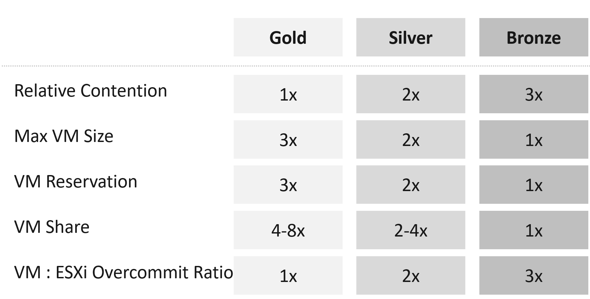

# Class of service in capacity planning

## Why a step per class
- Gold, Silver and Bronze require a relative value that tenants understand.
- The step follows the CPU overcommit ratio, 1:1, 2:1, 3:1 per physical thread: Silver has 2 consumers per thread, Bronze 3. So Bronze has about 3x the chance of contention of Gold, and costs a third.
- A step tied to one setting is easy to explain to senior leadership and application teams, and easy to run at scale.
- Price follows the same step: Gold price = 2x Silver = 3x Bronze (`sp5-framework/concepts/class-of-service`, section Generic guideline).
- The steps are a goal, not a rule: memory allocation (1:1, 1.2:1, 1.4:1), shares and utilization do not follow them exactly.
- Price, SLA numbers per class, size limits and soft products: `sp5-framework/concepts/class-of-service`. This file holds the capacity settings.

## Promise vs technique


- What is sold: a Gold VM has the lowest chance of contention; Silver about 2x Gold's, Bronze about 3x.
- Contention cannot be guaranteed directly. So the provider proves the promise with four techniques, each stepping with the class:
  - a lower overcommit ratio;
  - a larger reservation;
  - more shares, so a higher class wins under contention;
  - a larger maximum VM size, so a lower class cannot become the noisy neighbour (`sp5-framework/capacity/vm-size`).

| Relative value | Gold | Silver | Bronze |
|---|---|---|---|
| Relative contention | 1x | 2x | 3x |
| Maximum VM size | 3x | 2x | 1x |
| VM reservation | 3x | 2x | 1x |
| VM share | 4-8x | 2-4x | 1x |
| VM to ESXi overcommit ratio | 1x | 2x | 3x |

## Example implementation
![Reservation (relative to VM configured size, set at resource pool): Gold 50% CPU 100% RAM, Silver 25% CPU 50% RAM, Bronze 12.5% CPU 25% RAM. Allocation (thread, usable capacity; memory tiering beyond 1:1): Gold CPU 1:1 RAM 1:1, Silver CPU 2:1 RAM 1.5:1, Bronze CPU 4:1 RAM 2:1 (the image predates the final values: Bronze CPU 3:1; memory 1.2:1 and 1.4:1). Contention minimum Performance (%) KPI: 99.5%, 99%, 98%. Expected utilization against ESXi threads and usable capacity: Gold CPU about 50% RAM about 80%, Silver CPU below 70% RAM below 90%, Bronze CPU below 90% RAM below 95%](images/class-of-service-reservation-allocation-contention-utilization-table.png)

- **Reservation**
  - Gold: 50% CPU, 100% RAM
  - Silver: 25% CPU, 50% RAM
  - Bronze: 12.5% CPU, 25% RAM
  - Relative to the VM's configured size. Set at the resource pool, not the VM.
- **Allocation (overcommit, virtual : physical)**
  - Gold: CPU 1:1, RAM 1:1
  - Silver: CPU 2:1, RAM 1.2:1
  - Bronze: CPU 3:1, RAM 1.4:1
  - CPU per thread, not per core. 3:1 is the highest CPU overcommit of any class: 6:1 per core with Hyper-Threading. Against usable capacity, not total capacity. Memory tiering serves memory beyond 1:1.
- **Contention: minimum VM Performance (%)**
  - Gold: ≥ 99.5%
  - Silver: ≥ 99%
  - Bronze: ≥ 98%
  - The VM Performance (%) a cluster sized to the class is expected to keep: a capacity design expectation that sets the overcommit of the class. The KPI itself has no class of service (`sp5-framework/performance/kpi-vs-sla`).
- **Utilization (expected, not a ceiling)**
  - Gold: CPU about 50%, RAM about 80%
  - Silver: CPU below 70%, RAM below 90%
  - Bronze: CPU below 90%, RAM below 95%
  - Against ESXi physical threads, not cores. Against usable capacity, not total.

- Reservation, allocation and contention are the settings and promises. Utilization is the result they produce.
- A cluster of mostly Gold VMs is likely to stay well below 60% CPU utilization: the 1:1 allocation and the reservations fill the cluster first.
- Bronze is overcommitted, so utilization becomes its upper limit: above it, contention risk rises.
- The minimum Performance (%) leaves unmet demand of 0.5%, 1% and 2%.

## Planning phase vs running phase
- Planning phase: no VMs run yet, the cluster may not even be bought. The overcommit ratio is the input, and it is tied to the VM price. It is not tied to the Cluster Risk (%) score.
- Running phase: workload runs, so reality overrides the plan. Read Cluster Consumption, Cluster Performance and Cluster Risk. Bronze clusters are expected to score a higher Cluster Risk (%) than Gold clusters (`vsphere/object-types/cluster/models/cluster-risk`).

## Planning calculator
- At the planning stage there is no workload, so the plan is a simulation. Agent E2 runs it with the `capacity_plan` tool; the model gathers the inputs and explains the result. Defaults per class are catalog rows `planning-*`.
- Inputs: per host the cores, base GHz, DRAM, Hyper-Threading, hypervisor overhead (threads and GB), system CPU reservation, memory tiering; the number of hosts and HA hosts; per class the typical VM (vCPU, GB per vCPU), overcommit, reservation and expected concurrent peak.
- Supply per host, by model (usable capacity: `sp5-framework/capacity/capacity-model`):
  - utilization: threads - hypervisor threads; DRAM - hypervisor GB + tiering;
  - allocation: the utilization supply × the class overcommit (memory: DRAM part × overcommit + tiering);
  - reservation: CPU cores × base GHz - system reservation, because a reservation is capped at the base clock; memory as in utilization.
- Demand per model: allocation = configured size; reservation = configured size × reserved share; utilization = configured size × expected concurrent peak.
- Six numbers per host: three models × CPU and memory. The host is full at the first to reach 100%; it decides how many VMs fit and which resource binds.
- Mixed classes: in the allocation model each class's demand is divided by its overcommit ratio, so a Gold vCPU weighs 3 Bronze vCPUs.
- HA: not subtracted per host. A cluster carries load on hosts - HA hosts; the HA hosts are added on top.
- Aim for 90-110% at planning: the plan is an estimate, and reality will vary. Contention cannot be modelled; in a running cluster, read Cluster Performance (%).
- Example: 64 cores, 2.5 GHz, 768 GB, Hyper-Threading on, overhead 14 threads and 64 GB. Silver VMs of 8 vCPU and 32 GB: allocation CPU 28.5, memory 26.4; reservation CPU 30, memory 44; utilization CPU 28.5, memory 25.9. 25 VMs fit per host; memory utilization binds.

## Misconceptions
- "Our Bronze plan of 3:1 shows red overcommit in Cluster Risk, so the plan is wrong" → the ratio is a planning input tied to price; Cluster Risk reads the running cluster, where Bronze is expected to score higher than Gold.
- "Keep exactly the same step on every row" → the step is a goal, not a rule.
- "Gold gets 2x the performance of Silver" → Gold gets about half the chance of contention; speed is not doubled.
- "Set the Gold reservation on each VM" → set it on the resource pool; VM-level reservation changes HA admission control and restart.
- "Bronze at 90% CPU is overloaded" → for Bronze, 90% is the expected upper limit; for Gold, about 50% is expected.
- "Overcommit ratio per core" → the plan counts threads, not cores; 3:1 per thread is 6:1 per core with Hyper-Threading.
- "The host fits as many VMs as its allocation allows" → allocation is one of six numbers; at planning, memory utilization or CPU reservation often binds first.
- "Gold memory at 1:1 means no memory tiering" → tiering serves memory beyond 1:1; Gold stays at 1:1 against DRAM.

## Metadata
```yaml
id: sp5-framework/capacity/class-of-service-planning
retriever_guide: how-it-works
scope: sp5-framework
technology:
- cpu
- memory
- system
pillar:
- capacity
- performance
- value
product:
- vsphere
- vcf-operations
object:
- ClusterComputeResource
- ResourcePool
internal_derive:
- sp5-framework/capacity/capacity-model
- sp5-framework/capacity/capacity-dimensions
related:
- sp5-framework/concepts/class-of-service
- sp5-framework/performance/noisy-neighbour
- sp5-framework/capacity/vm-size
- sp5-framework/capacity/host-spec-from-class-of-service
- sp5-framework/performance/kpi-vs-sla
- vsphere/object-types/cluster/models/cluster-risk
- vsphere/object-types/vm/kpis/vm-performance
images:
  - path: images/class-of-service-relative-value-gold-silver-bronze-table.png
    product: [vsphere]
    object: [ClusterComputeResource]
    topic: 'Class of service relative value'
    image_type: table
  - path: images/class-of-service-reservation-allocation-contention-utilization-table.png
    product: [vsphere]
    object: [ClusterComputeResource, ResourcePool]
    topic: 'Class of service planning values'
    image_type: table
source:
  document: Private Cloud Management by Iwan Rahabok (https://isvara.io/download); Capacity Planning Stage (spreadsheet, 2026-11-11)
  path: 'Capacity Management > Capacity Model > Planning Phase; Planning Template'
corrections:
- 'Section ''Example implementation'': the image shows Bronze CPU 4:1 and memory 1.5:1 and 2:1; the final values are Bronze CPU 3:1 per thread and memory 1.2:1 and 1.4:1 (2026-11-11). The text states the final values.'
review_notes:
- 'Section ''Example implementation'': Silver 2:1 and Bronze 3:1 per thread are 4 and 6 vCPUs per core with Hyper-Threading; Cluster Risk (%) marks 3-4 vCPUs per core as red, so a Bronze cluster built to this plan scores red on the CPU overcommit row. Memory 1.4:1 stays below the memory red band (1.8-2.2).'
- 'Section ''Example implementation'': Gold at 50% CPU reservation and 1:1 CPU per thread from the book image. Text written from the image; the image is kept.'
- 'To check: Sections ''Promise vs technique'' and ''Example implementation'': the relative-value table steps reservation 3x/2x/1x and contention 1x/2x/3x, while the reservation shares (50%, 25%, 12.5%) and the unmet demand (0.5%, 1%, 2%) step 4x/2x/1x (Q175).'
- 'To check: section Contention: class minimum VM Performance (%) read as a capacity design expectation; the author''s table says KPI (Q162).'
status: draft
```
