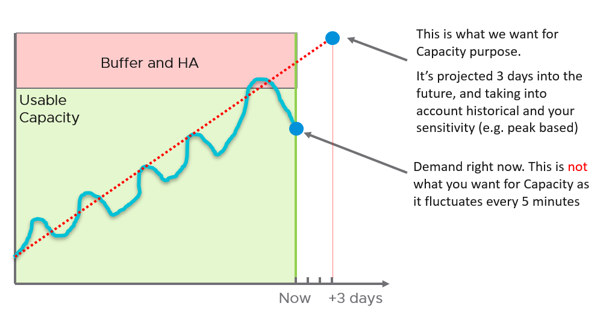

# Forecasting capacity

## What is forecast
- The long-term horizon of the running stage: when must hardware be bought? Procurement takes months, so the answer must come before the shortage ([`sp5-framework/capacity/capacity-management`](README.md), section Two stages).
- Supply is a chosen constant ([`sp5-framework/capacity/supply`](supply.md)). What is forecast is demand: utilization against usable capacity.
- Compute is projected from its past. Storage space is not: 0 bytes left stops IO, and that reality overrides any projection ([`vsphere/technology/storage/concepts/storage-dimensions`](../../vsphere/technology/storage/concepts/storage-dimensions.md)).
- Demand that is not yet visible is in no projection: new projects, DR tests and real DR, new VMs not yet at full load. Add it on top ([`sp5-framework/capacity/demand`](demand.md), section Invisible demand).

## Projection or percentile
- With a clear trend, a projection beats a percentile.
- Accuracy depends on data volume and cycle length. Quarter-end peaks need at least 6 months of data.
- Without 3 months of data: use the 97th percentile for overall sizing. 2 standard deviations ≈ 95%, 3 ≈ 99.7%; the 97th sits between.

- Momentary one-off peaks should barely move a projection; periodic peaks (month-end, quarter-end) must be kept in it.

## Reading the two numbers
- VCF Operations gives two numbers per cluster: Capacity Remaining (%), the short horizon, and Time Remaining (days), the long horizon. How it computes them: [`vcf-operations/features/capacity-forecast`](../../vcf-operations/features/capacity-forecast.md).
- Read both together. Ideal: low capacity remaining with high time remaining. The cluster is well used, and its growth is slow.
- Low capacity remaining with low time remaining: buy now, or close the cluster ([`vsphere/object-types/cluster/decision-tree/can-cluster-take-more-vms`](../../vsphere/object-types/cluster/decision-tree/can-cluster-take-more-vms.md)).
- High capacity remaining with high time remaining for months: wastage, unless the cluster is new or holds DR protection.
- Both numbers read utilization against usable capacity. Neither reads contention: a cluster with time remaining can still be full because its VMs wait ([`sp5-framework/concepts/performance-vs-capacity`](../concepts/performance-vs-capacity.md)).

## Misconceptions
- "Capacity Remaining is current free capacity" → it is a projection, 3 days ahead.
- "Time Remaining is long, so the cluster can take more VMs now" → the short term is decided by contention, consumption and risk; Time Remaining is for buying hardware.
- "A percentile is as good as a projection" → with a clear trend, project; use the 97th percentile only without enough data.
- "The projection includes the project starting next month" → committed future demand is not in the data; add it.
- "Storage has 60 days remaining, so there is time" → a burst of writes or snapshots can fill it first; 0 bytes left stops IO.

## Metadata
```yaml
id: sp5-framework/capacity/forecasting
retriever_guide: how-it-works
scope: sp5-framework
technology:
- cpu
- memory
- storage
- system
pillar:
- capacity
product:
- vsphere
- vcf-operations
object:
- ClusterComputeResource
- Datastore
internal_derive:
- sp5-framework/capacity/demand
- sp5-framework/capacity/supply
related:
- sp5-framework/capacity/capacity-management
- vcf-operations/features/capacity-forecast
- vsphere/object-types/cluster/decision-tree/can-cluster-take-more-vms
- vsphere/technology/storage/concepts/storage-dimensions
- sp5-framework/concepts/performance-vs-capacity
images:
  - path: images/capacity-projection-vs-percentile.png
    product: [vcf-operations]
    object: [ClusterComputeResource]
    topic: 'Projection vs percentile'
    image_type: diagram
source:
  document: Private Cloud Management by Iwan Rahabok (https://isvara.io/download)
  path: 'Provider Objects > Capacity > Projected Metrics'
corrections: []
review_notes: []
status: draft
```
