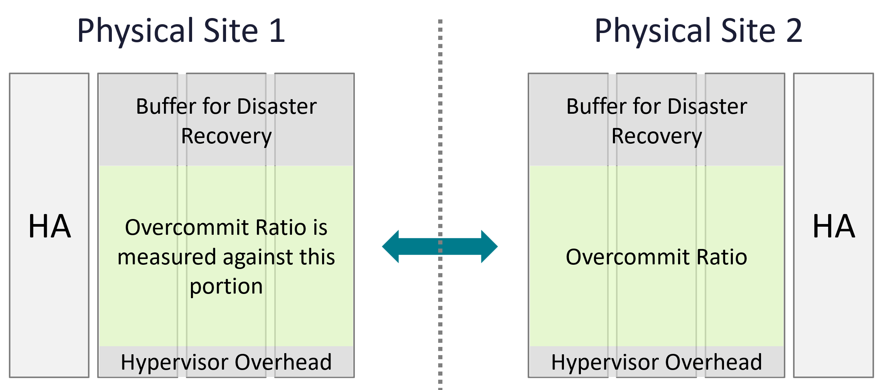

# Overcommit ratio

## Definition
- Allocation divided by supply: configured vCPU or memory of the powered-on VMs against physical capacity. Written virtual : physical (N:1): 3:1 is 3 vCPUs per physical thread.
- Only allocation can be overcommitted. A reservation is a guarantee and cannot be; utilization and demand are results, not settings ([`vsphere/architecture/resource-controls`](../../vsphere/architecture/resource-controls.md), section Allocation vs reservation).
- The main way to lower the cost of shared infrastructure. Acceptable while real and risk contention stay acceptable: queueing is normal in daily life.
- A provider that does not overcommit may not compete on cost.
- The ratio excludes buffer: it is read against the capacity left after HA and buffer. Allocation ignores utilization and the provider part ([`sp5-framework/capacity/supply`](supply.md)).

- A planning input tied to the VM price, not a verdict on a running cluster. A running cluster is judged by consumption, performance and risk ([`sp5-framework/capacity/capacity-management`](README.md), section Two stages).

## Per resource
- CPU: per physical thread, not per core, because the CPU executes per thread. With Hyper-Threading a ratio per core is twice the ratio per thread: 3:1 per thread is 6:1 per core.
- CPU: a vCPU maps to a thread, not to a fixed speed. A thread on a shared 1 GHz core gets 625 MHz; 1.6 GHz restores 1 GHz per thread. Tenants buying 4 GHz expect 4 GHz; with Hyper-Threading, state 2.5 GHz. Do not promise a GHz speed ([`vsphere/technology/cpu/concepts/hyper-threading`](../../vsphere/technology/cpu/concepts/hyper-threading.md)).
- Memory: against physical DRAM. Memory tiering is not part of the ratio: NVMe is about 1,000x slower than DRAM, so its pages are not memory of the same class. The plan leaves tiering out; the running stage measures it with its own signals: active memory against DRAM, NVMe read rate and NVMe read latency ([`vsphere/technology/memory/concepts/memory-tiering`](../../vsphere/technology/memory/concepts/memory-tiering.md)). Broadcom: do not combine memory overcommit with tiering.
- Disk: count only virtual disks; exclude snapshots and swap. On vSAN, exclude FTT protection and lower the ratio to match: FTT that doubles space halves the ratio.
- Network: exclude inter-switch links; count only ESXi ports used by VMs.

## Per class
- CPU per physical thread: Gold 1:1, Silver 2:1, Bronze 3:1. Per core with Hyper-Threading: 2:1, 4:1, 6:1.
- Memory: Gold 1:1, Silver 1.2:1, Bronze 1.4:1.
- 3:1 per thread is the highest CPU ratio of any class. 4:1 per thread is 8:1 per core.
- Values and the other planning settings per class: [`sp5-framework/capacity/class-of-service-planning`](class-of-service-planning.md); catalog rows `planning-*` in `catalog/thresholds-capacity`.
- The class also sets the maximum VM size, which follows from the ratio ([`sp5-framework/capacity/vm-size`](vm-size.md)).

## Ratio and price
- A price helps even for internal customers: money is the simplest way to value a service.
- VMs free of charge: VMs are added until someone complains. Put a performance KPI in place to avoid complaint-based operations ([`sp5-framework/performance/kpi-vs-sla`](../performance/kpi-vs-sla.md)).
- VMs not free of charge: the allocation model justifies why a Gold vCPU costs more than a Bronze vCPU on the same hardware. Bronze costs a third of Gold because it is overcommitted 3:1 per thread; cost is covered.
- Half price breaks even at 2:1: twice the tenants, each paying half.
- Price per class, SLA and progressive pricing: [`sp5-framework/concepts/class-of-service`](../concepts/class-of-service.md).

## Ratio and contention
- A ratio says nothing about performance by itself; contention does. Below 1:1 contention cannot come from the ratio; above it, contention becomes possible, first on the hottest host ([`sp5-framework/concepts/performance-vs-capacity`](../concepts/performance-vs-capacity.md), section Pattern difference).
- The same ratio gives different contention with different VM sizes: monster VMs raise contention at a ratio that small VMs run well at ([`sp5-framework/capacity/demand`](demand.md), section Limitations of allocation).
- In the running cluster, the overcommit rows of Cluster Risk (%) read the ratio per host ([`vsphere/object-types/cluster/models/cluster-risk`](../../vsphere/object-types/cluster/models/cluster-risk.md)).
- A higher class gets a lower ratio, so it sees contention less often. The KPI levels stay the same for every class ([`sp5-framework/performance/kpi-vs-sla`](../performance/kpi-vs-sla.md)).

## Misconceptions
- "We recommend 2:1 memory overcommit; going above is risky" → a ratio alone ignores utilization, VM size and class of service. Bronze runs memory at 1.4:1 while Gold runs 1:1 ([`sp5-framework/capacity/class-of-service-planning`](class-of-service-planning.md)).
- "Cluster XYZ is important, so 5:1 CPU overcommit is fine" → not wrong but misleading: it reduces capacity management to the allocation model, and the more important the cluster, the lower its ratio. It also omits the unit: a CPU ratio is per thread, not per core, because the CPU executes per thread.
- "3:1 CPU gives buffer for spikes and HA" → not wrong but misleading: allocation alone ignores utilization and VM size; buffer and HA are in usable capacity, not in the ratio.
- "Tier 3 can run 4:1 CPU" → 4:1 per thread (8:1 per core) is above the highest class ratio, Bronze 3:1; and a ratio is a planning input tied to the VM price, not a capacity verdict; the running cluster is judged by consumption, performance and risk.
- "4:1 overcommit means the same capacity on every host" → say whether it is per core or per physical thread; with Hyper-Threading the two differ by 2x.
- "A vCPU is worth the core's GHz" → with both threads busy, a thread gets about 62.5% of the core; sell threads, not GHz.
- "Reservations can be overcommitted like allocation" → a reservation is a guarantee: admission control refuses what cannot be reserved.

## Metadata
```yaml
id: sp5-framework/capacity/overcommit
retriever_guide: how-it-works
scope: sp5-framework
technology:
- cpu
- memory
- storage
- network
pillar:
- capacity
- value
product:
- vsphere
- vsan
- vcf-operations
object:
- ClusterComputeResource
- HostSystem
internal_derive:
- sp5-framework/capacity/demand
- vsphere/architecture/resource-controls
related:
- sp5-framework/capacity/capacity-management
- sp5-framework/capacity/supply
- sp5-framework/capacity/class-of-service-planning
- sp5-framework/capacity/vm-size
- sp5-framework/concepts/class-of-service
- sp5-framework/concepts/performance-vs-capacity
- vsphere/object-types/cluster/models/cluster-risk
- vsphere/technology/cpu/concepts/hyper-threading
- vsphere/technology/memory/concepts/memory-tiering
images:
  - path: images/cluster-overcommit-ratio-excludes-buffer.png
    product: [vcf-operations]
    object: [ClusterComputeResource]
    topic: 'Overcommit ratio'
    image_type: diagram
source:
  document: Private Cloud Management by Iwan Rahabok (https://isvara.io/download)
  path: 'Provider Objects > Capacity > Key Metrics (Overcommit); Capacity Management > Capacity Model (VM Price; Allocation; Overcommit)'
corrections: []
review_notes:
status: draft
```
