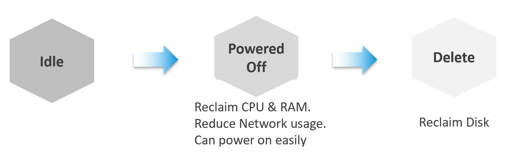

# Reclamation

## When reclamation is the provider's job

- When VMs are free of charge, the infrastructure team have the right to reclaim.
- When VMs are charged and are the main source of the IT budget, the application team owns VM cost; the infrastructure team has no authority to reclaim. Stocktake still applies to internal IT with chargeback (`sp5-framework/capacity/unused-vm`, section Annual stocktake).
- Reclamation is step 3 of the six steps (`sp5-framework/capacity/capacity-management-process`).

## Five areas, easiest to hardest


| Order | Area | Reclaims |
|---|---|---|
| 1 | Non-VM files: unmapped blocks, ISO, orphaned VMDK, RDM, LUN | Disk |
| 2 | Powered-off VM | Disk |
| 3 | Idle VM | Memory; CPU in allocation only; disk after power-off and delete |
| 4 | Oversized VM | Memory; CPU in allocation only |
| 5 | Unused VM | CPU and memory; disk after power-off and delete |

- Non-VM files are easiest: they have no other owner. Only disk can be reclaimed from them, not CPU or memory.
- Keep templates and ISO files in one datastore per physical location.
- Orphaned VM or VMDK: a file in a datastore no longer tied to a registered VM. Not registered in vCenter, or shown in italics when something is wrong; often without an owner.
- Orphaned RDM: check on the array whether any ESXi host still mounts the LUN. Requires a management pack (adapter) for that array.
- Snapshot: not a backup. Kept for long, it slows the VM (`vsphere/technology/storage/concepts/snapshot-impact`). Keep it only to protect a change; remove it once the change is validated. VCF Operations lists snapshots separately because they are easy to reclaim.

## What each area frees


| Area | Free up | Does not free up |
|---|---|---|
| Unused VM | Real CPU cycles and ESXi memory: the highest benefit | Disk until VM is deleted |
| Oversized VM | ESXi memory; cluster capacity: a lower cluster overcommit ratio | CPU cycles: the removed vCPUs were idle; allocation only |
| Idle VM | ESXi memory (consumed pages stay on the host) | CPU cycles: the idle loop uses almost none; allocation only. Disk until VM is deleted |
| Powered-off VM | Datastore space | Cluster capacity: it holds no CPU or memory |
| Orphaned VMDK | Datastore space | Cluster capacity |
| Snapshot | Datastore space | - |
| Unmapped blocks | Datastore and array space | - |

- Unused VMs are the hardest to find: they look active, neither idle nor oversized.
- Oversized VM performance gain: largest when the Guest OS does many context switches and the VM is larger than the cores of one host.
- Idle VM memory: Windows and Linux keep memory they once touched, so the host keeps it mapped. A reboot frees it quickly; power-off frees it fully (section Idle VM).
- Storage is saved only when the VM is deleted, not when it is powered off.

## Approach for running VMs

- Active VMs are politically the hardest: they serve the business.
- Large VMs first. Reclaim CPU and memory in separate changes: if the application team reports slowness after a change to both, both have to be restored.
- Small VMs are rarely worth it: a 1-vCPU idle VM cannot shrink further, and 4 to 2 vCPUs buys little on hosts with more than 20 cores per socket.
- Example: 20 large VMs reduced by 10 vCPUs each, or 100 small VMs by 2 each: both reclaim 200 vCPUs. The large-VM option gives more and is easier:
  - every downsize requires downtime, approval and a change request; 20 changes cost less than 100;
  - owners resist giving up what they have, more so when they have little;
  - large VMs hurt other VMs: the scheduler must find cores for all their vCPUs, idle or not, and other VMs get migrated between cores and sockets (esxtop tracks these migrations);
  - large VMs are slower themselves: all their vCPUs must be co-scheduled (Co-stop);
  - large VMs lower the consolidation ratio.

## Two sides of a running VM


| Stage | Question | Where to measure |
|---|---|---|
| Before | Does the VM qualify (idle, oversized)? | Inside the VM: the workload runs there |
| After | How much can be reclaimed? | ESXi metrics: ESXi resources are reclaimed |

- Before: ESXi-level metrics mislead. Some load charged to the VM is not the VM's own (vSphere Replication, vMotion); some CPU metrics move with power management.
- After: Guest OS usage does not matter. A queue inside the Guest OS does not load the hypervisor, so it holds nothing to reclaim.
- Two different logics, one per stage.

## Idle VM

- Idle means no useful business workload. A VM running only non-business work (antivirus scan, Windows update) counts as idle.
- Non-business work is hard to detect without per-process allow lists, and even those miss software that runs through Windows or Linux system services.
- Defined on CPU only. Network and disk activity take CPU cycles (packets processed, data copied to RAM), so CPU idleness implies the rest.
- Threshold is absolute, in MHz, not relative to VM size: idle is absolute; oversized is relative.
- Default: 100 MHz. On a 2 GHz host that is 5% of a 1-vCPU VM and 0.25% of a 20-vCPU VM.
- Evaluate every day, not over the whole window. A VM used 2 hours a week is 98.8% idle over the week (166 of 168 hours) but is not idle.
- The VM must be idle every day for N days. VCF Operations implements it with two metrics (`vsphere/technology/cpu/metrics/virtual-motherboard/idle-vm`).
- Window: a short window catches a decommissioned VM fast; a long window protects a month-end VM (payroll can be idle 29 days). With a 1-month window, a retired VM waits a month to be flagged.
- Check the creation date before powering off: a new VM can stay unused for a long time before go-live.
- Corner case: a runaway process keeps CPU high with no memory, network or disk work. The idle definition misses it. Use CPU Usage Disparity (%): a runaway process is usually single-threaded (`vsphere/technology/cpu/metrics/virtual-motherboard/usage-disparity`).
- Declare the definition as a formal policy: measurable, so customers cannot dispute it.
- Reclaiming an idle 10-vCPU VM that runs 1 vCPU does not give back 9 vCPUs of cycles: the cycles were never used. It frees allocation and memory.
- Power it off: that frees its memory. Reducing its vCPUs does not.
- Consumed pages linger long after a VM goes idle: Windows and Linux hold on to memory they have used, so the host keeps it mapped. Powering off reclaims it. The CPU side of idle vCPUs: `vsphere/technology/cpu/concepts/idle-and-unused-vcpus`.

## Powered-off VM

- Harder than orphaned files: the VM has an owner who must agree. Owner tags (email, business unit) make this possible.
- Two definitions:
  - non-stop: powered off for the whole period; a short power-on resets it. VCF Operations uses this one: safer.
  - percentile: allowed on for a short part of the period.

### Power-off as a brake



- Treat idle and powered off as one continuum: power off idle VMs early. CPU and memory come back; powering on again undoes it.
- Caveat: the VMs left running have a higher average utilization, so the overcommit ratio required to break even may not be reached.

## TRIM and unmap

- When the Guest OS deletes a file, it does not zero the blocks; it leaves them. Faster, and recoverable. The thin virtual disk keeps its size, and the array keeps the blocks too.
- TRIM (ATA) and unmap (SCSI) pass the free blocks down so that the virtual disk and the array can release them.
- Applies only to thin-provisioned disks.
- Estimate the space to reclaim per VM: Guest OS used space against virtual disk used space.
- ESXi metrics: `vsphere/technology/storage/metrics/host/datastore`, section Unmap.

## Misconceptions

- "The VM is idle, so its memory is already free" → Consumed stays; only power-off returns it.
- "Powering off an idle 10-vCPU VM frees 10 vCPUs of CPU cycles" → idle vCPUs used almost no cycles; it frees allocation and memory only.
- "A powered-off VM frees datastore space" → space returns only when the VM is deleted.
- "Delete orphaned VMDKs to free cluster capacity" → they use only datastore space.
- "Reclaim from the many small VMs first: there are more of them" → large VMs give more per change and also hurt their neighbours.
- "Measure idleness at the ESXi level" → qualify the VM from inside (vMotion and replication are charged to it); measure what is reclaimed at ESXi.
- "Idle over a week means 98% idle CPU on average" → a VM busy 2 hours a week is not idle; evaluate per day.
- "A 5% CPU threshold works for every VM" → idle is absolute (MHz); 5% of a 20-vCPU VM is 20x the cycles of 5% of a 1-vCPU VM.
- "Snapshots are a backup, keep them" → keep them only for the change window.

## Metadata

```yaml
id: sp5-framework/capacity/reclamation
retriever_guide: how-it-works
scope: sp5-framework
technology:
- cpu
- memory
- storage
- system
pillar:
- capacity
- value
product:
- vsphere
- vcf-operations
object:
- VirtualMachine
- Datastore
internal_derive: []
related:
- sp5-framework/capacity/unused-vm
- vsphere/technology/cpu/metrics/virtual-motherboard/idle-vm
- sp5-framework/capacity/rightsizing
- vsphere/technology/storage/metrics/host/datastore
- vsphere/technology/storage/concepts/snapshot-impact
- vsphere/technology/storage/metrics/virtual-motherboard/disk-space-snapshot
- vsphere/technology/cpu/concepts/idle-and-unused-vcpus
images:
  - path: images/reclamation-five-areas-easiest-to-hardest-diagram.png
    product: [vsphere]
    object: [VirtualMachine, Datastore]
    topic: 'Reclamation areas'
    image_type: diagram
  - path: images/vm-idle-powered-off-delete-continuum-diagram.png
    product: [vsphere]
    object: [VirtualMachine]
    topic: 'Power-off as a brake'
    image_type: diagram
source:
  document: PART 1 - Concepts of Operations Management.docx
  path: 'Capacity Management > Reclamation (Reclamation Approach; Focus on Monster VMs; Powered Off VM; Powered Off as Brake; 2 Sides of a Running VM; Idle VM; TRIM and Unmap). Pages 110-118.'
corrections: []
review_notes:
- 'To check: Section ''TRIM and unmap'': TRIM (ATA) and unmap (SCSI) naming; not in the book.'
status: draft
```
