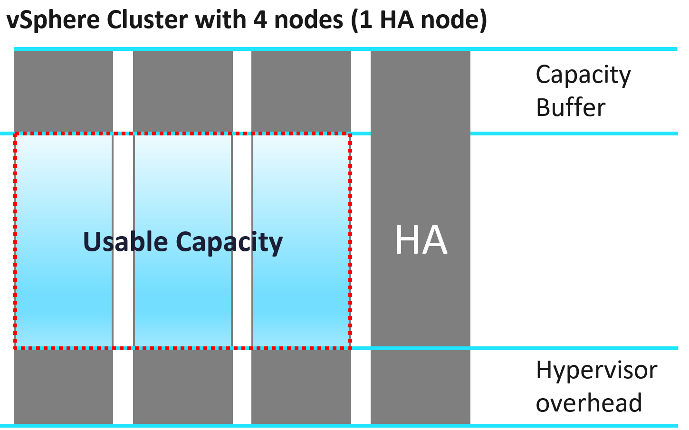

# Supply: total and usable capacity

## Supply and demand
- Supply: total capacity and usable capacity. It is the provider side: ESXi hosts, clusters, datastores, networks.
- Demand is the consumer side: utilization, reservation, allocation, unmet demand ([`sp5-framework/capacity/demand`](demand.md)).
- The hypervisor affects both supply and demand: avoid double counting.
- CPU, memory, storage and network differ in nature ([`sp5-framework/observability/resource-nature`](../observability/resource-nature.md)).
- Total and usable capacity should be constants: a stable 100% anchors capacity management and cost accounting.
- Units: CPU in physical threads, because a vCPU runs on a thread; GHz only for reservation. Memory in DRAM. A ratio of demand to supply is the overcommit ratio ([`sp5-framework/capacity/overcommit`](overcommit.md)).

## Total capacity
- Fixed unless changed on purpose.
- Scale up: one object grows (for example a LUN resized on demand).
- Scale out: identical nodes are added (Kubernetes clusters, Horizon pools, VMware Cloud on AWS clusters). More common: cheaper. Does not work when data cannot be partitioned.
- Dynamic only when intentional: horizontal auto-scaling, vSphere DPM.

## Usable capacity
```text
Usable Capacity = Total Capacity - Availability protection - Overhead - Buffer
ESXi Usable Capacity = Total Capacity - Hypervisor
Hypervisor = VMkernel + vSAN + NSX + vSphere Replication
```
- A stable, chosen number. Actual use can exceed it.
- Availability protection: HA and DR. RAID, hot spares, paired switches. In a vSphere cluster, at least 1 spare host for maintenance; it runs workload but is excluded. Kubernetes nodes are transient; HA may not apply.
- Overhead: unavoidable architecture cost (VMkernel, Kubernetes supervisor, node OS).
- A separate hypervisor value helps migrations between clusters with different stacks (for example to vSAN + NSX).
- Overhead and availability overlap: the HA host contains overhead too.

| Model | HA host | Hypervisor | Buffer |
|---|---|---|---|
| Allocation | Included | Included | Included |
| Utilization | Included | Not included: too volatile | Included |
| Reservation | Included | - | Included |

- Included: subtracted from total capacity in that model.
- Utilization, running stage: the hypervisor is not subtracted. Its load is in the measured utilization, and it is too volatile to fix as a constant. Planning stage: nothing is measured yet, so the calculator subtracts it from supply ([`sp5-framework/capacity/capacity-management`](README.md), section Two stages).
- Reservation: CPU supply is cores × base clock, because a reservation is capped at the base clock; memory supply is DRAM ([`sp5-framework/capacity/class-of-service-planning`](class-of-service-planning.md), section Planning calculator).

## Buffer
- A business decision. Optional.
- Applied to capacity after HA, not total capacity: (Total - HA) × buffer.
- VCF Operations properties: cpu|demand|bufferSetting (%), mem|demand|bufferSetting (%). Default 0%.
- Purpose: performance avoidance. Example: imbalance appears at 95% utilization; a 10% buffer sets usable at 90%, leaving 5% watched by contention counters.
- DR use: paired clusters, production plus DR cluster running test workloads, stretched clusters.
- Example: two 10-host clusters (9 + 1 each) protecting each other, each capped at 50% of 9 hosts (45% of 10 hosts with no imbalance): 50% buffer after HA. With 60% of workload switchable off in DR, utilization can reach 160% of usable.
- Typical: 10% CPU and 0% memory; stretched cluster 50% for both; DR depends on the DR workload.

## Cluster capacity
| Factor | Effect |
|---|---|
| Total capacity | Can be dynamic: maintenance mode, DPM, on-demand hosts in hybrid cloud. Avoid removing hosts from clusters with fewer than 5 hosts: availability overhead rises. |
| HA | 9 + 1: cluster average 100% means each host averages 90%. |
| Stretched cluster | Each site has its own capacity; they affect each other. |
| Host-VM affinity | Host groups act as sub-clusters. |
| Resource pool | Each pool has its own capacity. |
| DR | Use buffer to reserve for rare DR workload. |

## Total vs usable after host loss


| Event | Intentional | Desired | Impacts |
|---|---|---|---|
| DPM | Yes | Yes | Total capacity |
| Maintenance mode | Yes | No | Usable capacity |
| HA event | No | No | Usable capacity |

| Hosts out | Event | Total capacity | Usable capacity |
|---|---|---|---|
| 1 | DPM | 9 | 8 |
| 1 | Maintenance mode | 10 | 9 |
| 2 | DPM | 8 | 7 |
| 2 | Maintenance mode | 10 | 8 |

- 10-host cluster with 1 HA host. DPM takes hosts out of total capacity; maintenance mode keeps them in total and takes them out of usable capacity.
- The same events read as availability (Actual and Operational Availability of the hosts): [`sp5-framework/concepts/sla-metrics`](../concepts/sla-metrics.md), section Availability SLA.

- Total Capacity counts only hosts connected to vCenter. A disconnected host's value goes blank.

## Private cloud components
| Component | Covers | Note |
|---|---|---|
| Compute | ESXi, cluster, resource pool, server | Most attention; a good start with 1:1 compute to storage |
| Storage | Datastore, datastore cluster, vSAN, RDM, array, backup | Equal weight with many-to-many cluster to datastore, or vSAN HCI Mesh |
| Network | Virtual and physical: switch, router, firewall, load balancer | Usually the network architect's; 50 Gb per host is common |

- Storage capacity differs from compute: its shape varies (datastore, vSAN; local datastore and RDM are rare), and thin provisioning exists at both the virtual and the array layer. vSAN adds FTT and depends on compute.
- Network: hosts with 50 Gb rarely hit the limit, unless high-bandwidth VMs (network appliances, web servers) share the same hosts.

## Optimize the provider layer
| Area | Action |
|---|---|
| Compute | Larger clusters; remove host-VM affinity; DRS fully automated |
| Compute | Technology refresh: more supply at the same cost |
| Compute | No CPU pinning |
| Storage | Larger datastores: fewer islands of buffer |
| Storage | Local datastores for agent VMs and applications without HA |
| Storage | Consolidate datastores with low utilization |
| Network | Larger pipes: 2 × 100 Gb instead of 4 × 10 Gb; load-based teaming |
| Network | Remove unused networks: VLAN or VXLAN sprawl makes management and security harder |

- Pockets of resource are the common cause: affinity rules, pinning and small clusters or datastores each hold a buffer that others cannot use.

## Misconceptions
- "Buffer = HA" → buffer applies after HA.
- "Usable capacity changes with the load" → it is a chosen constant; actual use can exceed it.
- "Subtract the hypervisor from usable capacity and count its load in utilization too" → count it once: in supply when planning, in the measured load when running.
- "A host in maintenance mode lowers total capacity" → it lowers usable capacity; DPM lowers total capacity.
- "Affinity rules, CPU pinning and small datastores cost nothing in capacity" → each pocket holds a buffer that other workloads cannot use.

## Metadata
```yaml
id: sp5-framework/capacity/supply
retriever_guide: how-it-works
scope: sp5-framework
technology:
- cpu
- memory
- storage
- network
- system
pillar:
- capacity
- availability
- value
product:
- vsphere
- vsan
- nsx
- vcf-operations
object:
- ClusterComputeResource
- HostSystem
- Datastore
internal_derive:
- vsphere/architecture/overhead
related:
- sp5-framework/capacity/capacity-management
- sp5-framework/capacity/demand
- sp5-framework/capacity/overcommit
- sp5-framework/capacity/forecasting
- sp5-framework/concepts/sla-metrics
- vsphere/technology/cpu/concepts/cpu-measurement-levels
- vsphere/technology/memory/concepts/memory-capacity
- vsphere/object-types/cluster/concepts/admission-control-and-cluster-state
images:
  - path: images/cluster-total-vs-usable-capacity.png
    product: [vcf-operations]
    object: [ClusterComputeResource]
    topic: 'Total vs usable capacity'
    image_type: diagram
source:
  document: Knowledge base
  path: 'Provider Objects > Capacity > Key Metrics; Cluster Capacity; Capacity Management > Overview (Private Cloud Capacity; Optimized Capacity)'
corrections: []
review_notes: []
status: draft
```
