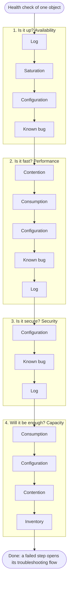

# Health check

## Definition
- A check of one object across every pillar: is it up, is it fast, is it secure, will it be enough. The what: is the object healthy, at risk, or wasteful.
- Always on an object type: VM, ESXi host, cluster, datastore, vSAN cluster, VCF Operations itself. Never on a technology: CPU, memory, storage and network are parts of an object, read inside its health check (VM CPU contention is a step of the VM health check).
- Never on one pillar. Health is a property of the object; a pillar is one aspect of it. A capacity-only check misses a cluster that has room for 50 VMs and has lost HA; a performance-only check misses a host that runs fast on an unsupported version.
- Proactive: no complaint and no alert starts it. It runs on a schedule (daily, twice a day; weekly and monthly with a longer data range) or on request (before a change, after a migration, on an estate seen for the first time). Cadence: [`sp5-framework/concepts/proactive-operations`](proactive-operations.md).

## Parent and children
- The health of a parent includes the health of its children. A cluster is not healthy when its VMs wait, whatever the cluster totals say: Cluster Performance (%) and ESXi Performance (%) are built from the contention of their VMs, at the worst VM and the 90th percentile.
- The reverse holds too: a child inherits the problems of its parent. A host in all-paths-down to a datastore stalls the IO of every VM on that datastore.
- A realm boundary stops it. The Guest OS is a separate realm from the VM and the host: the hypervisor neither sees nor controls what runs inside Windows or Linux. A Guest OS that is slow from its own run queue, a thread lock or a memory leak in the application does not make the VM or the ESXi host unhealthy. Realms: [`vsphere/architecture/vm-vs-guest-os`](../../vsphere/architecture/vm-vs-guest-os.md).
- So the VM health check reads the virtual motherboard; the Guest OS gets its own check, as its own object.

## Superset of troubleshooting
- Troubleshooting starts from a known problem. A complaint, an alert or a failed health check step gives the object and the problem type (down or slow). The question is only why.
- A health check starts with no known problem. It must first find out whether there is one, on which pillar, on which object, and how bad. Only then does a failed step open its troubleshooting flow.
- So a health check contains troubleshooting: detection across every pillar, then troubleshooting for each step that fails.
- The availability, performance and security steps use the same order of checks as the reactive flows (down, slow, breached). Reactive enters one pillar directly; the health check walks all four.
- Detection is the harder half. There is no symptom to anchor on, most metrics are fine, and the object count is large. KPIs and models (0-100%, colour coded) keep the check to about 5 minutes when nothing is wrong.
- Capacity and efficiency are checked but never troubleshot: there is no incident to explain, only a plan to compare with.

## Order of checks

- Is it up? Availability first: a system that is down has no performance problem and cannot be attacked.
- Is it fast? Up does not mean fast.
- Is it secure? Running well does not mean safe from attack.
- Will it be enough? A healthy present does not mean a healthy future. Efficiency (waste) is read here.
- Within each pillar, the what before the why: establish the fact, then explain it.
- Configuration and known bugs sit inside each pillar, not after them: a configuration issue or a bug can cause an outage, slowness or a security loophole.

## Running the daily check
- Top down: clusters first, worst first; then the hosts of a failing cluster; then its VMs. A parent's verdict tells where to look next.
- Stop rule: an availability failure stops that object's check, because a down object has no performance or capacity to read. A performance failure opens its troubleshooting flow; the check then goes on to capacity.
- Inside performance, the same order on every object: the KPI, the failing sub-metric, consumption, configuration.
- About 5 minutes when there is no problem.
- The VCF Operations dashboards for the daily check: after 1.0.

## Interpretation
- Three verdicts, read separately: present health, risk (future health) and efficiency. Never one score ([`sp5-framework/concepts/health-risk-efficiency`](health-risk-efficiency.md)).
- Each failed step names the KPI or model, its band, and the troubleshooting flow it opens.
- Release 1.0 checks availability, performance and capacity. Security and compliance steps are a future phase: state them as not checked.

## Health checks vs other flows
- Most questions in VCF operations are not health checks. Three kinds of question are answered by a flow, each in its own folder:
  - Health check (`health-check/`): is this object healthy? Starts from a schedule or a request, on one object type, every pillar.
  - Troubleshooting (`troubleshooting/`): why is it down or slow? Starts from a known problem: a complaint, an alert, a failed health check step.
  - Decision tree (`decision-tree/`): can it, should it, how much? Starts from one operational question and ends in a choice to act, with its reason. Examples: can this cluster take more VMs ([`vsphere/object-types/cluster/decision-tree/can-cluster-take-more-vms`](../../vsphere/object-types/cluster/decision-tree/can-cluster-take-more-vms.md)), does this host have CPU headroom ([`vsphere/technology/cpu/decision-tree/host-cpu-capacity-headroom`](../../vsphere/technology/cpu/decision-tree/host-cpu-capacity-headroom.md)), should this VM be downsized ([`vsphere/technology/cpu/decision-tree/oversized-vm-downsizing`](../../vsphere/technology/cpu/decision-tree/oversized-vm-downsizing.md)).
- A health check may read the result of a decision tree as one of its steps: the cluster health check reads whether the cluster is closed. The decision tree is still not a health check.

## Object health checks
- VM: [`vsphere/object-types/vm/vm-health-check`](../../vsphere/object-types/vm/vm-health-check.md).
- ESXi host: [`vsphere/object-types/esxi/esxi-health-check`](../../vsphere/object-types/esxi/esxi-health-check.md).
- vSphere cluster: [`vsphere/object-types/cluster/cluster-health-check`](../../vsphere/object-types/cluster/cluster-health-check.md).

## Misconceptions
- "Run a capacity health check on this cluster" → there is no capacity health check. Name the operational question (can it take more VMs, how long until full) and answer it with its decision tree; say the other pillars were not checked.
- "Run a CPU health check" → a health check is on an object type, not a technology. Check the VM, host or cluster; CPU is a step inside it.
- "The application inside the VM is slow, so the ESXi host is unhealthy" → the Guest OS is a separate realm. Check host and VM contention; if both are green, the cause is inside the Guest OS.
- "Health check and troubleshooting are the same thing" → troubleshooting starts from a known problem and asks why; the health check first finds out whether there is a problem.
- "The VM is slow: run its health check" → a complaint is reactive. Start the troubleshooting flow ([`sp5-framework/performance/vm-slow`](../performance/vm-slow.md)).
- "No alert fired, so the object is healthy" → alerts are guard rails for what humans miss; most risk and waste never raise one.
- "Performance is green, so the object is healthy" → availability, security and capacity are checked separately; up and fast today is not safe or enough tomorrow.
- "Troubleshoot the capacity problem" → capacity is planned and monitored; only down and slow are troubleshot.

## Metadata
```yaml
id: sp5-framework/concepts/health-check
retriever_guide: how-it-works
scope: sp5-framework
technology:
- system
pillar:
- availability
- performance
- compliance
- capacity
- value
product:
- vsphere
- vcf-operations
object:
- VirtualMachine
- HostSystem
- ClusterComputeResource
internal_derive:
- sp5-framework/concepts/proactive-operations
- sp5-framework/concepts/health-risk-efficiency
- sp5-framework/concepts/monitoring-vs-troubleshooting
related:
- vsphere/object-types/cluster/cluster-health-check
- vsphere/object-types/vm/vm-health-check
- vsphere/object-types/esxi/esxi-health-check
- sp5-framework/performance/vm-slow
- vsphere/architecture/vm-vs-guest-os
- vsphere/object-types/cluster/decision-tree/can-cluster-take-more-vms
source:
  document: Knowledge base synthesis of the files in internal_derive; order of checks from the health check template (2026-11-09)
  path: 'Your Private Cloud > SP5 Framework > Health; Monitor | Troubleshoot; Proactive Operations'
corrections: []
review_notes: []
status: draft
```
