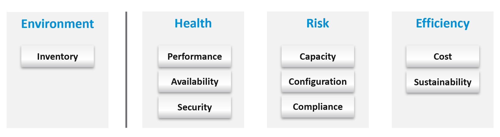

# Health, risk and efficiency

## Why one score fails
- IT uses the word health everywhere and rarely defines it. Trying to cover everything makes the definition too broad.
- What counts as healthy depends on the object, the aspect and the scope. A score that covers everything drops when anything is imperfect, so it reads low while the environment runs well.
- The same holds outside IT. A person can be physically fit and still ill in another sense; a country can be a strong economy and weak in some of its provinces. A health statement needs its aspect and its scope.
- So there is no single health score. The definition of health (present health, risk, efficiency, below) is separate from the action of checking it: the health check runs availability, performance, security, capacity, with configuration as the drill-down (`vsphere/object-types/cluster/health-check/cluster-health-check`).
- The book maps health to the pillars of operations and splits it into three metrics: present health, risk (future health) and efficiency.
- Inventory is left out: it describes the environment, not its health.


## Present health
- Problems that happened or are still going on. A possible problem is risk: a security exposure is not a breach.
- Three problem types, checked in this order:
  - Availability (is it up?): workloads (VMs, Kubernetes) and infrastructure (VCF appliances, ESXi). Crashes and unscheduled downtime. The data comes mostly from logs, not metrics.
  - Performance (is it fast?): actual slowness (contention) and its main cause (very high consumption), as a trend over time. Read both the KPI and the SLA.
  - Security, present part (is it secure?): actual incidents. Example: the environment runs well, but unauthorized access and suspicious commands appear on ESXi consoles. Data from logs, events and metrics.
- An environment can be 100% available and still slow: availability and performance are measured separately.

## Future health: risk
- No problem yet, but one becomes likely if nothing is done. Applications and the business are not affected yet.
- Four problem types:
  - Security, future part.
  - Compliance.
  - Configuration: settings that are incorrect, outdated, complex or suboptimal. Fix the most urgent first. Keep versions current to stay supported (technical debt).
  - Capacity: rightsizing, reclamation and capacity planning (what-if, commitments), read as a trend: how much capacity is left, and should workloads be rebalanced?
- Example: a vSphere cluster without HA. While all hosts run, availability is 100% and performance is fine, but one host failure takes VMs down.

## Efficiency
- No problem and no risk; the same service could cost less. Efficiency covers cost, complexity, capacity footprint and application performance.
- Efficiency is about running the current design well. A wrong architecture can still be run efficiently; fixing it is a design question.
- Ways to raise it, by object:
  - hardware refresh: more performance and capacity at the same price;
  - removing waste: oversized VMs, idle VMs, unused instances, unmapped disk space, orphaned files;
  - cost: compare with other cloud providers; IaaS is a commodity.
- Sustainability (green operations) belongs here: less waste means less power.

## Inventory over time
- Not part of health, but read next to it. Watch how the counts change over time and whether that matches the plan.

## Traps
- "One health score for the whole environment" → health needs an aspect and a scope; a broad score is low while everything runs well.
- "The health check order must match the health grouping" → the grouping defines health; the check is an action in its own order (availability, performance, security, capacity).
- "The health score is low, so something is broken" → a broad score drops on risk and inefficiency too. Read present health, risk and efficiency separately.
- "Security findings mean we are under attack" → a finding of exposure is risk (future health). Present health counts only actual incidents.
- "Everything is up and fast, so the environment is healthy" → present health is fine; risk (no HA, outdated versions, capacity trend) can still be high.
- "No HA, but nothing failed, so availability is fine" → availability today is 100%; the availability risk is in future health.
- "Availability is 100%, so performance is fine" → up is not fast.
- "Availability is monitored from metrics" → crashes and unscheduled downtime show mostly in logs.
- "Efficiency work can wait until there is a problem" → efficiency is the work done when there is no problem and no risk.

## Metadata
```yaml
id: sp5-framework/concepts/health-risk-efficiency
retriever_guide: how-it-works
scope: sp5-framework
technology:
- system
pillar:
- availability
- performance
- compliance
- capacity
- value
product:
- vsphere
- vcf-operations
- kubernetes
object:
- ClusterComputeResource
- VirtualMachine
- HostSystem
internal_derive:
- sp5-framework/concepts/overview
related:
- sp5-framework/alerts/alerts-and-insights
- sp5-framework/concepts/monitoring-vs-troubleshooting
- sp5-framework/concepts/proactive-operations
- sp5-framework/capacity/rightsizing
images:
  - path: images/health-risk-efficiency-pillar-grouping-diagram.png
    product: [vsphere, vcf-operations]
    object: [ClusterComputeResource]
    topic: 'Pillars grouped as environment, health, risk and efficiency'
    image_type: diagram
source:
  document: PART 1 - Concepts of Operations Management.docx
  path: 'Your Private Cloud > SP5 Framework > Health (pp. 50-52)'
corrections: []
review_notes:
- 'Section ''Why one score fails'': the industry rarely defines health; the person and country analogies (condensed); definition of health vs the health check as an action (author, 2026-11-09).'
- 'Security and compliance grouping: author answer Q102 (2026-11-09); the question is secure covers both; a security issue is present (exploited or exposed), a non-compliant setting is risk. See sp5-framework/concepts/overview, section Security and compliance.'
- 'Grouping differs inside the section: the grouping image puts compliance under risk and inventory under environment; the present/future health image puts compliance in present health (with security) and inventory in future health. Written from the text table and the grouping image. Q102.'
- 'Section ''Present health'' and ''Future health'': details (logs, data sources, four kinds of setting issue, capacity questions) from the present/future health image (not copied).'
- 'The personal and country analogies of the book are left out.'
status: draft
```
