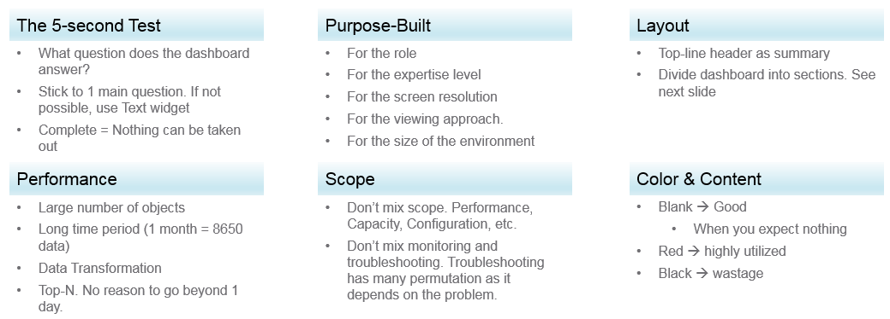
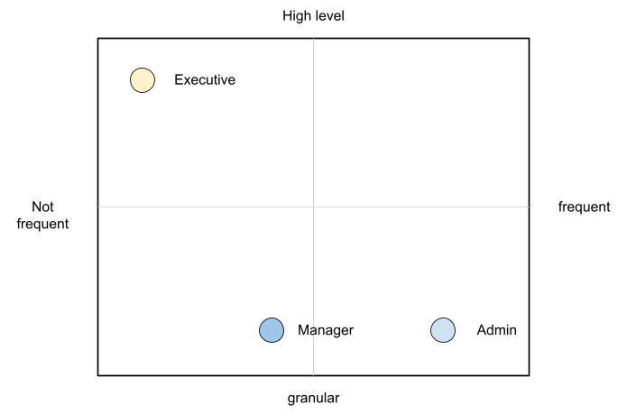

# Dashboard design in VCF Operations

## Conflicting requirements
- A dashboard balances requirements that pull against each other:
  - The 5-second test: what question does it answer? Stick to one main question; if that is not possible, explain with a Text widget. Complete means nothing more can be taken out.
  - Purpose-built: for the role, the expertise level, the screen resolution, the viewing approach and the size of the environment.
  - Layout: a top-line header as the summary; the dashboard divided into sections.
  - Performance of the page: many objects, long periods (one month of 5-minute data is about 8,766 points per metric: 288 a day × 30.44 days, the average month of 365.25 / 12 days), data transformation. For a Top-N, there is rarely a reason to go beyond one day.
  - Scope: do not mix pillars (performance, capacity, configuration) in one dashboard. Do not mix monitoring and troubleshooting: troubleshooting has many paths, depending on the problem.
  - Colour and content: blank means good where nothing is expected; red means highly utilized; dark grey means wastage.

- A dashboard understood within 5 seconds earns a few more minutes: the user sees what it does and spends time learning it. To pass, ask which object, metric or piece of information can be removed. A dashboard that tries to please everyone and cover every scenario ends up unused.
- The purpose decides the design. Two dashboards with the same role, purpose and use case still differ when the environments differ in size: 50,000 VMs are managed differently from 500.
- A good dashboard answers a set of questions. Write them down first, with the metric and the visualization for each.
- A small environment (100 VMs, 8 hosts, 1 cluster, 1 vCenter) needs fewer dashboards than a large one (10,000 VMs, 800 hosts, 100 clusters, 10 data centres, 3 vCenter instances).
- Dashboards complement the built-in pages of VCF Operations, which are hand-coded HTML. Dashboards give the customization and personalization the pages do not.

## Design method: who, what, how, when, why
- Who: list every user and persona, and next to each, the information they find useful.
- What: the activity, granular or high level. Some users want a KPI number, some a trend, some to interact and drill down. The complexity of the activity decides between a complex and a simple widget.
- How: the workflow after viewing. If the next step is another application or visualization, place navigation to it.
- When: how often (hourly, daily, weekly, monthly, quarterly); daily work or irregular monitoring.
- Why: the outcome the user gets from it.
- Plot the personas on a grid of frequency (not frequent to frequent) against granularity (high level to granular):
  - executive: not frequent, high level. A granular dashboard that takes effort will not be used;
  - manager: weekly or monthly, both granular and high level;
  - administrator: daily; sometimes detailed, sometimes one number.

- The grid decides one dashboard or one per persona, what comes first, and how complex it can be for the time the stakeholder has.

## Layout
- Divide the screen into visual sections; the dashboard reads more easily.
- Keep the layout consistent across rows: four rows with the same layout read as four layers.
- Try dark mode as well.
- Summary and detail:
  - summary at the top: the big picture;
  - detail below: drill down into one object, such as the performance of one VM.
- Design the detail section for quick context switching: move from one VM to the next and see its KPIs without changing screens or opening windows. Troubleshooting checks many objects in a row.

## Past vs present
- The present value depends on when you look. At 08:00, the 08:00 value does not say what happened overnight.
- The past has more than one point per object, so it is harder to show. A line chart shows the trend; one number, such as the maximum or the average, hides whether it is going up or down and how long the peak lasted. A line chart takes space.
- With many objects or metrics, summarize. Show two numbers where one is an average, such as the average and the worst ([`sp5-framework/observability/aggregation`](../observability/aggregation.md)).

## Summary, list, detail
- Large environments have many items (Kubernetes pods, cloud instances). Summarize, work on a subset, then pick the item.
- Summary: the whole picture, not a subset.
  - Number oriented, where the absolute value matters: a Scoreboard widget, colour coded. Drill down from it by the object that owns the metric.
  - Not number oriented, where values matter relative to each other: a distribution chart, such as a bar or pie chart.
- List: the View List widget, a table of all objects. Filter when there are many. A filter keeps the dashboard fast (tens of thousands of rows slow it) and directs attention to the big picture first (progressive disclosure).
- Detail: one item, such as one Horizon session. With many metrics, a Scoreboard first (colour coded, drills down to the trend chart).

## Interaction and navigation
- Interaction links widgets within a dashboard. Navigation links dashboards. Keep both consistent so they stay simple.
- Draw the information flow first in any drawing tool, such as PowerPoint.
- Prefer symmetrical interaction: for example, 4 heat maps each driving one of 4 line charts. It looks complex on a screenshot and feels natural in use.
- Progressive disclosure limits information overload and keeps the page fast. The browser session remembers the last selection.

## Misconceptions
- "One dashboard for every scenario" → it ends up unused; one main question per dashboard.
- "The same dashboard for 500 and 50,000 VMs" → size changes the design even for the same role and purpose.
- "Mix capacity and performance to save clicks" → mixing pillars, or monitoring with troubleshooting, makes the dashboard fail the 5-second test.
- "A Top-N over a month" → a month is about 8,766 points per metric; one day is enough for a Top-N.
- "Show the current value only" → at 08:00 it says nothing about the night; show the trend.
- "Show the maximum to summarize the past" → it hides the direction and duration; show a line chart, or the average with the worst.
- "List every object in a View List" → filter first; it keeps the page fast and the focus on the big picture.

## Metadata
```yaml
id: sp5-framework/outputs/dashboard-design
retriever_guide: how-it-works
scope: sp5-framework
technology:
- system
pillar:
- availability
- performance
- capacity
- security
product:
- vcf-operations
internal_derive:
- sp5-framework/outputs/system-engagement
related:
- sp5-framework/outputs/dashboard-colour
- sp5-framework/outputs/performance-dashboards
- sp5-framework/outputs/capacity-dashboards
- sp5-framework/observability/aggregation
images:
  - path: images/dashboard-design-considerations-diagram.png
    product: [vcf-operations]
    object: [VirtualMachine]
    topic: 'Dashboard design considerations: 5-second test, purpose-built, layout, performance, scope, colour and content'
    image_type: diagram
  - path: images/dashboard-persona-frequency-granularity-grid-diagram.png
    product: [vcf-operations]
    object: [VirtualMachine]
    topic: 'Persona grid: frequency of use against granularity; executive, manager, admin'
    image_type: diagram
source:
  document: Private Cloud Management by Iwan Rahabok (https://isvara.io/download)
  path: 'Overall Design Approach > Design Consideration (Design Methodology, Clean Layout, Past vs Present, Summary List Detail, Interaction)'
corrections: []
review_notes:
- 'Section ''Layout'': the source shows example dashboards by Brock Peterson and Dale Hassinger; third-party screenshots not copied.'
- 'Not copied: the layout sketches, the widget screenshots (Scoreboard, distribution, View List), the PowerPoint flow and the 4x4 heat map screenshot; their content is in the text.'
status: draft
```
