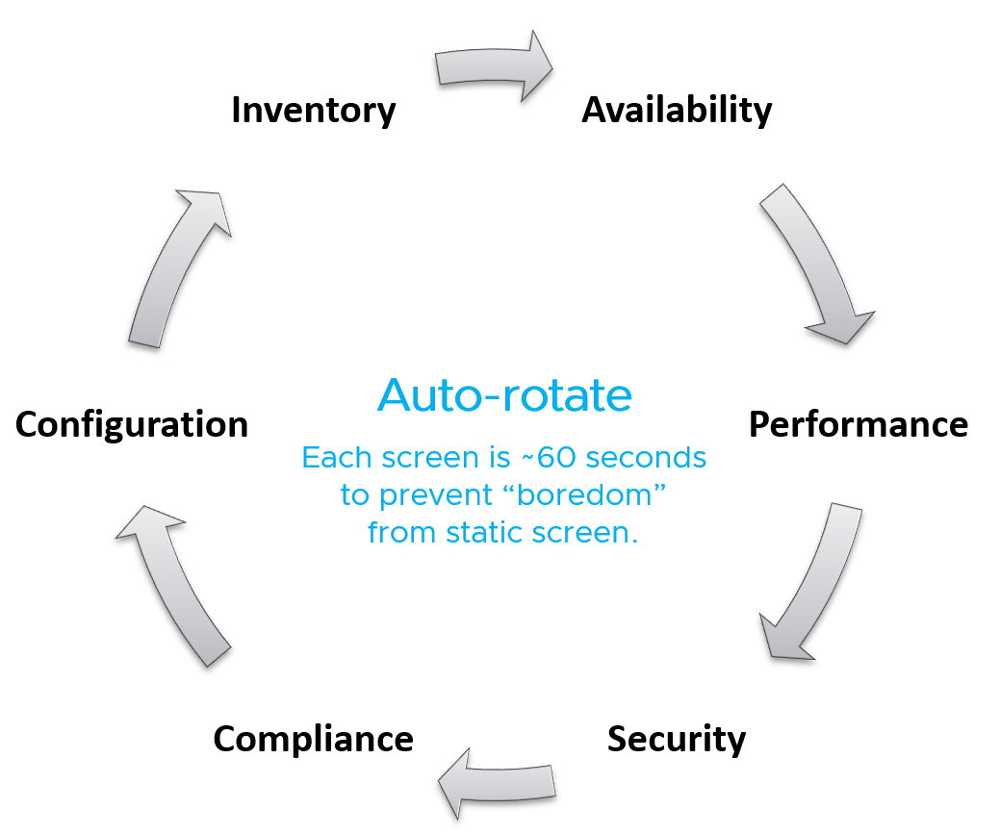

# NOC live screen design

## Audience
- The live screen runs on the wall of the Network Operations Center (NOC). The NOC team consumes it, so design it with them: what they need, what you need from them, the entry and exit criteria of each screen.
- Its life is real time, so it needs a different design from a laptop dashboard.
- Requirements: zero interaction, large numbers, now, colour, the 5-second test, action, auto-rotate.

## Zero interaction
- Treat the screen as a TV, not a monitor. There is no keyboard or mouse, so content auto-refreshes and auto-rotates.
- A touch screen is a bonus. The screen must still work from a distance without it.
- No toolbars or buttons: they confuse and cannot be used from afar.
- Most widgets do not fit as a result.

## Large numbers
- The screen is read from a distance, so fonts are much larger than on a laptop. Less fits on the screen.
- Design on a 14-inch screen, not a 24-inch one, to get the real space.

## Now
- The screen shows time-sensitive information. Capacity, cost and sustainability stay the same for hours, so they do not belong on it.
- Show the latest 5-minute data. The past matters less. Ideally, project the next hour.
- Refresh often: every minute, not every 10 minutes. A display that stays static for 300 seconds does not draw the eye.
- Its content is more urgent than alerts, else an alert would do. It complements alerts.

## Colour
- Use colour heavily. Colour is read without reading; a lot of text confuses and is hard to read from afar.
- Use green, yellow, orange and red to classify severity.
- Everything should be green by default. A tile that is red most of the time gets ignored, which defeats the screen. Use alerts for what is less urgent.
- Ideally every number is a percentage, 0 bad and 100 perfect.

## The 5-second test
- Keep it simple: a viewer understands the screen within 5 seconds, without explanation.

## Action, not information
- The screen shows data to act on now. Remediation of a red item starts as soon as possible.
- What cannot be fixed the same day does not belong on the screen: remediation that takes more than a day keeps the screen red for hours. Use an alert for a longer remediation window.
- Problems that need no immediate attention distract. The NOC screen is not a to-do list.
- Suitable actions: stop provisioning new VMs; act on VMs that abuse the shared infrastructure.
- Unsuitable actions: increase infrastructure supply, such as adding hardware.

## Auto-rotate
- Auto-refresh is not enough for the amount of content. Auto-rotate shows more without scrolling and stops the boredom of one screen for hours.
- Rotate in a logical order and explain it to the viewers; it can overwhelm.
- Recommended order, about 60 seconds per screen: inventory, availability, performance, security, compliance, configuration, then back to inventory.

- To keep the screen running: disable the Guest OS screen saver and sleep of the display PC, and the VCF Operations user session time-out.

## Operators and visitors
- The rules above apply to the part projected on the wall. The NOC operators can open the same dashboard on their desktop and use keyboard and mouse to drill down.
- Visitors, such as IT leaders, are not the audience. If a CIO drops by for 10 minutes a day, prepare a dashboard for that visit and bring it up only then; it does not stay on the wall for the other 23 hours 50 minutes.

## Misconceptions
- "Show capacity on the wall screen" → capacity stays the same for hours. It belongs to longer-cadence dashboards.
- "A red tile keeps attention on a known issue" → a tile that stays red is ignored. Show only what can be fixed the same day.
- "Design the wall screen on a 24-inch monitor" → large fonts leave the space of a 14-inch screen.
- "Refresh every 5 minutes, as the data is 5-minute" → a static screen does not draw the eye; refresh every minute and rotate.
- "Add buttons and filters so the NOC can drill down" → nobody can click a wall screen. Operators drill down on their own desktop copy.
- "Show trends over the past week" → the live screen is about the last 5 minutes and the next hour.

## Metadata
```yaml
id: sp5-framework/outputs/noc-live-screen
retriever_guide: how-it-works
scope: sp5-framework
technology:
- system
pillar:
- availability
- performance
- compliance
product:
- vcf-operations
internal_derive:
- sp5-framework/outputs/system-engagement
related:
- sp5-framework/concepts/proactive-operations
- sp5-framework/outputs/alerts-and-insights
images:
  - path: images/noc-live-screen-auto-rotate-order-diagram.png
    product: [vcf-operations]
    object: [VirtualMachine, HostSystem, ClusterComputeResource]
    topic: 'Auto-rotate order of NOC live screens, about 60 seconds each'
    image_type: diagram
source:
  document: Private Cloud Management by Iwan Rahabok (https://isvara.io/download)
  path: 'Proactive Operations > Live Screen (Action, Auto Rotate)'
corrections: []
review_notes:
- 'Section ''Colour'': the source names the colours green, yellow, amber and red; written as orange, the word the knowledge base uses for the third band.'
- 'To check: Section ''Auto-rotate'': the source says Aria Operations user time out; Aria Operations is the former name of VCF Operations (renamed in VCF 9).'
- 'Section ''Auto-rotate'': the order puts security before compliance and configuration and starts with inventory; the day-to-day order is availability, performance, security (sp5-framework/concepts/proactive-operations). Consistent.'
- 'Not copied: the hexagon picture of requirements (its words are the section headings) and the screenshot of the auto-rotate settings.'
status: draft
```
