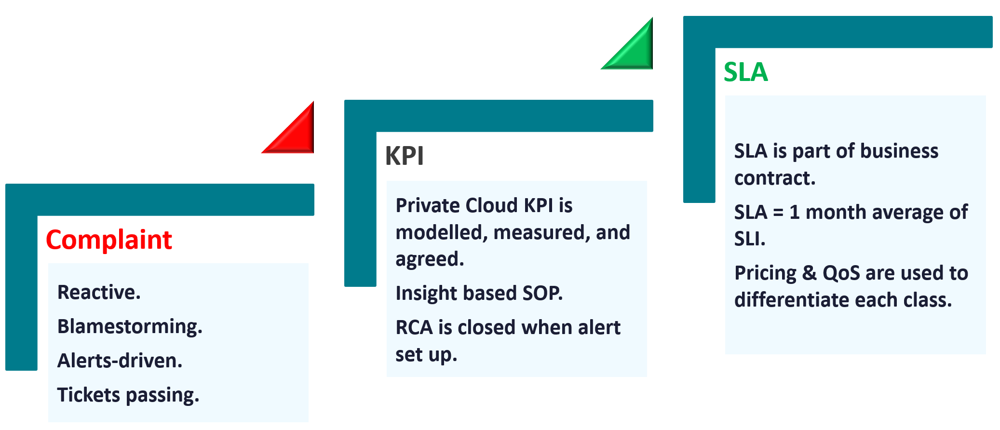
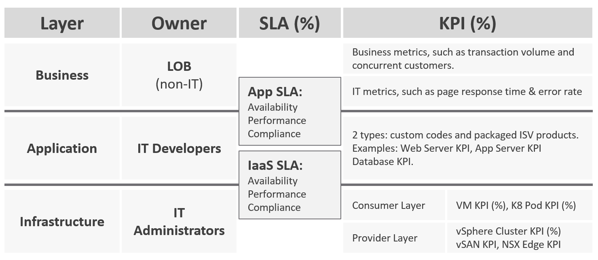
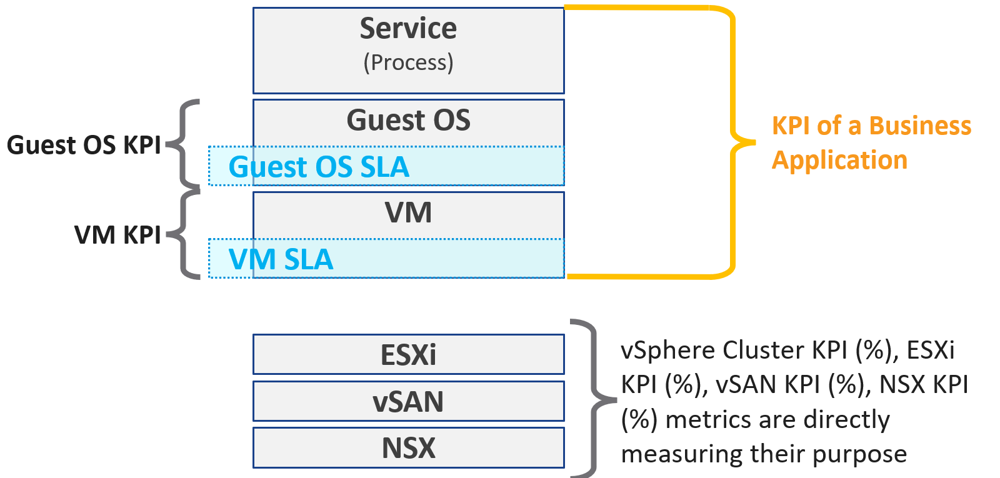

# KPI vs SLA

## KPI means performance

- In this knowledge base KPI is strictly about performance: "performance" has a specific meaning in enterprise IT infrastructure.
- While capacity and availability can impact performance, they should not be mixed up. One name per pillar keeps monitoring unambiguous.
- A KPI is one metric that quantifies the true performance of a logical entity.
- A KPI is a baseline, the standard expectation maintained with effort, not a target still to reach. Provider and consumer each have their own KPI. The ideal, an ESXi host at 100% while no VM sees contention, is not realistic.
- A performance SLA is rarely defined in public sources: the phrase is used without a number. Without a number it becomes subjective to the interpretation.

## Three steps of maturity


| Step | How it works |
|---|---|
| Complaint | Reactive, alert-driven, tickets passed between teams, blame between teams |
| KPI | Modelled, measured, agreed; one policy for all; SOPs from insight; an RCA closes with an alert set up |
| SLA | Part of the business contract; one policy per class of service; price and QoS separate the classes |

- The KPI step:
  - uses both the 20-second and the 5-minute average;
  - quantifies consumer and provider objects;
  - includes the Guest OS when IT owns VM sizing;
  - has no formal class of service; the expectation is set by production;
  - both the application team and the infrastructure team track the KPI, through a self-service portal. An SLA needs a far higher cloud maturity.
- The SLA step: measured on the 5-minute average. Every 5 minutes the SLI computes a pass or fail: a micro SLA. SLA = the mean of the SLI over the calendar month.
- SLI means SLA leading indicator, not service level indicator. The two sound like peers; they are not.
- Start with KPIs: they need no class of service. With different expectations for production and non-production, make one group per environment and a super metric that averages each group's KPI. Production should score better.
- A KPI is the step that leads to operations with formal business SLAs.
  

## KPI vs SLA

- Scope:
  - KPI: one metric for one object. VM and Guest OS each have a KPI. For the application team they are one entity (permanent 1:1), so operations can report the average of the two as a VM GOS KPI (`sp5-framework/performance/performance-kpi-design`).
  - SLA: a set of metrics in the contract between provider (infrastructure team) and consumer (application team or business unit). What happens inside the Guest OS is not part of the VM SLA.
- Coverage:
  - KPI: comprehensive. The SLA metrics plus metrics that warn before an SLA metric is breached. Many KPIs per SLA: most performance metrics are monitored, few belong in a contract.
  - SLA: limited to the important metrics; more metrics make compliance harder. Guest OS metrics stay out of the IaaS SLA: they affect VM performance, but the fix is in the Guest OS.
- Value:
  - KPI: tends to be lower. A 5-minute score of 75% is acceptable for a development VM. The KPI is an internal target, not a legal contract with a penalty: one bad interval is not a breach.
  - SLA: near 100%; a typical SLA is above 99%.
- Effort:
  - KPI: simple to put in place.
  - SLA: needs operations transformation, more than technical change: contract, price (not only cost), process, people, class of service.
- Reference:
  - KPI: reality, the absolute value: how bad. The contract is irrelevant to it.
  - SLA: always relative to an agreed threshold. Each 5-minute SLI is binary: a fail is a fail, so 1.01% and 50% memory contention against a 1% promise count the same.
- Different metrics, different resolution: the SLA uses few metrics, the KPI many. Even the same metric is read differently: the SLI reads the 5-minute average at VM level; the KPI reads the 20-second peak of the worst vCPU or virtual disk. The SLI is the guide for the SLA.
- Two numbers each:
  - actual: volatile, per VM (SLA: share of passed intervals in the month; KPI: the VM's score);
  - target: steady, for many VMs. SLA targets are per class of service: `catalog/thresholds-performance`, rows `performance-sla-*`. The KPI is never per class of service: one set of levels and one target for every VM. A Gold VM still tends to score higher than a Silver VM, because its design (less overcommit) causes less contention.
  - Daily KPI actual (performance): the 99th percentile of the day's 288 scores, the score that 99% of the intervals reach or exceed; the worst 2 intervals (10 minutes) are ignored. The 95th percentile (70 minutes ignored) is too lenient for large organisations. For capacity, the summary over time is part of each model.
- Cadence:
  - KPI: daily, in a technical meeting. A month is far too late.
  - SLA: monthly, in a business meeting with stakeholders.
- Not related: no formula links SLA and KPI, and their rankings can be opposite. A VM whose few fails are severe has the better SLA and the worse KPI; a VM that fails often but barely has the worse SLA and the better KPI.
- Timing:
  - KPI: leading indicator, 5-minute window, 20-second accuracy, more metrics and events. The start of troubleshooting, before a complaint.
  - SLA: lagging indicator, 30 days back, 5-minute accuracy. The SLI tracks it every 5 minutes. A breach means a penalty, usually a credit on the next bill, not a refund.
- Period:
  - KPI: based on day, not date: a rolling window (last 1 hour), like live operations.
  - SLA: a fixed calendar period (June 1972).
- KPIs fit when the infrastructure team owns VM sizing. Sizing the VM is sizing the Guest OS, so the team answers for Windows and Linux metrics too.
- A KPI is colour coded (green, yellow, orange, red) so the reader reacts before the situation degrades. Scoring: `sp5-framework/performance/performance-kpi-design`.
- KPIs and SLAs per layer:
  - business (line of business): business metrics (transaction volume, concurrent customers) and IT metrics (page response time, error rate);
  - application (IT developers): custom code and packaged ISV software, such as web server, application server and database KPIs;
  - infrastructure (IT administrators): consumer layer VM KPI and Kubernetes pod KPI; provider layer vSphere cluster, vSAN and NSX Edge KPIs.
  - The application SLA and the IaaS SLA each cover availability, performance and compliance.
    

## KPIs in VM as a Service

- One SLA contract per service, holding several SLA metrics (availability, performance, security); several KPIs.
- Guest OS SLA: when central IT owns the Guest OS, it provides a Guest OS SLA with its own availability, performance and security SLA. Its values can be combined with the VM SLA for reporting.
- Security SLA is preferred over compliance SLA, which is correct but narrower: compliance compares settings against a secured configuration; security also covers activity, such as undesirable activity that is a potential risk.
- VM KPI: stops at Windows or Linux. The application or service inside the Guest OS is excluded: the infrastructure team stops at the OS.
- Business application KPI: three levels. The business transaction first (user login). Below expectation → the application software KPI (Apache web server) and the infrastructure KPI (the VM KPI).
- vSphere cluster KPI: only the contention metrics of the running VMs. Utilization is excluded: it has no direct link to cluster performance. A vSAN cluster adds vSAN performance metrics. Implementation: `vsphere/object-types/cluster/kpis/cluster-performance`.
- vSAN KPI: disk latency of every VM using the vSAN datastore, from the same or another cluster.
- NSX KPI: many-to-many with vSphere clusters, so not tied to one cluster.
  

## Worked example: higher KPI, failed SLA
- Two Gold VMs, June 2026: 8,640 five-minute intervals. SLI: VM Memory Contention (5-minute average) fails above its SLI threshold of 1%. Gold SLA target 99.9%: at most 8 failed intervals in the month.
- KPI: VM Performance (%). The memory sub-metric scores 100 at 0%, 50 at 1% and 0 at 4% and above (`sp5-framework/performance/performance-kpi-design`, Scoring). With the other 8 sub-metrics at 100:
  - 1.01% scores 49.75 with weight 4.03: VM Performance (8 × 100 + 49.75 × 4.03) / (8 + 4.03) = 83.17;
  - 50% scores 0 with weight 16: VM Performance (8 × 100) / (8 + 16) = 33.33.
- Assumed: the 20-second peak equals the 5-minute average; contention is 0% otherwise.

| | VM A | VM B |
|---|---|---|
| Bad intervals | 5 at 50%, one 25-minute episode on 12 June | 60 at 1.01%, two a day |
| SLI fails | 5 | 60 |
| SLA | 8,635 / 8,640 = 99.94%: pass | 8,580 / 8,640 = 99.31%: fail |
| Daily KPI, 12 June (99th percentile: worst 2 ignored) | 3rd worst score: 33.33 | 2 bad intervals ignored: 100 |
| Daily KPI, other days | 100 | 100 |

- VM B has the higher KPI every day, yet fails the Gold SLA that VM A passes. The SLI does not care how bad a fail is: 1.01% and 50% count the same. The KPI shows how bad: VM A's application stalled for 25 minutes.
- The same day, VM A's 50% also raises the red VM memory contention alert, after its wait cycle; VM B stays below any alert.
- Lesson: the SLA answers "did we keep the promise?" for the business, monthly. The KPI answers "how did the VM perform?" for the technical team, daily. The alert answers "must someone act now?".

## Traps

- "VM 01 has the better SLA, so it performed better" → the SLA counts fails, not how bad they were. Five intervals at 50% memory contention pass a Gold SLA that sixty intervals at 1.01% breach; the KPI shows the 50% stall (section Worked example).
- "The KPI target is higher for Gold" → the KPI has no class of service. Gold scores higher because it has less contention by design.
- "The SLA is green, so there is no performance problem" → the SLA is a 30-day lagging average at 5-minute accuracy. The KPI, at 20-second accuracy over a moving window, shows the problem first.
- "A KPI of 75% is a failure, since SLAs are above 99%" → one 5-minute score of 75% on a development VM is acceptable; the KPI is not a contract with a penalty. The two scales are not comparable.
- "Put every KPI metric in the SLA" → more metrics make compliance harder. The SLA keeps the few contract metrics; the KPI covers the rest as early warning.
- "Include Guest OS metrics in the IaaS SLA" → the fix for a Guest OS problem is in the Guest OS; the IaaS provider cannot remediate it.
- "Cluster performance KPI includes host utilization" → it includes only the contention of the running VMs.
- "KPI means any key indicator, availability included" → KPI is performance only: the P is performance. Availability has KAI (key availability indicator); security, compliance included, has KSI (key security indicator). In daily speech users say availability KPI, business KPI or marketing KPI for any key indicator: translate by the pillar it measures.

## Metadata

```yaml
id: sp5-framework/performance/kpi-vs-sla
retriever_guide: how-it-works
scope: sp5-framework
technology:
- system
pillar:
- performance
- availability
product:
- vsphere
- vsan
- nsx
- vcf-operations
object:
- VirtualMachine
- ClusterComputeResource
internal_derive:
- sp5-framework/performance/performance-kpi-design
related:
- sp5-framework/concepts/sla-metrics
- vsphere/object-types/cluster/kpis/cluster-sla-sli
- vsphere/object-types/cluster/kpis/cluster-performance
- vsphere/object-types/vm/kpis/vm-performance
- sp5-framework/concepts/performance-vs-capacity
- sp5-framework/concepts/realms-and-layers
images:
  - path: images/complaint-kpi-sla-maturity-steps-diagram.png
    product: [vcf-operations]
    object: [VirtualMachine]
    topic: 'Complaint, KPI, SLA maturity steps'
    image_type: diagram
  - path: images/layer-owner-sla-kpi-table.png
    product: [vsphere]
    object: [VirtualMachine, ClusterComputeResource]
    topic: 'SLA and KPI per layer and owner'
    image_type: table
  - path: images/vm-as-a-service-kpi-and-sla-scope-diagram.png
    product: [vsphere, vsan, nsx]
    object: [VirtualMachine]
    topic: 'KPI and SLA scope in VM as a Service'
    image_type: diagram
source:
  document: PART 1 - Concepts of Operations Management.docx
  path: 'Performance Management > Key Performance Indicator > KPIs as a Stepping Stone; KPI | SLA > Differences; KPIs in IaaS (pp. 76-80)'
corrections:
- 'Section ''KPI vs SLA'', Scope: Part 1 combines VM and Guest OS in one KPI; outdated. Two KPIs; the VM GOS KPI is their average, for the application team.'
- 'Section ''KPI means performance'': a KPI is a baseline, not a target.'
- 'Section ''KPIs in VM as a Service'': one SLA contract per service; Guest OS SLA when IT owns the Guest OS; security, not compliance.'
- 'Sections ''Three steps of maturity'', ''KPI vs SLA'': KPI timing confirmed; both teams track the KPI.'
- 'Section ''Three steps of maturity'': SLA = mean of SLI; SLI = SLA leading indicator.'
review_notes:
- 'Source of the search for performance SLA articles (Google screenshot) not copied.'
status: draft
```
