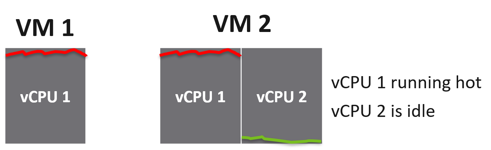
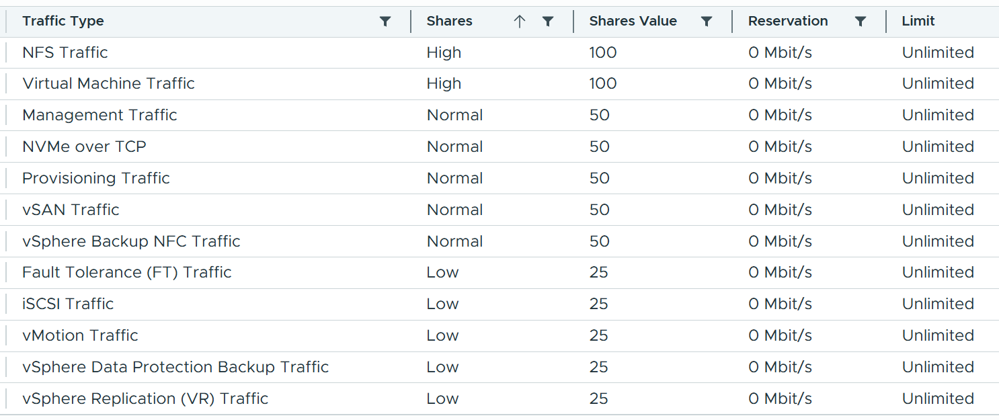

# Noisy neighbour

## Definition
- Enough total capacity, yet some consumers (VM, Kubernetes pod) do not get what they demand: imbalance in a shared environment. A main cause is a noisy neighbour.
- Without limits or controls on consumers, a few villains hurt the victims:
  - simple: one constant villain, the same few victims;
  - complex: transient, no pattern; villains and victims change and can swap roles;
  - self-harm: the victim is its own villain.
- The real source can be outside the VM: Windows or Linux executes what a central system tells it.
- The cause can be unrelated to the symptom.

### Example: the antivirus update
- Symptom: random VMs across clusters, datastores and data centres froze, some not answering ping, always recovering within 15 minutes. Windows and Linux, all sizes, no time pattern.
- Cause: the antivirus signature update was not spread over time. Hundreds of VMs updated at once; the combined IOPS saturated the WAN link that carried synchronous replication of mission-critical datastores. Replication slowed, IO commands paused, and the VMs froze.
- Lesson: no villain VM existed. The villain was a schedule, and the path was the replication link.

## The three controls
- Limit, reservation, share. Details: `vsphere/architecture/resource-controls`.
- Priority is not a control: it gives 0% to the lower priority. Shares still give every consumer some.
- Resource pools add a management layer and make the settings harder.

## CPU
- CPU is where the problem usually is.
- Limit:
  - the default limit is the configured size; it is usually too high because the price is low. A VM that runs on 8 vCPU is given 32 because the buyer can afford it;
  - a limit set on the VM gives unpredictable performance: Windows or Linux does not know it can use only part of its vCPUs;
  - the limit is in GHz, not vCPU, so its effect changes every second as the frequency changes.
- Example cluster: 10 hosts × 40 cores × 2.5 GHz = 1,000 GHz (HT not counted). Overcommit 4:1 per core (2:1 per thread): 400 VMs × 4 vCPU = 1,600 vCPU on 400 cores, 800 threads. Overcommit is stated per physical thread from here on. A core runs 2 vCPU at once with HT, at a 37.5% penalty each.
  - A few 32-vCPU VMs cause the problem: 10 of them can each fill one host. So overcommit ratio and maximum VM size both belong in the pricing policy.
- Reservation:
  - at 4:1, at most 25% of each VM's configured capacity can be reserved: a 2-vCPU VM gets 1.25 GHz, about 0.5 vCPU;
  - reserving the first vCPU of each VM: 400 × 2.5 GHz = 1,000 GHz, the whole cluster, beyond usable capacity once HA is counted. HT adds about 25% throughput;
  - the higher the overcommit, the less a reservation can guarantee: at 4:1 per physical thread, at most 0.25 thread per vCPU across the environment, on average.
- Share:
  - shares are per VM, not per vCPU. A larger VM has more shares in total, shared among its vCPUs;
  - the busy vCPU of a 2-vCPU VM gains from its idle sibling: vCPU 1 of VM 2 gets 2x the share of vCPU 1 of VM 1. A Level 400 trap;
  - shares are charged against CPU Used, not CPU Run. Used includes System time, the hypervisor's work for the VM (network packets, disk commands). A VM with heavy IO uses up its shares and can see CPU Ready.
  - formula of Used (%RUN, %SYS, %OVRLP, frequency and HT factors): `vsphere/tools/esxtop/cpu`.


## Memory
- Memory is a very fast disk: space matters more than speed. Its utilization is flat over time, at VM and ESXi level.
- Exception: transient VMs and containers. ESXi clears a VM's consumed memory at power-off, so Horizon instant clones fluctuate more.
- Flat utilization keeps the overcommit ratio low, so contention is rarer. The cost: much of the memory paid for is cache.
- Limit: Guest OS and VM memory are mostly cache. A VM limit risks contention, because the two layers are independent. Avoid it; rightsize the Guest OS instead.
- Reservation:
  - sticky: once the VM touches a page it stays reserved, whatever its later use. The VMkernel cannot tell a useful page from an idle one. Avoid it;
  - memory is seldom overcommitted beyond 2:1 (CPU often is). When overcommitting, watch VM ballooning as the early warning of contention;
  - the highest class of service guarantees memory with no overcommit. Then a per-VM reservation adds nothing.
  - with memory tiering, the memory overcommit ratio counts DRAM only: the NVMe tier exists to avoid overcommit.
- Share: behaves as for CPU; the default values differ.

## Disk
- Two dimensions: space (GB) and speed (IOPS, throughput). Speed is the harder one: the ceiling is high and spikes are unpredictable.
- No upper limit by default: one VM can generate unlimited IOPS. One developer running IOMeter can saturate shared storage.
- More layers than compute: the storage provider is often outside the hypervisor. vSAN has its own kernel stack and network; a central array has a fabric.
- Points of control: non-vSAN: VM, datastore, array, and the fabric if it can throttle. vSAN: VM and vSAN.
- Limit:
  - IOPS limit per virtual disk. The cost of 1,000 IOPS varies with block size, read/write ratio and random vs sequential. Application teams seldom know these;
  - too low → VM latency rises; too high → no protection. If each of 2,000 VMs may take 2.5% of the array, 40 VMs (2% of the population) at their limit saturate it, even with IO spread evenly over the disks; hot spots make it worse;
  - a limit on the OS disk is reasonable when the applications do not use it: it stops rogue agents and system services.
- Reservation: none in the VM disk settings.
- Share: applies only when latency passes a threshold. It ignores disk size. The control wanted is IOPS per GB: storage sold by GB should carry IOPS and throughput at a latency, which justifies a higher Gold price per GB.
- Disk space under thin provisioning cannot be controlled. Monitor snapshot age and remove snapshots within a few days.

### Storage I/O Control
- Deprecated: with VCF 9.0, vSphere Storage I/O Control components are deprecated (vSphere 9.1 documentation). Do not design with it; the knowledge base follows the official deprecation, not the book.
- It was datastore-wide throttling, separate from the per-disk controls, and never applied to vSAN, which has its own mechanism.

## Network
- The hardest: the network is an interconnect.
- Example host: 2 × 25 Gb/s NICs = 50 Gb, counted as 40 Gb (20% headroom). VMkernel traffic (vSAN, vMotion, vSphere Replication) takes about 20 Gb; 20 Gb remains for 25 VMs.
- One villain at 10 Gb (a Hadoop worker receiving data, sustained 10 Gb over 300 seconds) leaves 10 Gb for 24 VMs: about 400 Mb/s each. VMs that are not network-heavy may not notice.
- With 2 × 10 Gb the risk is far higher: it is the overcommit ratio again.
- The pool is the group of uplinks assigned to the switch, not one uplink. With Load Based Teaming the distributed switch checks the uplinks every 30 seconds; above 75% load it moves the port (VM or VMkernel) with the highest I/O to another uplink.
- Configured on the distributed switch, not in the cluster resource allocation. Each VM network adapter has share, reservation and limit.
- Limit and reservation per VM: not recommended. They complicate operations, more so in a dynamic, large environment. The book's 8 Gb/s limit and 100 Mb/s reservation are withdrawn.
- Share: the main issue is VM vs VMkernel traffic. All VM traffic gets one share as a group, while each VMkernel traffic type gets its own share, so VM traffic is outnumbered.
- Example, a distributed switch (not the defaults): virtual machine traffic High (100) as one group; NFS High (100); management, NVMe over TCP, provisioning, vSAN and backup NFC Normal (50 each); Fault Tolerance, iSCSI, vMotion, data protection backup and vSphere Replication Low (25 each). VMkernel traffic totals 475 shares against 100 for all VMs.
- Between VMkernel types it is hard: replicating a mission-critical VM vs migrating a development VM.
- Pro tip: customize the share allocation per traffic type for your environment; do not leave it as found. Give VM traffic enough weight against the sum of the VMkernel types, and set shares only for the traffic types the hosts carry.


## Avoiding it
- With overcommit it cannot be avoided, only reduced: like a highway with more cars than lanes at peak hour. Capacity planning reduces the impact.
- Pricing policy:
  - a function of the overcommit ratio: half price means twice as many tenants to break even;
  - progressive tiers: a 64-vCPU VM costs more than 64 × a 1-vCPU VM.
- Without chargeback, use class of service: a lower class has a higher overcommit ratio and a smaller maximum VM size.
- Tell customers the quality of each class through its overcommit:

| Class | Memory overcommit |
|---|---|
| Gold | 1:1 |
| Silver | 1.5:1 |
| Bronze | 2:1 |

- No contention at all is not realistic: the cost escalates. A lower class sees contention more often; its VM KPI shows how much. The KPI levels are the same for every class (`sp5-framework/performance/kpi-vs-sla`).

### Maximum VM size
| Overcommit | Maximum VM size |
|---|---|
| 1:1 per physical thread | ESXi logical CPUs (48 cores, 96 threads → 96) |
| 2:1 | 0.5 × logical CPUs; 0.4 × for 20% headroom |
| 4:1 | 0.25 × logical CPUs |
| 8:1 | 0.125 × logical CPUs; lab, dev, simple VDI |

- 1:1: mind the HT throughput penalty and NUMA.
- 2:1: two large VMs on one host each demand whole cores and both get the 37.5% penalty.
- 4:1: four medium VMs on a 2-socket host, each the size of a socket: two compete for each socket.
- 8:1 per thread (4:1 per core with HT): for 2-vCPU desktops. On 96 threads the maximum is 12 vCPU; keep most VMs at 4-6 vCPU so they fit across the cluster.
- The problem is not specific to vSphere: it follows from overcommit on shared resources (Microsoft Azure noisy neighbour antipattern).

## Traps
- "Find the villain VM" → the villain can be a schedule or an external system, and the damage can travel through a shared path (replication link). Look for a common time and path, not a VM.
- "Reserve CPU for every VM to stop noisy neighbours" → at 4:1 overcommit a reservation covers at most 25% of each VM; reserving the first vCPU of 400 VMs uses the whole cluster.
- "A CPU limit on the VM is a safe cap" → the Guest OS cannot see it, and it is in GHz, so its effect changes with frequency. Rightsize instead.
- "A VM with low CPU Run cannot run out of CPU shares" → shares are charged on Used, which includes System time from IO. An IO-heavy VM can see Ready.
- "Memory reservation protects the VM's working set" → it is sticky and blind to page use; it pins idle pages too.
- "A disk IOPS limit of 1,000 gives the same protection on every VM" → the cost of an IO varies with block size, read/write mix and pattern.
- "Set network priority between VMs" → priority starves the lower class; shares give every VM a part.
- "VM traffic has High shares, so VMs win under contention" → VM traffic is one group; each VMkernel type has its own share and together they outnumber it (475 vs 100 in the example).
- "The host has 40 Gb usable, so one VM at 10 Gb is harmless" → after VMkernel traffic, 24 VMs share 10 Gb, about 400 Mb/s each.

## Metadata
```yaml
id: sp5-framework/performance/noisy-neighbour
retriever_guide: how-it-works
scope: sp5-framework
technology:
- cpu
- memory
- storage
- network
pillar:
- performance
- capacity
product:
- vsphere
- vsan
object:
- VirtualMachine
- HostSystem
- ClusterComputeResource
- Datastore
- VmwareDistributedVirtualSwitch
internal_derive:
- vsphere/architecture/resource-controls
related:
- vsphere/object-types/resource-pool/configuration/scalable-shares
- sp5-framework/capacity/capacity-model
- sp5-framework/concepts/performance-vs-capacity
- vsphere/technology/cpu/metrics/virtual-motherboard/ready
- vsphere/tools/esxtop/cpu
images:
  - path: ../../vsphere/technology/network/images/distributed-switch-network-share-allocation-by-traffic-type.png
    product: [vsphere]
    object: [VmwareDistributedVirtualSwitch]
    topic: 'Network shares by traffic type'
    image_type: screenshot
  - path: images/vm-shares-busy-vcpu-vs-idle-vcpu-diagram.png
    product: [vsphere]
    object: [VirtualMachine]
    topic: 'CPU shares per VM: busy vs idle vCPU'
    image_type: diagram
source:
  document: PART 1 - Concepts of Operations Management.docx
  path: 'Performance Management > Noisy Neighbour > CPU; Memory; Disk > Storage I/O Control; Network; Solution > Maximum VM Size (pp. 80-90)'
corrections:
- 'Section ''Network'': no per-VM network limit or reservation; the book''s 8 Gb/s and 100 Mb/s are withdrawn.'
- 'Section ''Network'': the pool is the uplink group, Load Based Teaming every 30 s above 75%; the villain sustains 10 Gb over 300 s (book said 5); VM traffic outnumbered by per-type VMkernel shares; the screenshot values are not defaults, customize them.'
- 'Section ''Memory'': overcommit ratio against DRAM only with tiering.'
- 'Section ''CPU'', Share: the busy vCPU gains from its idle sibling; 2x.'
- 'Section ''CPU'', Reservation: 4:1 against physical thread gives 0.25 thread; the book says 8:1.'
- 'Section ''Disk'', Limit: 2.5% per VM, not 1%; 40 VMs saturate the array. The book says 5% of the population; 40 of 2,000 is 2%.'
- 'Section ''Maximum VM size'': overcommit is per physical thread, not per core; the book''s example is per core.'
- 'Section ''Storage I/O Control'': deprecated features are not practised; follow the official documentation (vSphere 9.1, Manage Storage I/O Resources with vSphere, p. 1886); no disk reservation.'
review_notes: []
status: draft
```
