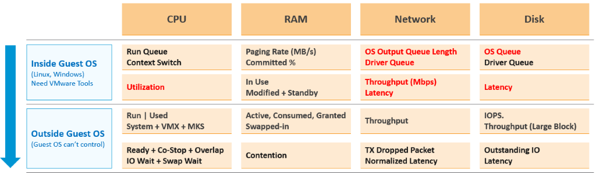

# Performance KPI design

## What a KPI is
- KPI is strictly about performance: "performance" has a specific meaning in enterprise IT infrastructure.
- While capacity and availability can impact performance, they should not be mixed up. One name per pillar keeps monitoring unambiguous.
- A KPI is one metric that quantifies the true performance of a logical entity.
- A KPI is a baseline, the standard expectation maintained with effort, not a target still to reach. Provider and consumer each have their own KPI. The ideal, an ESXi host at 100% while no VM sees contention, is not realistic.

## Why a KPI
- 5,000 VMs every 5 minutes over 24 hours is too many trend charts. One score per VM makes monitoring at scale possible.

## One KPI per realm
- VM Performance (%) and Guest OS Performance (%): one per realm.
- Pros: the direction of troubleshooting is clear; each score is higher (a single number dilutes less).
- Cons: twice the metrics; application teams see both as infrastructure and ask for one number.
- For the application team the two are one entity: report the VM GOS KPI, the average of VM Performance (%) and Guest OS Performance (%).


## Which metrics qualify
- A metric qualifies only if its values map to the 4 ranges (green, yellow, orange, red). Otherwise it distorts the KPI.
- So most utilization metrics (disk IOPS, network throughput) are excluded: no universal mapping fits all VMs.
- Only VM and Guest OS metrics. ESXi, resource pool, datastore and cluster metrics are averages of VMs: less visibility, and derivable from the VM metrics. You troubleshoot VMs, not infrastructure.

## Excluded metrics
| Area | Metric | Reason |
|---|---|---|
| Guest OS | CPU context switch | Very wide band in profiling. |
| Guest OS | Memory page-in | Can include application binaries and proactive fetch. More volatile in 3,300 VMs. |
| Guest OS | Swap file free capacity | Effect of a low value on performance unknown. Correlates with free memory: double counting. |
| Guest OS | Dead processes | Range values unknown; Windows and Linux require separate profiles. |
| Guest OS | RAM page fault | VMware Tools does not provide it. |
| Ratio | Guest OS IOPS : VM IOPS | Should be near 1 or stable. Guest reports the last value, VM the average. No data yet. |
| CPU | Other Wait | Too many CPU metrics inflate CPU weight. A rare bug gives false positives. |
| Memory | Consumed, Active, Granted | Do not indicate performance problems. |
| Storage | Outstanding IO | A function of IOPS and latency: duplicate. |
| Storage | Snapshot latency | Covered by CPU Other Wait. |
| Network | Broadcast, multicast | Undesirable, but do not cause performance problems. |
| Network | Error packets | VMware Tools does not provide them. |
| Network | Network queue | No such metric. |
| Network | Receive dropped | Too many false positives. |
| Network | Packets per second | 100% cannot be quantified. |
| Cluster | VM DRS Score | About execution efficiency and cluster performance; reuses KPI metrics. |
| vMotion | Downtime, stun time | Not enough data for ranges beyond green (0.2 s). |

## Depth and breadth
- A provider KPI (ESXi host, cluster) reads the contention of its consumers with two questions:
  - how deep? The worst VM: a problem that hits one VM hard;
  - how broad? The 90th percentile across the VMs: a problem that many VMs have.
- Aggregate directly from the VMs, not from hosts first: a two-level aggregation misrepresents the VM population.
- Breadth uses the 90th percentile: the average reacts too late; the 95th percentile suffers from host imbalance.
- The worst-VM rows have higher limits than the 90th-percentile rows: one VM with a limit in a large cluster is an outlier, not a cluster problem.
- Not the average of the VM KPIs: a cluster serves VMs, so guest contention matters little to it, and the host physical network matters to it but not to a VM.
- VM stats are 20-second peaks, not 5-minute averages, to catch short bursts: that makes the KPI a leading indicator.

## Reading a KPI over time
- Two numbers each KPI has:
  - actual: volatile, per object (the VM's score);
  - target: steady, for many objects. One set of levels and one target for every VM: the KPI is never per class of service. A Gold VM still tends to score higher than a Silver VM, because its design (less overcommit) causes less contention.
  - Daily KPI actual: the 99th percentile of the day's 288 scores, the score that 99% of the intervals reach or exceed; the worst 2 intervals (10 minutes) are ignored. The 95th percentile (70 minutes ignored) is too lenient for large organisations. For capacity, the summary over time is part of each model.
- Cadence: daily, in a technical meeting; a month is far too late (`sp5-framework/performance/kpi-vs-sla`).

## VM DRS Score
```text
VM DRS score = Performance Goodness × 0.8 / CPU Demand
```
- 0.8 is the performance degradation threshold.
- Considers CPU, memory (including tiering), network, Fault Tolerance, vSAN, storage and maintenance.
- A low score does not mean the VM runs badly (Niels Hagoort). It reflects execution efficiency.

## Scoring
- Each metric maps to a score: green 100-75, yellow 75-50, orange 50-25, red 25-0.
- Five limits per metric: the values where the score is 100, 75, 50, 25 and 0. Inside a range the score falls in a straight line. Past the 0 limit it stays 0; before the best limit it stays 100.
- Combine as a weighted average where a worse score weighs more:

```text
KPI = sum(score × weight) / sum(weight)
weight = 2 ^ ((100 - score) / 25)
```

- The weight is 1 at score 100, 2 at 75, 4 at 50, 8 at 25 and 16 at 0, and changes smoothly in between, so the KPI does not jump when a value crosses a range limit. The earlier weights were one step per range (1x, 2x, 4x, 8x).
- Reason: with a plain average one red metric among nine healthy ones is hidden. Nine at 100 and one at 18.75: plain average about 91.9; weighted (9 × 100 + 18.75 × 9.51) / (9 + 9.51) ≈ 58.3.
- Values are rounded to two decimals before scoring, so the KPI matches the numbers the user sees.
- Green given as a single value (for example 0%): only that value scores 100; any other value starts in yellow at 75.
- Excluded green: a metric whose green range says nothing about health (rare dropped packets, low utilization) is left out of the KPI while green, so it does not add a free 100. Once it leaves green it counts. If every metric with data is excluded, the KPI is 100.
- Missing data: a metric with no data is left out, never counted as 0, because 0 usually means perfect. With no data at all, the KPI is not published.
- Limitation: because the weight grows as the score falls, a metric that gets worse can move the KPI the wrong way when other metrics are already worse. Example and effect: `vsphere/object-types/cluster/models/cluster-risk`, section A worse sub-metric can lower Cluster Risk.
- Excluded green on the VM KPI: CPU Net Run below 95%, CPU Overlap below 0.5%, Network Dropped Tx at exactly 0 (`vsphere/object-types/vm/kpis/vm-performance`).
- Guest OS Free Memory is descending: more is better. 1 GB or more scores 100; green ends at 512 MB. KB is converted to MB.
- Free Memory uses the latest value, not the lowest 20-second value: it measures space, and the latest value matters.
- Swapped + Compressed has no built-in metric: the pack computes it as Memory Zip Swap.
- Why four equal ranges, thresholds and validation: `sp5-framework/concepts/modelling`.

## Misconceptions
- "Add IOPS to the KPI" → no universal range; it masks real problems.
- "Use datastore latency in the VM KPI" → it is an average of VMs.
- "The KPI target is higher for Gold" → the KPI has no class of service. Gold scores higher because it has less contention by design.
- "A KPI of 75% is a failure" → one 5-minute score of 75% on a development VM is acceptable; the KPI is not a contract with a penalty.
- "KPI means any key indicator, availability included" → KPI is performance only: the P is performance. Availability has KAI (key availability indicator); security, compliance included, has KSI (key security indicator). In daily speech users say availability KPI, business KPI or marketing KPI for any key indicator: translate by the pillar it measures.
- "Cluster Performance is the average of its VM KPIs" → a provider KPI reads depth (worst VM) and breadth (90th percentile) of VM contention, plus the host network.
- "Average the daily KPI" → read the 99th percentile of the day's 288 scores; an average hides the bad intervals.

## Metadata
```yaml
id: sp5-framework/performance/performance-kpi-design
retriever_guide: how-it-works
scope: sp5-framework
technology:
- cpu
- memory
- storage
- network
- system
pillar:
- performance
product:
- vcf-operations
object:
- VirtualMachine
internal_derive:
- sp5-framework/observability/thresholds
related:
- sp5-framework/performance/performance-management
- sp5-framework/performance/kpi-vs-sla
- vsphere/object-types/vm/kpis/vm-performance
- guest-os/system/metrics/guest-os-performance
- vcf-operations/features/peak-20-second-metrics
images:
  - path: images/guest-os-and-vm-performance-kpi-metrics.png
    product: [vcf-operations]
    object: [VirtualMachine]
    metric: ['VM Performance', 'Guest OS Performance']
    image_type: table
source:
  document: Private Cloud Management by Iwan Rahabok (https://isvara.io/download)
  path: 'Consumer Objects > Performance: VM & Guest OS > Approach; Metrics Not Used; Implementation'
corrections:
- 'Section ''Two KPIs, not one'': VM GOS KPI = average of the two, for the application team. Part 1 of the book, which combines them in one KPI, is outdated.'
- 'Section ''Scoring'': weights and the Excluded, single-value green, rounding and missing-data rules from the vCommunity adapter documentation (https://github.com/e1-rahabok/VCF-vCommunity-Adapter/blob/main/docs/concepts/kpi-scoring-models.md, 2026-11-05). The book gives step weights 1x, 2x, 4x, 8x.'
review_notes:
- 'To check: VM DRS Score blog cited by the book (vSphere 7), not read (https://blogs.vmware.com/vsphere/2020/05/vsphere-7-a-closer-look-at-the-vm-drs-score.html).'
status: draft
```
