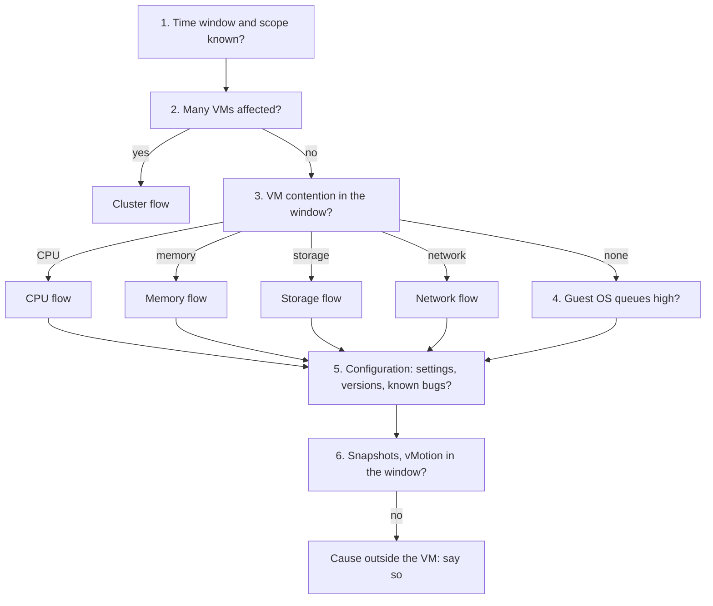

# Users say the VM is slow: triage

## Symptom
- Users or the application owner report that a VM (and its application) is slow.
- No metric has been named yet. The first job is to find the layer and the resource, then hand over to the flow for that resource.

## Flow


## Checks, in order
1. Time window and scope. Ask when the slowness happens (a time, a schedule, all the time) and which VMs. Read every counter below at the 20-second peak within that window, not the 5-minute or daily average. See `vsphere/tools/vcf-operations/peak-20-second-metrics`. → step 2.
2. Breadth (ClusterComputeResource). Several VMs on the same cluster or host slow in the same window → the cause is likely at host or cluster level → `vsphere/object-types/cluster/troubleshooting/cluster-vm-contention`. One VM → step 3.
3. VM contention (VirtualMachine), one resource at a time, in the complaint window. Start from VM Performance (%) at scale (`vsphere/object-types/vm/kpis/vm-performance`), then the counters:
   - CPU: Ready and Co-stop, read against Run → `vsphere/technology/cpu/troubleshooting/vm-cpu-contention-high`.
   - Memory: Latency → `vsphere/technology/memory/troubleshooting/vm-memory-latency-high`.
   - Storage: disk latency per virtual disk, read and write, with outstanding IO → `vsphere/technology/storage/troubleshooting/vm-storage-performance-checks`.
   - Network: dropped packets → `vsphere/technology/network/troubleshooting/vnic-rx-drops`.
   - The SLI thresholds give a first bar: Ready 2.5%, memory contention 1%, disk latency 10 ms, transmit dropped packets 0% (`vsphere/object-types/cluster/kpis/cluster-sla-sli`).
   - Contention found → that resource's flow, then step 5. No contention on any resource → step 4.
4. Guest OS (Guest OS layer, through VMware Tools). CPU run queue, memory page-out rate, disk queue. High while the VM shows no contention → the VM gets what it demands; the Guest OS or the application waits on its own queues. Size the Guest OS from Guest OS counters (`guest-os/system/concepts/guest-os-sizing`). Either way → step 5.
5. Configuration (VirtualMachine). Always checked, also when step 3 found contention: a setting can cause the contention or the slowness. A CPU or memory limit, shares and reservations (`vsphere/architecture/resource-controls`); VMware Tools, virtual hardware and Guest OS versions, and settings that are outdated or incompatible (`vsphere/object-types/vm/configuration/vm-configuration-review`). Known bugs are mostly configuration: an older version or incompatible settings. → step 6.
6. Context in the window (VirtualMachine). A snapshot (`vsphere/technology/storage/concepts/snapshot-impact`), a vMotion stun (`vsphere/object-types/vm/metrics/vmotion`). Nothing in steps 3-6 → the cause is outside the VM and its host: the application, a dependency, or the network beyond the host. Say so; vSphere has no counter for it.

## Why this order
- The window first: a counter read outside the complaint window, or averaged over a day, misses the wait.
- Breadth before depth: many slow VMs point to a shared cause; tuning one VM would not help.
- VM contention before Guest OS: contention is waiting the hypervisor imposes and the Guest OS cannot see. Rule it out before blaming the guest.
- Guest OS before context: guest queues explain slowness with no hypervisor cause, and they are common.
- Configuration always: a configuration issue can cause a performance problem, and known bugs are mostly configuration (author, Q104). It is checked even when contention is found, because a limit or an outdated setting can be the cause of that contention.
- Context last: snapshots and stuns cause short stalls; they are checked when the counters do not explain it.

## How to read the result
- Contention on one resource → that resource's flow.
- No contention, Guest OS queues high → the guest is short of vCPU or memory, or the application is the bottleneck.
- Contention and a configuration finding (a limit, an old version) → fix the configuration first.
- No contention, queues normal, configuration clean, nothing in context → not a vSphere cause.

## Traps
- "The VM's CPU Usage is 95%, so it is short of CPU" → Usage is consumption and includes Turbo; check Ready, Co-stop and Run.
- "The daily chart is flat, so nothing happened" → read the 20-second peak in the complaint window.
- "The Guest OS run queue is high, so the host is overloaded" → the run queue is inside the Guest OS; check VM contention first.
- "No vSphere counter is high, so the users are wrong" → the cause can be outside the VM; say what was checked and what is not visible.

## Metadata
```yaml
id: sp5-framework/performance/troubleshooting/vm-slow-triage
retriever_guide: troubleshooting
scope: sp5-framework
technology:
- cpu
- memory
- storage
- network
- system
pillar:
- performance
product:
- vsphere
- vcf-operations
- windows
- linux
object:
- VirtualMachine
internal_derive:
- vsphere/object-types/vm/configuration/vm-configuration-review
- vsphere/tools/vcf-operations/peak-20-second-metrics
- vsphere/object-types/cluster/troubleshooting/cluster-vm-contention
- vsphere/object-types/vm/kpis/vm-performance
- vsphere/technology/cpu/troubleshooting/vm-cpu-contention-high
- vsphere/technology/memory/troubleshooting/vm-memory-latency-high
- vsphere/technology/storage/troubleshooting/vm-storage-performance-checks
- vsphere/technology/network/troubleshooting/vnic-rx-drops
- vsphere/object-types/cluster/kpis/cluster-sla-sli
- guest-os/system/concepts/guest-os-sizing
- vsphere/architecture/resource-controls
- vsphere/technology/storage/concepts/snapshot-impact
- vsphere/object-types/vm/metrics/vmotion
related:
- vsphere/object-types/vm/health-check/vm-health-check
- vsphere/architecture/vm-vs-guest-os
source:
  document: Knowledge base synthesis of the files in internal_derive
  path: n/a
corrections:
- 'Step 5: author answer Q104 (2026-11-08): every performance flow, VM slow triage included, checks configuration; known bugs are mostly configuration.'
review_notes:
- 'Drafted by Claude 2026-11-06 from the files in internal_derive and vsphere/object-types/vm/health-check/vm-health-check (architecture review 2026-11-06, section 3.3). The order of checks is to be confirmed by the author from field practice (Q060).'
status: draft
```
