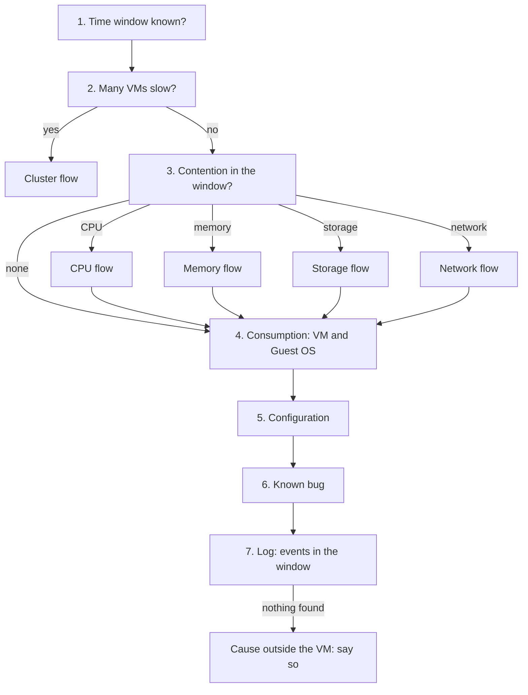

# Users say the VM is slow

## Symptom
- Users or the application owner report that a VM (and its application) is slow. A complaint starts the reactive process: no health check first.
- No metric has been named yet. Establish the facts first, then explain them; do not jump to a cause.

## Flow


## Checks, in order
1. Time window (VirtualMachine). Ask when the slowness happens (a time, a schedule, all the time). Read every counter below at the 20-second peak within that window, not the 5-minute or daily average (`vcf-operations/features/peak-20-second-metrics`). → step 2.
2. Breadth (ClusterComputeResource). Several VMs on the same cluster or host slow in the same window → the cause is likely shared → `vsphere/object-types/cluster/troubleshooting/cluster-vm-contention`. One VM → step 3.
3. Contention (VirtualMachine), the what. Start from the KPI, not the SLA: VM Performance (%) and its colour bands (`vsphere/object-types/vm/kpis/vm-performance`). Then the counter that pulls it down:
   - CPU: Ready and Co-stop, read against Run → `vsphere/technology/cpu/troubleshooting/vm-cpu-contention-high`.
   - Memory: Latency (VCF Operations: Memory Contention) → `vsphere/technology/memory/troubleshooting/vm-memory-latency-high`.
   - Storage: disk latency per virtual disk, read and write, with outstanding IO → `vsphere/technology/storage/troubleshooting/vm-storage-performance-checks`.
   - Network: dropped packets → `vsphere/technology/network/troubleshooting/vnic-rx-drops`.
   - Contention or not → step 4: consumption tells whether the VM's own demand explains it.
4. Consumption (VirtualMachine, then the Guest OS layer).
   - VM: CPU Run and Usage, memory Consumed, disk IOPS and throughput, network throughput (`vsphere/technology/cpu/metrics/comparisons/consumption-metrics`). Very high consumption can cause the contention found in step 3.
   - Guest OS: CPU run queue, memory page-out rate, disk queue (`guest-os/system/metrics/guest-os-performance`). High queues while the VM has no contention → the VM gets what it demands; the Guest OS or the application waits on its own queues (`guest-os/system/concepts/guest-os-sizing`).
   - → step 5.
5. Configuration (VirtualMachine), the first why. Always checked, also when contention was found: a setting can cause the contention or the slowness. A CPU or memory limit, shares and reservations (`vsphere/architecture/resource-controls`); VMware Tools, virtual hardware and Guest OS versions; settings that are outdated or incompatible (`vsphere/object-types/vm/configuration/vm-configuration-review`). → step 6.
6. Known bug (VirtualMachine, HostSystem). Check the versions in the window against known issues of that release: VMware Tools, virtual hardware, ESXi build, drivers. Known bugs are mostly configuration (an older version, an incompatible setting); the current list is outside the knowledge base, so search vendor documentation and KB articles. → step 7.
7. Log (VirtualMachine). Events in the window that counters do not show: a snapshot taken or consolidated (`vsphere/technology/storage/concepts/snapshot-impact`), a vMotion and its stun (`vsphere/object-types/vm/metrics/vmotion`), VMware Tools or Guest OS errors, an HA restart. Nothing in steps 3-7 → the cause is outside the VM and its host: the application, a dependency, or the network beyond the host. Say so; vSphere has no counter for it.

## Why this order
- The window first: a counter read outside the complaint window, or averaged over a day, misses the wait.
- Breadth before depth: many slow VMs point to a shared cause; tuning one VM would not help.
- The what before the why: contention and consumption establish what happened; configuration, known bugs and logs explain it. This is the order of the performance step of every health check.
- Contention before consumption: contention is the performance metric; consumption explains it or rules out the platform.
- The KPI, not the SLA: the KPI is stricter and has the 20-second leading view; the SLA is monthly and lagging.
- Configuration always: a limit or an outdated setting can cause the contention itself.
- Log last: logs explain short events (snapshots, stuns) once the counters have placed the problem in time.

## How to read the result
- Contention on one resource → that resource's flow, then configuration, known bug and log for the cause.
- No contention, Guest OS queues high → the guest is short of vCPU or memory, or the application is the bottleneck.
- Contention and a configuration finding (a limit, an old version) → fix the configuration first.
- No contention, queues normal, configuration clean, no known bug, nothing in the logs → not a vSphere cause.

## Traps
- "The VM's CPU Usage is 95%, so it is short of CPU" → Usage is consumption and includes Turbo; check Ready, Co-stop and Run first.
- "The daily chart is flat, so nothing happened" → read the 20-second peak in the complaint window.
- "The Guest OS run queue is high, so the host is overloaded" → the run queue is inside the Guest OS; check VM contention first.
- "The SLA is met, so the VM is not slow" → the SLA is a monthly average; troubleshoot with the KPI.
- "Contention found, so the cause is the host" → a limit or an old version on the VM can cause it; check configuration and known bugs.
- "No vSphere counter is high, so the users are wrong" → the cause can be outside the VM; say what was checked and what is not visible.

## Metadata
```yaml
id: sp5-framework/performance/troubleshooting/vm-slow
retriever_guide: troubleshooting
scope: sp5-framework
technology:
- cpu
- memory
- storage
- network
- system
pillar:
- performance
product:
- vsphere
- vcf-operations
- windows
- linux
object:
- VirtualMachine
internal_derive:
- vsphere/object-types/vm/configuration/vm-configuration-review
- vcf-operations/features/peak-20-second-metrics
- vsphere/object-types/cluster/troubleshooting/cluster-vm-contention
- vsphere/object-types/vm/kpis/vm-performance
- vsphere/technology/cpu/troubleshooting/vm-cpu-contention-high
- vsphere/technology/memory/troubleshooting/vm-memory-latency-high
- vsphere/technology/storage/troubleshooting/vm-storage-performance-checks
- vsphere/technology/network/troubleshooting/vnic-rx-drops
- vsphere/technology/cpu/metrics/comparisons/consumption-metrics
- guest-os/system/metrics/guest-os-performance
- guest-os/system/concepts/guest-os-sizing
- vsphere/architecture/resource-controls
- vsphere/technology/storage/concepts/snapshot-impact
- vsphere/object-types/vm/metrics/vmotion
related:
- vsphere/object-types/vm/health-check/vm-health-check
- vsphere/architecture/vm-vs-guest-os
source:
  document: Knowledge base synthesis of the files in internal_derive
  path: n/a
corrections:
- 'Step 5: author answer Q104 (2026-11-08): every performance flow, this one included, checks configuration; known bugs are mostly configuration.'
review_notes:
- 'Rewritten 2026-11-09 (author): steps follow the slow order of the reactive process: contention, consumption, configuration, known bug, log, after the time window and breadth; troubleshoot with the KPI, not the SLA (the SLI thresholds step removed).'
- 'Drafted by Claude 2026-11-06 from the files in internal_derive and vsphere/object-types/vm/health-check/vm-health-check (architecture review 2026-11-06, section 3.3). The order of checks is to be confirmed by the author from field practice (Q060).'
status: draft
```
