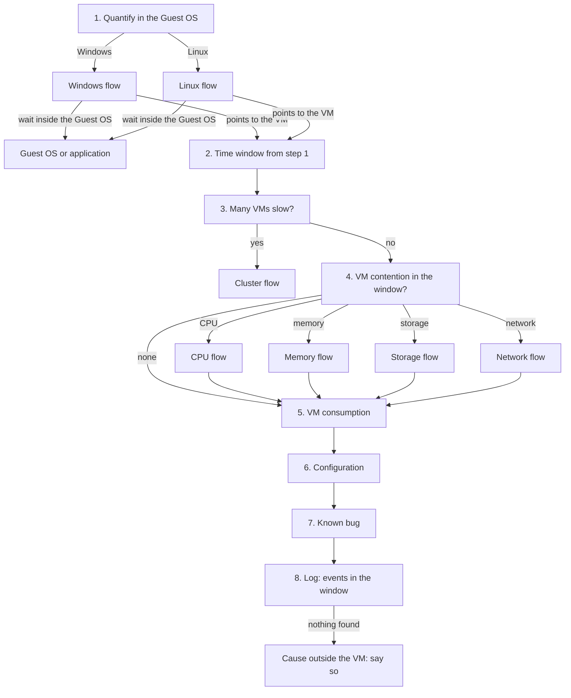

# Users say the VM is slow

## Symptom
- Users or the application owner report that a VM (and its application) is slow. A complaint starts the reactive process: no health check first.
- No metric has been named yet, and users rarely tell the Guest OS from the VM. Establish the facts first, then explain them; do not jump to a cause.
- Unreachable or failing is down: the availability process, not this flow.

## Flow


## Checks, in order
1. Quantify in the Guest OS (Guest OS layer). Ask the application team to quantify the slowness in the counters they can see: Windows or Linux, not vSphere or Kubernetes. Which transaction, how slow, and when. Windows → [`guest-os/system/troubleshooting/ms-windows-slow`](../../guest-os/system/troubleshooting/ms-windows-slow.md); Linux → [`guest-os/system/troubleshooting/linux-os-slow`](../../guest-os/system/troubleshooting/linux-os-slow.md). The Guest OS flow returns the time window and one of two verdicts: the wait is inside the Guest OS (the Guest OS or the application; this flow stops after a check of VM contention in step 4) or it points to the VM → step 2.
2. Time window (VirtualMachine). Use the window from step 1. Read every VM counter below at the 20-second peak within that window, not the 5-minute or daily average ([`vcf-operations/features/peak-20-second-metrics`](../../vcf-operations/features/peak-20-second-metrics.md)). → step 3.
3. Breadth (ClusterComputeResource). Several VMs on the same cluster or host slow in the same window → the cause is likely shared → [`vsphere/object-types/cluster/troubleshooting/cluster-vm-contention`](../../vsphere/object-types/cluster/troubleshooting/cluster-vm-contention.md). One VM → step 4.
4. Contention (VirtualMachine), the what. Start from the KPI: VM Performance (%) and its colour bands ([`vsphere/object-types/vm/vm-performance`](../../vsphere/object-types/vm/vm-performance.md)). Then the counter that pulls it down:
   - CPU: Ready and Co-stop, read against Run → [`vsphere/technology/cpu/troubleshooting/vm-cpu-contention-high`](../../vsphere/technology/cpu/troubleshooting/vm-cpu-contention-high.md).
   - Memory: Latency (VCF Operations: Memory Contention) → [`vsphere/technology/memory/vm-memory-latency-high`](../../vsphere/technology/memory/vm-memory-latency-high.md).
   - Storage: disk latency per virtual disk, read and write, with outstanding IO → [`vsphere/technology/storage/troubleshooting/vm-storage-performance-checks`](../../vsphere/technology/storage/troubleshooting/vm-storage-performance-checks.md).
   - Network: dropped packets → [`vsphere/technology/network/vnic-rx-drops`](../../vsphere/technology/network/vnic-rx-drops.md).
   - Contention or not → step 5: consumption tells whether the VM's own demand explains it.
5. Consumption (VirtualMachine). CPU Run and Usage, memory Consumed, disk IOPS and throughput, network throughput ([`vsphere/technology/cpu/metrics/comparisons/consumption-metrics`](../../vsphere/technology/cpu/metrics/comparisons/consumption-metrics.md)). Very high consumption can cause the contention found in step 4. Guest OS counters are not read here: the Guest OS is a separate realm, read in step 1. → step 6.
6. Configuration (VirtualMachine), the first why. Always checked, also when contention was found: a setting can cause the contention or the slowness. A CPU or memory limit, shares and reservations ([`vsphere/architecture/resource-controls`](../../vsphere/architecture/resource-controls.md)); VMware Tools, virtual hardware and Guest OS versions; settings that are outdated or incompatible ([`vsphere/object-types/vm/configuration/vm-configuration-review`](../../vsphere/object-types/vm/configuration/vm-configuration-review.md)). → step 7.
7. Known bug (VirtualMachine, HostSystem). Check the versions in the window against known issues of that release: VMware Tools, virtual hardware, ESXi build, drivers. Known bugs are mostly configuration (an older version, an incompatible setting); the current list is outside the knowledge base, so search vendor documentation and KB articles. → step 8.
8. Log (VirtualMachine). Events in the window that counters do not show: a snapshot taken or consolidated ([`vsphere/technology/storage/concepts/snapshot-impact`](../../vsphere/technology/storage/concepts/snapshot-impact.md)), a vMotion and its stun ([`vsphere/object-types/vm/vmotion`](../../vsphere/object-types/vm/vmotion.md)), VMware Tools or Guest OS errors, an HA restart. Nothing in steps 4-8 → the cause is outside the VM and its host: the application, a dependency, or the network beyond the host. Say so; vSphere has no counter for it.

## Order rationale
- The Guest OS first: the application team sees Windows or Linux counters, not vSphere. Quantifying the slowness in their terms gives the time window and tells whether the wait is inside the Guest OS at all.
- The window next: a counter read outside the complaint window, or averaged over a day, misses the wait.
- Breadth before depth: many slow VMs point to a shared cause; tuning one VM would not help.
- The what before the why: contention and consumption establish what happened; configuration, known bugs and logs explain it. This is the order of the performance step of every health check.
- Contention before consumption: contention is the performance metric; consumption explains it or rules out the platform.
- VM counters only after step 1: the Guest OS and the VM are separate realms, so each is read in its own flow.
- The KPI: it has the 20-second view and shows how bad. A contract number, if the customer has one, is monthly, lagging and often on the wrong object.
- Configuration always: a limit or an outdated setting can cause the contention itself.
- Log last: logs explain short events (snapshots, stuns) once the counters have placed the problem in time.

## Interpretation
- Contention on one resource → that resource's flow, then configuration, known bug and log for the cause.
- No VM contention, and step 1 found a wait inside the Guest OS → the Guest OS is short of vCPU or memory, or the application is the bottleneck.
- Contention and a configuration finding (a limit, an old version) → fix the configuration first.
- No contention, queues normal, configuration clean, no known bug, nothing in the logs → not a vSphere cause.

## Misconceptions
- "The VM's CPU Usage is 95%, so it is short of CPU" → Usage is consumption and includes Turbo; check Ready, Co-stop and Run first.
- "The daily chart is flat, so nothing happened" → read the 20-second peak in the complaint window.
- "The Guest OS run queue is high, so the host is overloaded" → the run queue is inside the Guest OS; check VM contention first.
- "Our SLA is met, so the VM is not slow" → an SLA is a monthly contract number, often on the wrong object (the cluster, not the VM); troubleshoot with the KPI.
- "Contention found, so the cause is the host" → a limit or an old version on the VM can cause it; check configuration and known bugs.
- "No vSphere counter is high, so the users are wrong" → the cause can be outside the VM; say what was checked and what is not visible.

## Metadata
```yaml
id: sp5-framework/performance/vm-slow
retriever_guide: troubleshooting
scope: sp5-framework
technology:
- cpu
- memory
- storage
- network
- system
pillar:
- performance
product:
- vsphere
- vcf-operations
- windows
- linux
object:
- VirtualMachine
internal_derive:
- vsphere/object-types/vm/configuration/vm-configuration-review
- vcf-operations/features/peak-20-second-metrics
- vsphere/object-types/cluster/troubleshooting/cluster-vm-contention
- vsphere/object-types/vm/vm-performance
- vsphere/technology/cpu/troubleshooting/vm-cpu-contention-high
- vsphere/technology/memory/vm-memory-latency-high
- vsphere/technology/storage/troubleshooting/vm-storage-performance-checks
- vsphere/technology/network/vnic-rx-drops
- vsphere/technology/cpu/metrics/comparisons/consumption-metrics
- guest-os/system/troubleshooting/ms-windows-slow
- guest-os/system/troubleshooting/linux-os-slow
- vsphere/architecture/resource-controls
- vsphere/technology/storage/concepts/snapshot-impact
- vsphere/object-types/vm/vmotion
related:
- vsphere/object-types/vm/vm-health-check
- vsphere/architecture/vm-vs-guest-os
source:
  document: Knowledge base synthesis of the files in internal_derive
  path: n/a
corrections:
- 'Step 5: every performance flow, this one included, checks configuration; known bugs are mostly configuration.'
review_notes:
- 'To check: Steps 2-8, from field practice (Q060).'
status: draft
```
