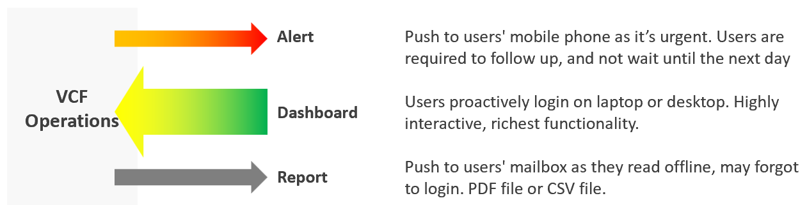

# How VCF Operations reaches its users

## Four channels
- VCF Operations reaches people in four ways: live screen, alert, dashboard, report.
- Urgency, highest first: live screen, then alert. A report suits long-term review.
- Direction of each channel:
  - alert: pushed to the user's mobile phone because it is urgent; the user must follow up and not wait until the next day;
  - dashboard: the user logs in on a laptop or desktop; it is the most interactive channel and has the most functions;
  - report: pushed to the mailbox as a PDF or CSV file, for users who read offline or forget to log in.
- Use dashboards as much as possible. The other channels are narrower.


## What a dashboard-first design gives
- Fewer reports: users log in because a dashboard gives them more. Login-less dashboards on an intranet page cover users without an account.
- More engagement from IT leaders: show them how a dashboard answers their questions; a login-less dashboard on a screen near their office keeps them involved.
- Usage data: nobody can tell whether a report was read. Dashboard use can be tracked, even per interaction, with a third-party website tracker.
- Thresholds per channel: each channel has its own urgency, so each can carry its own green, yellow, orange, red thresholds.

## Alerts, dashboards and reports compared
- The live screen is left out here: its use is narrow (`vcf-operations/dashboards/noc-live-screen`).

| Item | Alert | Dashboard | Report |
|---|---|---|---|
| Nature | Reactive | Proactive | Passive |
| Good for | Exceptions | Exceptions and analysis | Exceptions |
| Depth | Detail | Detail and summary | Summary |
| Use case | Troubleshooting | Troubleshooting, monitoring, optimizing | Export to spreadsheet or slides |
| Time | Minutes; focus is now | Daily to monthly; focus is days | Weekly onwards; focus is weeks |
| Roles | Level 1 | Level 1 onwards; architects | IT leadership; finance |

- Three roles need a dashboard and a report together: the capacity team, the audit team and the tenant.

## Three dashboard cadences
- VCF Operations implements three kinds of proactive view as dashboards: the live NOC screen, the daily health check and longer-cadence analysis. Their time frames differ, so their purposes differ.

| Item | Live NOC screen | Daily health check | Longer cadence |
|---|---|---|---|
| Purpose | Attend a live fire at once | Prevent today's alerts | Larger optimization; deep, broad analysis |
| Urgency | Urgent, ideally not important | Important, ideally not urgent | Important, not urgent |
| Focus | Last 5 minutes | Next 12 hours | Weekly to quarterly |
| Data shown | 1 hour | 1 week | 1 year |
| Use | Always on, on the wall | Twice a day: start and end of day | Varies by persona and need |
| Time spent | 10 seconds to read | A few minutes | Varies |
| User | Level 1 | Level 2 | Auditor, capacity planner, performance or cost specialist |
| Content | Availability, performance, security | Same pillars, broader and deeper | Capacity (utilization, reclamation, optimization), sustainability |

- How the cadence changes the dashboard:
  - Live NOC screen: fits the TV or projector with no scrolling; no tables, because many numbers do not give a conclusion at a glance; trends with the current number; no interaction, because there is no keyboard or mouse; auto-refresh and auto-rotate.
  - Daily health check: 1-2 screens deep; scoreboards, because Level 2 clicks to filter and analyse; standard interaction.
  - Longer cadence: more than 2 screens deep; tables for export to a spreadsheet; interaction follows the need of the moment.
- The daily health check itself: `vcf-operations/dashboards/daily-health-check-dashboards`. Why insight replaces most alerts: `sp5-framework/alerts/alerts-and-insights`.

## Misconceptions
- "Send everyone a weekly report" → nobody can tell whether a report was read, and a report has the least depth. Use a dashboard; add a report where a role needs an offline copy.
- "One threshold set for every channel" → each channel has its own urgency. A live screen that turns red for a non-urgent issue is ignored after a while.
- "The NOC screen is a smaller daily health check" → the NOC screen covers the last 5 minutes for Level 1; the daily check covers the next 12 hours for Level 2. Content, size and interaction differ.
- "Put capacity on the live screen" → capacity changes over days and months. It belongs to the longer-cadence dashboards.
- "Tables on the NOC screen give the most information" → many numbers seen from a distance give no conclusion; show trends and the current value.

## Metadata
```yaml
id: vcf-operations/concepts/system-engagement
retriever_guide: how-it-works
scope: vcf-operations
technology:
- system
pillar:
- availability
- performance
- capacity
- compliance
product:
- vcf-operations
internal_derive:
- sp5-framework/alerts/alerts-and-insights
- sp5-framework/concepts/proactive-operations
related:
- vcf-operations/dashboards/noc-live-screen
- vcf-operations/dashboards/daily-health-check-dashboards
- sp5-framework/alerts/alert-design
images:
  - path: images/vcf-operations-alert-dashboard-report-engagement-diagram.png
    product: [vcf-operations]
    object: [VirtualMachine]
    topic: 'Alert, dashboard and report: direction, device and purpose of each channel'
    image_type: diagram
source:
  document: PART 2 - Consumption for Agent E2.docx
  path: 'Proactive Operations > System Engagement (with its two Heading 4 sections, the table of alerts, dashboards and reports, and Timeline) (pp. 1-3)'
corrections:
- 'Section ''Three dashboard cadences'', time spent on the daily health check: the source table says screen time 10 minutes; written as a few minutes (about 5 minutes when there is no problem).'
review_notes:
- 'To check: Section ''Alerts, dashboards and reports compared'': the source table lists Good for as Exception for all three; the report column lists Exception, written as is. (Q138).'
- 'Section ''Four channels'': the source says four ways and its diagram shows three (alert, dashboard, report); the live screen is the fourth, from the text.'
- 'Not copied: the hexagon picture of NOC requirements (decorative; its content is in vcf-operations/dashboards/noc-live-screen).'
status: draft
```
