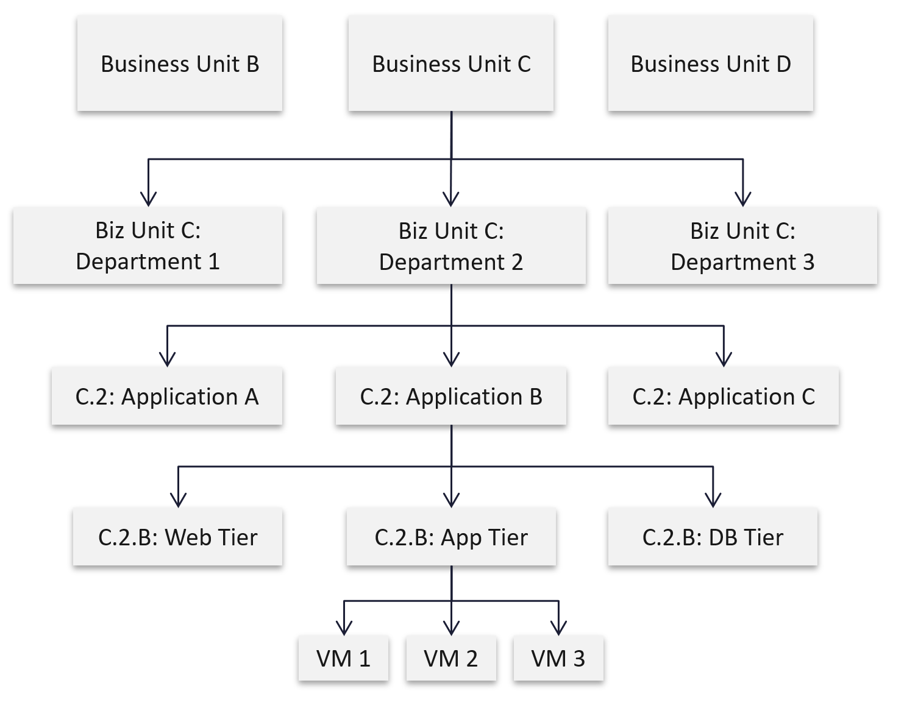

# Business applications in VCF Operations

## Why business views
- Business owners ask about logical business units: services, applications, departments, divisions, teams.
- Performance, capacity and cost reported per business unit mean more to business leaders than per cluster. A service or application can span private, hybrid and public infrastructure.
- Typical questions from a business owner:
  - What is the infrastructure cost of an application, service or department?
  - How can we reduce it?
  - How much compute and storage does it consume?
  - Which VMs of the application stack perform poorly, and why?
- The questions are about infrastructure, asked from the application side. Element managers show objects in a fixed hierarchy that does not map to an elastic business structure, which is why IT finds them hard to answer.

## Business application dashboard
- Top row: one tile per application, coloured by health.
- Selecting an application shows the health of every VM that makes it up, colour coded.
- Selecting a VM shows the counters that make up its KPI. KPI: `vsphere/object-types/vm/kpis/vm-performance`.


## vSphere folder structure
- First step: a vSphere VM folder structure that reflects the organisation. VCF Operations groups and business applications use these folders and their parent-child links.
- Levels, top down: business unit, department, business application, tier, VM.
  - A business unit has one or more departments.
  - A department owns several business applications.
  - An application has tiers, such as web, application and database.
  - A tier is a group of VMs with the same function, the same software and identical hardware configuration. Its VMs are either scale-out (a farm) or active/passive.

- Keep only 2 organisation levels (business unit, department). A reorganisation means renaming folders, moving them to new parents and deleting old ones. Example: Business Unit B merges into C under a new name; rename one folder and delete the other. The goal is context, not a copy of the organisation chart.
- Naming:
  - the application name is unique; if not, prefix it with the department name;
  - folder names are unique across all vCenter instances, so prefix the folder with the application name;
  - names are the same across all vCenter instances.

## Objects in VCF Operations
- A business application is not a vSphere object. It can hold objects from outside VMware, so its parent is not a vSphere object.
- Inventory path: Container > Entire Enterprise > Entire Enterprise Applications > one Business Application object per application.
- An application object holds its tiers; a tier holds its VMs.
- Limit: tiers are added by hand. They have no dynamic membership, as custom groups have.

## Misconceptions
- "Mirror the full organisation chart in vSphere folders" → every reorganisation becomes folder renames, moves and deletions. Two levels give enough context.
- "Folder names only need to be unique per vCenter" → VCF Operations reads several vCenter instances; prefix with the application name so names are unique across all.
- "A business application lives under a vSphere object" → it can hold non-VMware objects, so it sits under Entire Enterprise Applications.
- "Tier membership updates itself" → tiers are manual; a new VM must be added by hand, unlike a custom group with dynamic membership.
- "Report business units per cluster" → a business unit spans clusters and clouds; report by application.

## Metadata
```yaml
id: vcf-operations/dashboards/business-applications
retriever_guide: how-it-works
scope: vcf-operations
technology:
- system
pillar:
- performance
- capacity
- value
product:
- vcf-operations
- vsphere
object:
- VirtualMachine
- Folder
internal_derive:
- sp5-framework/concepts/iaas-business
related:
- vsphere/object-types/vm/kpis/vm-performance
- vcf-operations/dashboards/daily-health-check-dashboards
images:
  - path: images/business-application-health-chart-and-kpi-dashboard-layout-diagram.png
    product: [vcf-operations]
    object: [VirtualMachine]
    topic: 'Business application dashboard: application tiles, VM health chart, detailed KPI'
    image_type: diagram
  - path: images/vsphere-folder-business-unit-department-application-tier-diagram.png
    product: [vsphere]
    object: [Folder, VirtualMachine]
    topic: 'vSphere folder tree: business unit, department, application, tier, VM'
    image_type: diagram
source:
  document: PART 2 - Consumption for Agent E2.docx
  path: 'Proactive Operations > Business Applications (The Crown Jewel, vSphere Folder Structure, Objects Design) (pp. 7-10)'
corrections: []
review_notes:
- 'To check: Section ''vSphere folder structure'', diagram: Application C under Department 2 is labelled C.3, not C.2. (Q139).'
- 'Section ''Objects in VCF Operations'': the inventory path is read from the source screenshot (Inventory > Container > Entire Enterprise > Entire Enterprise Applications > Internet Banking, MS Active Directory, Shop Floor Control). Screenshot not copied.'
- 'To check: Section ''Business application dashboard'': the KPI link is not in the source, which says detailed KPI, actual counters that define a VM KPI.'
status: draft
```
