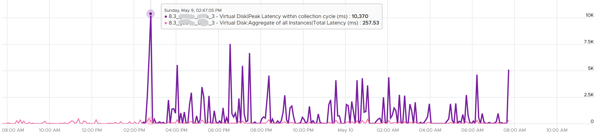

# 20-second peak metrics vs 5-minute averages

## Why
- VCF Operations stores data every 5 minutes. Good for monitoring, too coarse for troubleshooting.
- Problems can be microbursts. A 5-minute average hides them.
- The 20-second peak is 15x sharper. Example: 10,370 ms disk latency at 20-second peak vs 257 ms at 300-second average.
- The gap can exceed 15x: one or two bursts far above the average, and many sets (a VM with 20 virtual disks has 40 sets × 15 points = 600 values; the peak is the highest).


## Design (VCF Operations 8.3 and later)
- A metric named Peak ... within collection cycle is the highest of the 15 20-second averages in the 5-minute cycle.
- KPIs and SLIs are reported every 5 minutes; the SLA is a lagging indicator, reported once a month for the whole month. All are VCF Operations metrics, not vSphere metrics.
- A new metric, not a replacement. The 5-minute average stays for SLAs; the peak is an early warning toward the SLA.
- Stores only the peak of the 15 points every 5 minutes, not all 15: less IO and storage. Answers: did the VM or guest have a problem in any 20-second period?
- Takes the peak across instances: all virtual disks (read and write), all vCPUs. A 64-vCPU VM gets one metric. Which vCPU it was rarely changes the remediation.

## Pairs
| Object | 5-minute average | 20-second peak |
|---|---|---|
| Guest OS | CPU Run Queue | Peak CPU Queue within collection cycle |
| Guest OS | CPU Context Switch | Peak CPU Context Switch within collection cycle |
| Guest OS | Memory Page-out Rate | Peak Guest OS Page-out Rate within collection cycle |
| Guest OS | Disk Queue Length | Peak Disk Queue within collection cycle |
| VM CPU | Ready (%) | Peak vCPU Ready within collection cycle |
| VM CPU | Co-Stop (%) | Peak vCPU Co-Stop within collection cycle |
| VM CPU | Other Wait (%) | Peak Other Wait within collection cycle |
| VM CPU | Overlap (second) | Peak vCPU Overlap within collection cycle |
| VM Memory | Contention (%) | Peak Memory Contention within collection cycle |
| VM Disk | Read and Write Latency (ms) | Peak Latency within collection cycle |
| VM Network | Usage Rate (KB/s) | Peak Usage Rate within collection cycle |
| VM Network | Packets/sec | Peak Network Packets/sec within collection cycle |
| VM Network | Transmitted Packets Dropped | Peak Transmitted Packet Dropped within collection cycle |

## Limitations
- No pattern within the 300 seconds: one point. Compare with the average: a large gap means a one-off.
- Peaks of different metrics can come from different 20-second blocks. High utilization cannot be tied to the contention in the same 5 minutes.

## Traps
- "Peak 15x the average is the maximum gap" → it can be far larger.
- "Use the peak for the SLA" → use the 5-minute average; the peak is a warning.

## Metadata
```yaml
id: vcf-operations/features/peak-20-second-metrics
retriever_guide: metric-meaning
scope: vcf-operations
technology:
- cpu
- memory
- storage
- network
- system
pillar:
- performance
product:
- vcf-operations
- windows
- linux
object:
- VirtualMachine
metric_class: contention
internal_derive:
- observability/measurement-precision
same_name: []
same_meaning: []
related:
- vsphere/object-types/vm/kpis/vm-performance
- guest-os/system/metrics/guest-os-performance
images:
  - path: images/vm-disk-latency-20-second-peak-vs-300-second-average.png
    product: [vsphere]
    object: [VirtualMachine]
    metric: ['VM Disk Latency']
    topic: '20-second peak vs 5-minute average'
    image_type: timeline
source:
  document: PART 3 - Counters.docx
  path: 'Consumer Objects > Performance: VM & Guest OS > 20-second Peak Metrics'
corrections: []
review_notes: []
status: draft
```
