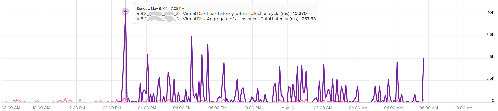

# 20-second peak metrics vs 5-minute averages

## Reason
- VCF Operations stores data every 5 minutes. Good for monitoring, too coarse for troubleshooting.
- Problems can be microbursts. A 5-minute average hides them.
- The 20-second sample is 15x shorter than the 5-minute cycle. For one series the peak is at most 15 times the 5-minute average: the average is the mean of the same 15 samples, none below 0, so one sample can hold at most the whole sum.
- Across instances the gap can exceed 15x: the peak is the highest of many series, while the 5-minute value is the VM-level average. A VM with 20 virtual disks has 40 series (read and write) × 15 points = 600 values; one slow disk sets the peak, while the VM-level average blends it with the other disks.
- Example: 10,370 ms VM disk latency at the 20-second peak vs 257 ms at the 300-second average, about 40x: only a peak taken across virtual disks can be that far above the average.

- Relevance for operations: performance troubleshooting and the VM and Guest OS KPIs read the peak; contention alerts read the peak (acute) with the 5-minute average (sustained); capacity and trends read the 5-minute average.

## Design (VCF Operations 8.3 and later)
- A metric named Peak ... within collection cycle is the highest of the 15 20-second averages in the 5-minute cycle.
- KPIs are reported every 5 minutes. Both the peak and the 5-minute average are VCF Operations metrics, not vSphere metrics.
- A new metric, not a replacement. The 5-minute average stays for trends and capacity; the peak shows the short burst the average hides. The VM KPI reads the peak.
- Stores only the peak of the 15 points every 5 minutes, not all 15: less IO and storage. Answers: did the VM or guest have a problem in any 20-second period?
- Takes the peak across instances: all virtual disks (read and write), all vCPUs. A 64-vCPU VM gets one metric. Which vCPU it was rarely changes the remediation.
- Computed at collection time: each 5-minute cycle the adapter reads the 15 samples of 20 seconds that vCenter holds and records the highest. vCenter keeps its 20-second samples for about an hour; the peak metric stays in VCF Operations after they are gone, so a burst can be read days later.

## Pairs
| Object | 5-minute average | 20-second peak |
|---|---|---|
| Guest OS | CPU Run Queue (Guest\|CPU Queue; per vCPU) | Peak vCPU Queue within collection cycle (Guest\|Peak vCPU Queue within collection cycle; per vCPU) |
| Guest OS | CPU Context Switch | Peak CPU Context Switch within collection cycle |
| Guest OS | Memory Page-out Rate | Peak Guest OS Page-out Rate within collection cycle |
| Guest OS | Disk Queue Length | Peak Disk Queue within collection cycle |
| VM CPU | Ready (%) | Peak vCPU Ready within collection cycle |
| VM CPU | Co-Stop (%) | Peak vCPU Co-Stop within collection cycle |
| VM CPU | Other Wait (%) | Peak Other Wait within collection cycle |
| VM CPU | Overlap (second) | Peak vCPU Overlap within collection cycle |
| VM Memory | Contention (%) | Peak Memory Contention within collection cycle |
| VM Disk | Read and Write Latency (ms) | Peak Latency within collection cycle |
| VM Network | Usage Rate (KB/s) | Peak Usage Rate within collection cycle |
| VM Network | Packets/sec | Peak Network Packets/sec within collection cycle |
| VM Network | Transmitted Packets Dropped | Peak Transmitted Packet Dropped within collection cycle |

## Limitations
- No pattern within the 300 seconds: one point. Compare with the average: a large gap means a one-off.
- Peaks of different metrics can come from different 20-second blocks. High utilization cannot be tied to the contention in the same 5 minutes.

## Misconceptions
- "Peak 15x the average is the maximum gap" → it is the maximum for one series only. A peak taken across vCPUs or virtual disks, read against the VM-level average, can be far larger: about 40x in the disk latency example.
- "Use the peak for a performance SLA" → performance is managed by the KPI, which reads the 20-second peak; the 5-minute average is for trends and capacity.
- "The 5-minute value is below the threshold, so there is no problem" → a threshold holds only for its object, its level within the object and its sample interval. A 5-minute average hides 20-second peaks: read the Peak ... within collection cycle metric of the same object (VM CPU Ready: Peak vCPU Ready within collection cycle) against the levels set for 20 seconds.

## Metadata
```yaml
id: vcf-operations/features/peak-20-second-metrics
retriever_guide: metric-meaning
up_front: 'The 5-minute value is below the threshold, so there is no problem'
scope: vcf-operations
technology:
- cpu
- memory
- storage
- network
- system
pillar:
- performance
product:
- vcf-operations
- windows
- linux
object:
- VirtualMachine
metric_class: contention
internal_derive:
- sp5-framework/observability/measurement-precision
same_name: []
same_meaning: []
related:
- vcf-operations/vcf-operations-role
- vsphere/object-types/vm/vm-performance
- guest-os/system/guest-os-performance
images:
  - path: images/vm-disk-latency-20-second-peak-vs-300-second-average.png
    product: [vsphere]
    object: [VirtualMachine]
    metric: ['VM Disk Latency']
    topic: '20-second peak vs 5-minute average'
    image_type: timeline
source:
  document: Knowledge base; Broadcom KB 444403, Understanding "Peak" or "Worst" Performance Metrics in VMware VCF / Aria Operations (VCF Operations 9.x)
  path: 'Consumer Objects > Performance: VM & Guest OS > 20-second Peak Metrics; KB 444403 (15 samples of 20 seconds per 5-minute cycle; vCenter keeps 20-second data typically 1 hour; VCF Operations "permanently records that brief spike")'
corrections: []
review_notes:
- 'To check: Section ''Pairs'': the key of Peak Transmitted Packet Dropped within collection cycle; the VM key list collected from VCF Operations 9.1.1 (project/sources/export-templates/vcf-operations) has no exact key, the closest are net|droppedTxPct_max and net|droppedTx_summation; the VCF Operations 9.1 metric reference.'
status: draft
```
