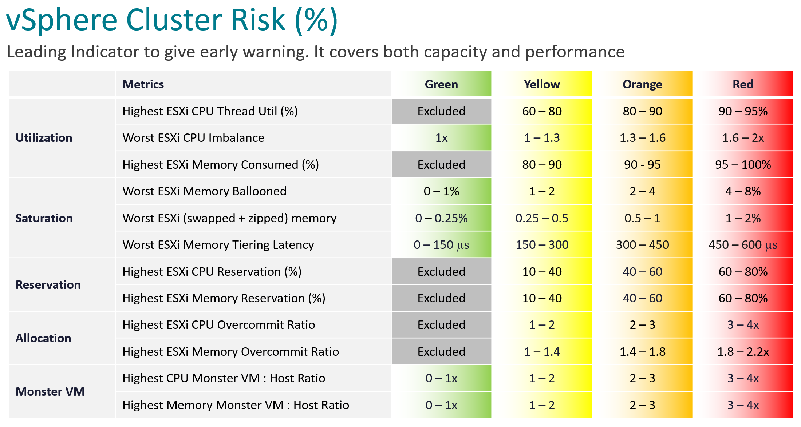

# Cluster Risk (%) (vCommunity management pack KPI for VCF Operations)

## Purpose
- A leading indicator: it warns before the VMs feel contention. It covers capacity and performance.
- Cluster Performance shows contention happening now (`vcf-operations/kpis/cluster-performance`). Cluster Risk shows how close the cluster is to it.
- Higher is worse: 0 is no risk, 100 is maximum risk. The only KPI of the pack read this way.
- Every sub-metric takes the worst ESXi host. One full host hurts its VMs while the cluster average looks fine. Many clusters have 8 hosts or fewer, so the worst warns early. Different sub-metrics can come from different hosts: fine for monitoring, not for troubleshooting.
- Not built into VCF Operations: a metric of the author's vCommunity management pack, published on the cluster under `vCommunity|Cluster Risk|Cluster Risk Score`, with its 12 sub-metrics.

## Thresholds
| Group | Metric | Green | Yellow | Orange | Red |
|---|---|---|---|---|---|
| Utilization | Highest ESXi CPU thread utilization (%) | Excluded | 60-80 | 80-90 | 90-95 |
| Utilization | Worst ESXi CPU imbalance (ratio) | 1 | 1-1.3 | 1.3-1.6 | 1.6-2 |
| Utilization | Highest ESXi memory consumed (%) | Excluded | 80-90 | 90-95 | 95-100 |
| Saturation | Worst ESXi memory ballooned (%) | 0-1 | 1-2 | 2-4 | 4-8 |
| Saturation | Worst ESXi swapped + zipped memory (%) | 0-0.25 | 0.25-0.5 | 0.5-1 | 1-2 |
| Saturation | Worst ESXi memory tiering latency (µs) | 0-150 | 150-300 | 300-450 | 450-600 |
| Reservation | Highest ESXi CPU reservation (%) | Excluded | 10-40 | 40-60 | 60-80 |
| Reservation | Highest ESXi memory reservation (%) | Excluded | 10-40 | 40-60 | 60-80 |
| Allocation | Highest ESXi CPU overcommit ratio | Excluded | 1-2 | 2-3 | 3-4 |
| Allocation | Highest ESXi memory overcommit ratio | Excluded | 1-1.4 | 1.4-1.8 | 1.8-2.2 |
| Monster VM | Highest CPU monster VM : host ratio | 0-1 | 1-2 | 2-3 | 3-4 |
| Monster VM | Highest memory monster VM : host ratio | 0-1 | 1-2 | 2-3 | 3-4 |



- Excluded: six green ranges. A host that is not busy, has little reserved or is not overcommitted says nothing about risk. While green, these rows are left out instead of scoring 100; they count once they leave green.
- The excluded green ends where yellow starts: thread utilization below 60%, memory consumed below 80%, reservation below 10%, overcommit below 1.
- CPU imbalance is green only at exactly 1 (one running thread per running core). Any imbalance is yellow.

## How each sub-metric is calculated
Per host, then the worst host is kept.

| Sub-metric | Per host | Source (VCF Operations) |
|---|---|---|
| CPU thread utilization | % of the host's threads in use, Hyper-Threading aware | `cpu\|utilization_average` |
| CPU imbalance | Running threads / running cores. Running threads = utilization % × threads; running cores = core utilization % × cores | `cpu\|utilization_average`, `cpu\|coreUtilization_average`, `hardware\|cpuInfo\|numCpuCores` |
| Memory consumed | Consumed, as % of host DRAM | `mem\|consumed_average` |
| Memory ballooned | Ballooned, as % of host DRAM | `mem\|vmmemctl_average` |
| Swapped + zipped | (Compressed + swapped), as % of host DRAM | `mem\|compressed_average`, `mem\|swapout_average` |
| Memory tiering latency | Read latency of the NVMe memory tier. Left out on hosts without memory tiering | `mem:NVMe\|latency.read_latest` |
| CPU reservation | Reserved CPU, as % of host CPU capacity | `cpu\|reservedCapacity_average` / `cpu\|totalCapacity_average` |
| Memory reservation | Reserved memory, as % of host DRAM | `mem\|reservedCapacity_average` |
| CPU overcommit | vCPUs of powered-on VMs per physical core | `cpu\|vcpus_allocated_on_all_powered_on_vms`, `hardware\|cpuInfo\|numCpuCores` |
| Memory overcommit | Memory of powered-on VMs / host DRAM | `mem\|memory_allocated_on_all_powered_on_vms` |
| Monster VM ratios | Size of the largest powered-on VM / monster size of its host | VM `config\|hardware\|numCpu`, `config\|hardware\|memoryKB` |

- Threads = 2 × cores when Hyper-Threading is available and active, else the cores.

## Host memory is DRAM only
- Every memory % and ratio is against the host's DRAM (the DIMMs). A memory tier such as NVMe is never added.
- Reason: VMs run in DRAM; NVMe holds only cold pages. A % of DRAM + NVMe looks smaller than the real pressure. There is no use case, in risk or performance, for the expanded capacity.
- Source: host `mem:DRAM\|memory_tier_total_capacity`; fallback `mem\|host_provisioned`. With neither, the host's memory rows are left out, never scored against a guess.

## Monster VM
| Resource | A VM is a monster when it has more than | Example |
|---|---|---|
| CPU | 50% of the host's physical cores. Cores, not threads. | 64 cores, 128 threads: above 32 vCPU |
| Memory | 40% of the host's DRAM, or 256 GB, whichever is smaller. NVMe tiering does not count. | 768 GB DRAM + 768 GB NVMe: 40% is 307 GB, so 256 GB |

- The ratio compares the largest VM with that size: 1 is exactly the monster size; above 1 it is a monster.
- The three numbers (50%, 40%, 256 GB) are defaults, settable per adapter instance. The ratio limits (1, 2, 3, 4) do not change.
- Horizontal risk: more monster VMs, unevenly spread across hosts. Vertical risk: bigger VMs. One 96-vCPU VM is riskier than four 24-vCPU VMs.
- Factors: NUMA (most Xeon and EPYC use 8-core CCDs; a 16-vCPU threshold would flag too many VMs), Hyper-Threading, hypervisor overhead (vSAN + NSX + VMkernel can take more than 10% CPU).
- Monster VMs cause contention despite low utilization, reservation and allocation.

## Scoring
- The sub-metrics are scored and combined as for every KPI of the pack (`operations-management/performance/performance-kpi-design`, section Scoring), where 100 is best. The published value is flipped: Cluster Risk = 100 − weighted average.
- Bands are the mirror of the other KPIs: green 0-25, yellow 25-50, orange 50-75, red 75-100. An alert or widget on Cluster Risk must treat high as bad: red from 75.
- Worked example: two hosts of 32 cores, 512 GB DRAM; host 1 at 90% thread and 100% core utilization, host 2 at 30% and 60%. Thread utilization 90% enters at the start of red (25, weight 8). Imbalance of host 1 is 57.6 running threads / 32 running cores = 1.8, halfway through red (12.5, weight 11.31). Cluster Risk ≈ 67.9.
- Missing data: a sub-metric with no data, or data older than 10 minutes, is left out; never counted as 0, because 0 means no risk.

## Known limitation: a worse sub-metric can lower Cluster Risk
- The weight of a sub-metric rises as its score falls. When the KPI is already high, a sub-metric that gets worse but is still better than the ones driving the KPI pulls the weighted average up, so Cluster Risk goes down.
- An Excluded row that leaves green enters at weight 2 at once: the same effect.
- Example: Cluster Risk 67.9; new idle VMs raise the CPU overcommit ratio from 0.5 to 1.125. The row enters yellow and Cluster Risk falls to 64.5. Only from about 2.7 does it raise Cluster Risk above 67.9.
- Read the sub-metrics before acting on a falling Cluster Risk. A cluster just above orange (50) can drop to yellow after VMs are deployed.
- It happens only when Cluster Risk is already high. When the other sub-metrics are green, a worse sub-metric always raises it.

## Reasons
- CPU reservation is against base clock speed: All-Core Turbo is unknown.
- Allocation is per host, not cluster-wide: the metric is about performance as well as capacity.

## Not used
- Inter-host imbalance: partly covered by highest host utilization; complex; field validation that it changes remediation is pending.
- vMotion: involves the network across top-of-rack switches. Track the maximum vMotion stun time across the environment separately, as basic health (`vcf-operations/kpis/cluster-performance`, section vMotion is not part of the KPI).

## Traps
- "Cluster average utilization shows risk" → use the worst host.
- "Cluster Risk fell, so the cluster is safer" → a worse sub-metric can lower it when the KPI is already high; read the sub-metrics.
- "Memory consumed is low against DRAM + NVMe" → risk is measured against DRAM only.
- "A monster VM is one above half the host threads" → half the physical cores, not threads; memory above 40% of DRAM or 256 GB, whichever is smaller.

## Metadata
```yaml
id: vcf-operations/kpis/cluster-risk
retriever_guide: metric-meaning
scope: vcf-operations
technology:
- cpu
- memory
- system
pillar:
- capacity
- performance
product:
- vcf-operations
object:
- ClusterComputeResource
metric_class: context
internal_derive: []
same_name: []
same_meaning: []
related:
- vcf-operations/kpis/cluster-consumption
- vsphere/technology/cpu/metrics/host/imbalance
- vsphere/object-types/cluster/concepts/cluster-operations
- vsphere/technology/cpu/concepts/cpu-measurement-levels
images:
  - path: images/cluster-risk-thresholds-table.png
    product: [vcf-operations]
    object: [ClusterComputeResource]
    metric: ['Cluster Risk']
    image_type: table
source:
  document: VCF-vCommunity-Adapter documentation, Cluster Risk KPI (author, 2026-11-05); PART 3 - Counters.docx for reasons and monster VM factors
  path: https://github.com/e1-rahabok/VCF-vCommunity-Adapter/blob/main/docs/reference/metrics/cluster-risk.md; formula/cluster-risk.png; Provider Objects > Other Metrics > Cluster Risk (%); Monster VM
corrections:
- 'Sections ''Thresholds'', ''How each sub-metric is calculated'', ''Host memory is DRAM only'', ''Scoring'', ''Known limitation'': from the adapter documentation, replacing the book table (author, Q031, 2026-11-05). Changes: six Excluded green ranges; imbalance 1.3/1.6/2; reservation 10/40/60/80; memory overcommit 1.4/1.8/2.2; monster ratios 1/2/3/4; memory tiering latency row added.'
- 'Section ''Monster VM'': the adapter definition is final (author, Q032, 2026-11-05): CPU above 50% of physical cores; memory above 40% of DRAM or 256 GB, whichever is smaller. The book''s other values (45% or 40% of threads, half the host) are superseded.'
review_notes:
- 'Section ''Thresholds'', Allocation rows: the Part 1 class-of-service plan (Silver CPU 2:1 and Bronze 4:1 per thread; Bronze memory 2:1) falls in red here (Q114). Section ''Monster VM'': the 8-core CCD statement for Xeon is challenged in Q119.'
- 'Moved 2026-11-06 from vcf-operations/kpis/cluster-risk (architecture review 2026-11-06, section 5).'
status: draft
```
