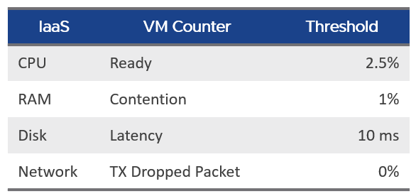

# Cluster SLA and SLI

## Cluster SLA
- Derived from VM SLAs: the percentage of VMs that fail their SLA.
- Pass or fail only; how badly or comfortably each VM fails or passes does not matter at cluster level.
- Not the average of VM SLA values: an average reacts too late unless the SLA is 100%.
- A 30-day, lagging indicator. Next step: identify failing VMs and a common cause.

## Cluster SLI
- An indicator, not in the SLA contract. Acts before the 30-day SLA.
- Each VM has 4 IaaS SLIs (CPU, memory, disk, network). A VM must pass all four.

| IaaS | VM counter | Threshold |
|---|---|---|
| CPU | Ready | 2.5% |
| RAM | Contention | 1% |
| Disk | Latency | 10 ms |
| Network | TX dropped packets | 0% |



```text
Cluster SLI (%) = 100 - ( (Sum [VM] Performance|Number of KPIs Breached + Sum [Pod] Performance|Number of KPIs Breached)
                          / (Summary|Number of Running VMs + Summary|Number of Pods) × 100 / 4 )
```
- Normalized by actual breaches: 1 VM with 4 breaches scores the same as 4 VMs with 1 breach each.
- One threshold set for all classes of service.
- SLA, SLI and KPI differences: the author's VMware Operations Transformation book, Part 1. Implemented with VCF Operations super metrics and dashboards.

## Traps
- "Cluster SLA = average VM SLA" → it is the share of VMs failing.

## Metadata
```yaml
id: vcf-operations/kpis/cluster-sla-sli
retriever_guide: metric-meaning
scope: vcf-operations
technology:
- cpu
- memory
- storage
- network
- system
pillar:
- performance
- value
product:
- vcf-operations
- kubernetes
object:
- ClusterComputeResource
metric_class: contention
internal_derive: []
same_name: []
same_meaning: []
related:
- vcf-operations/kpis/cluster-performance
- foundations/thresholds
images:
  - path: images/sli-thresholds-table.png
    product: [vcf-operations]
    object: [ClusterComputeResource, VirtualMachine]
    topic: 'SLA and SLI'
    image_type: table
source:
  document: PART 3 - Counters.docx
  path: Provider Objects > Performance > Service Level Metrics
corrections: []
review_notes:
- 'Moved 2026-11-06 from vcf-operations/kpis/cluster-sla-sli (architecture review 2026-11-06, section 5).'
status: draft
```
