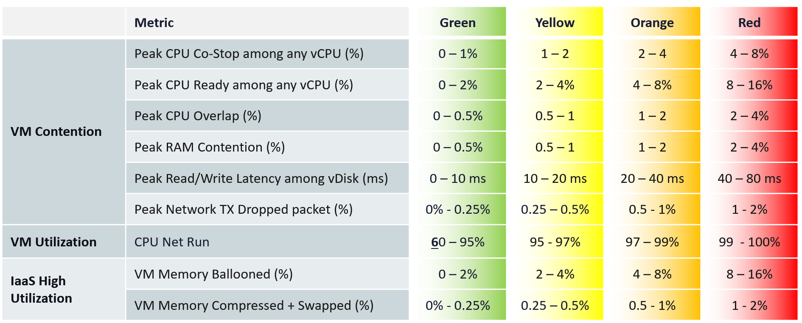

# VM Performance (%) (VCF Operations KPI)

## Thresholds (book)
| Group | Metric | Green | Yellow | Orange | Red |
|---|---|---|---|---|---|
| VM contention | Peak CPU Co-stop among any vCPU (%) | 0-1 | 1-2 | 2-4 | 4-8 |
| VM contention | Peak CPU Ready among any vCPU (%) | 0-2 | 2-4 | 4-8 | 8-16 |
| VM contention | Peak CPU Overlap (%) | 0-0.5 | 0.5-1 | 1-2 | 2-4 |
| VM contention | Peak RAM Contention (%) | 0-0.5 | 0.5-1 | 1-2 | 2-4 |
| VM contention | Peak read/write latency among vDisks (ms) | 0-10 | 10-20 | 20-40 | 40-80 |
| VM contention | Peak network TX dropped packets (%) | 0-0.25 | 0.25-0.5 | 0.5-1 | 1-2 |
| VM utilization | CPU Net Run (%) | 60-95 | 95-97 | 97-99 | 99-100 |
| IaaS high utilization | VM Memory Ballooned (%) | 0-2 | 2-4 | 4-8 | 8-16 |
| IaaS high utilization | VM Memory Compressed + Swapped (%) | 0-0.25 | 0.25-0.5 | 0.5-1 | 1-2 |



## Reasons
- CPU uses 4 metrics (Co-stop, Ready, Overlap, Net Run). They do not peak in the same 20-second period, so they cannot be combined. Known limitation: CPU weight is larger.
- Ready, Co-stop and Overlap have different thresholds: different sensitivity. Ready tends to be 2x Co-stop.
- High CPU utilization threshold: high utilization means work is done.
- Memory Contention is the only counter that shows a VM memory problem. VM and Guest OS can have memory problems independently.
- Ballooned and Compressed + Swapped are leading indicators, not real performance problems.
- Compressed and Swapped are combined: both result from the same action (reclaiming a page), so together they tell the complete picture.
- Their band is tighter than Memory Contention (green 0-0.25% vs 0-0.5%) although they are less serious: they are measured on 5-minute samples, Memory Contention on 20-second peaks. A 5-minute average reads lower than a 20-second peak, so its band must be lower too.
- Ballooned and Compressed + Swapped are divided by Guest OS used memory, not configured memory. Configured would under-report the risk.
- Network: vCenter has no latency or retransmit, so transmit dropped packets are used. Threshold not low: drops are retransmitted and often unnoticed.
- Known limitation: dropped packets use the 20-second peak, but packets transmitted uses the period average (which of the 15 points to take is unknown).

## Traps
- "CPU Run 70% lowers the score" → below 95% is green; below 60% scores 100.

## Metadata
```yaml
id: vcf-operations/kpis/vm-performance
retriever_guide: metric-meaning
scope: vcf-operations
technology:
- cpu
- memory
- storage
- network
- system
pillar:
- performance
product:
- vcf-operations
object:
- VirtualMachine
layer:
- virtual-motherboard
metric_class: contention
internal_derive:
- operations-management/performance/performance-kpi-design
same_name: []
same_meaning: []
related:
- guest-os/system/metrics/guest-os-performance
- vcf-operations/metrics/vm/peak-20-second-metrics
images:
  - path: images/vm-performance-thresholds-table.png
    product: [vcf-operations]
    object: [VirtualMachine]
    metric: ['VM Performance']
    image_type: table
source:
  document: PART 3 - Counters.docx
  path: 'Consumer Objects > Performance: VM & Guest OS > VM Performance (%)'
corrections:
- 'Section ''Reasons'': the book says the Compressed + Swapped threshold is 2x memory contention. The table (half) is correct; the text is superseded by author answer Q026 (2026-11-04). Keep until the book is updated.'
review_notes:
- 'Section ''Reasons'': author answer Q026 (2026-11-04): the table is right; the band was lowered because Compressed + Swapped is measured at 5 minutes and Memory Contention at 20 seconds.'
- 'Moved 2026-11-06 from vcf-operations/kpis/vm-performance (architecture review 2026-11-06, section 5).'
status: draft
```
