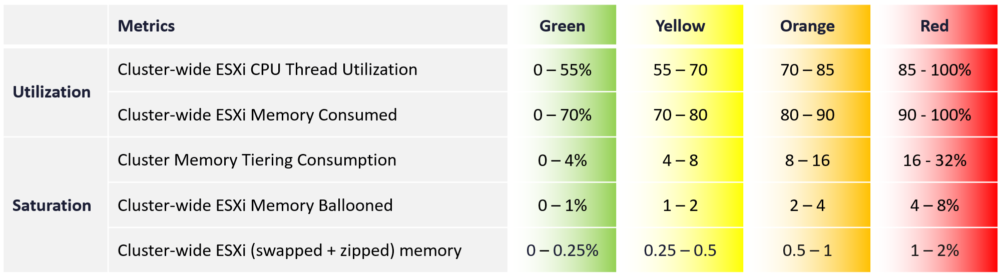

# Cluster Consumption (%) (capacity model, vCommunity management pack for VCF Operations)

## Thresholds (book)
| Group | Metric | Green | Yellow | Orange | Red |
|---|---|---|---|---|---|
| Utilization | Cluster-wide ESXi CPU thread utilization (%) | 0-55 | 55-70 | 70-85 | 85-100 |
| Utilization | Cluster-wide ESXi memory consumed (%) | 0-70 | 70-80 | 80-90 | 90-100 |
| Saturation | Cluster memory tiering consumption (%) | 0-4 | 4-8 | 8-16 | 16-32 |
| Saturation | Cluster-wide ESXi memory ballooned (%) | 0-1 | 1-2 | 2-4 | 4-8 |
| Saturation | Cluster-wide ESXi swapped + zipped memory (%) | 0-0.25 | 0.25-0.5 | 0.5-1 | 1-2 |



## Meaning
- Saturation is not contention: no slowness yet. It is real consumption, tracked with dedicated metrics.

## Traps
- "Saturation means VMs are slow" → check Cluster Performance (%).

## Metadata
```yaml
id: vcf-operations/models/cluster-consumption
retriever_guide: metric-meaning
scope: vcf-operations
technology:
- cpu
- memory
- system
pillar:
- capacity
product:
- vcf-operations
object:
- ClusterComputeResource
metric_class: consumption
internal_derive: []
same_name: []
same_meaning: []
related:
- vcf-operations/models/cluster-risk
- vcf-operations/kpis/cluster-performance
- operations-management/capacity/capacity-model
images:
  - path: images/cluster-consumption-thresholds-table.png
    product: [vcf-operations]
    object: [ClusterComputeResource]
    metric: ['Cluster Consumption']
    image_type: table
source:
  document: PART 3 - Counters.docx
  path: Provider Objects > Other Metrics > Cluster Consumption (%)
corrections: []
review_notes:
- 'Section ''Thresholds (book)'': Part 1 puts 40-80% of usable capacity in green and 80% as best, with 0-40% grey (operations-management/capacity/capacity-dimensions). Which governs, and whether a grey band applies here: Q116.'
- 'Moved 2026-11-06 from vcf-operations/models/cluster-consumption (architecture review 2026-11-06, section 5).'
status: draft
```
