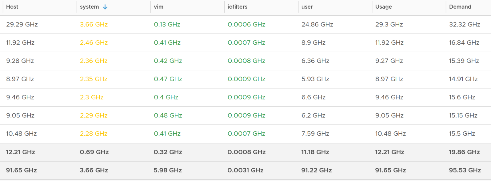
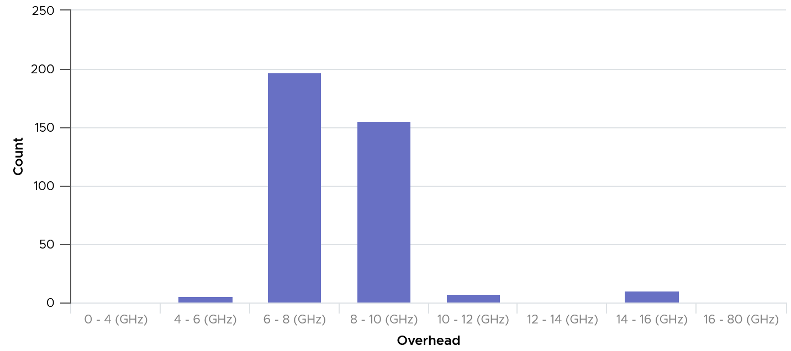
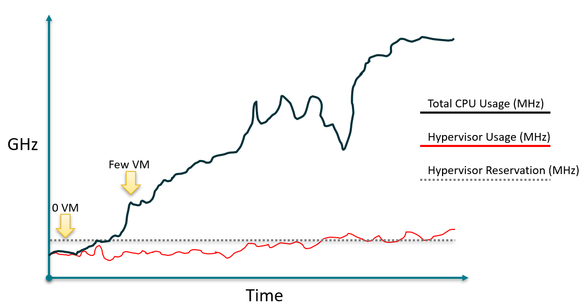
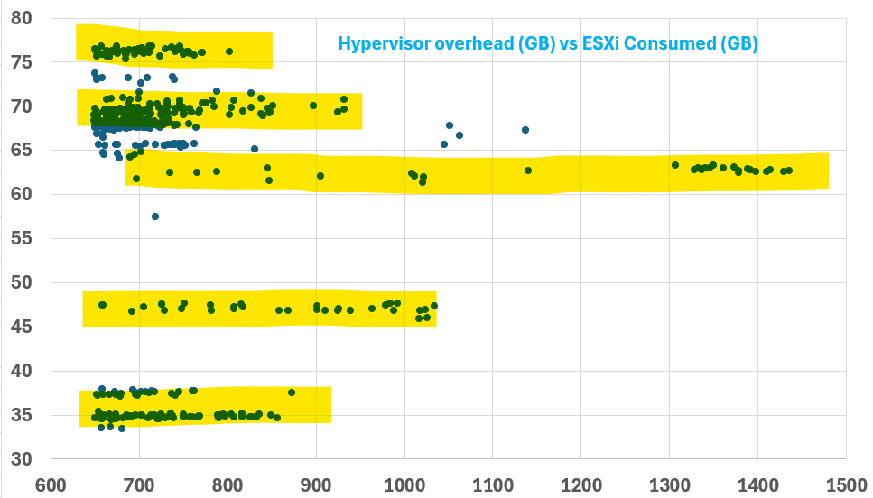
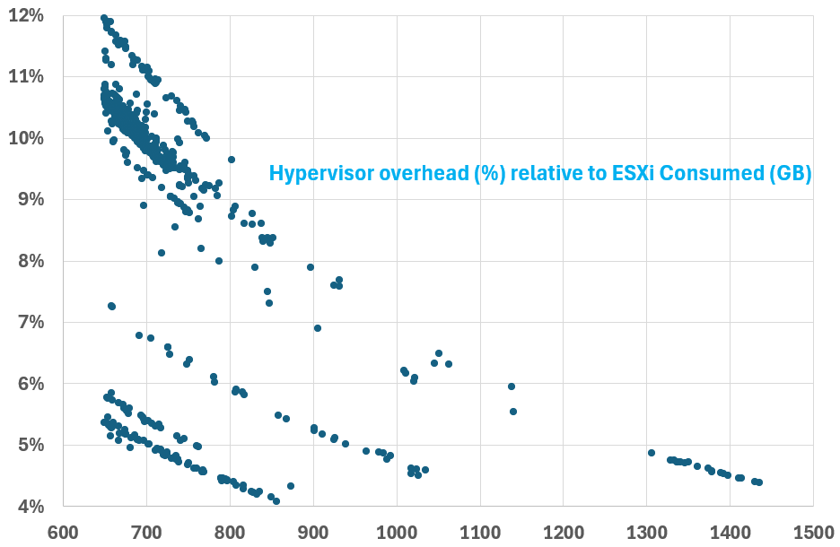

# Overhead

## Definition
- Overhead: mandatory (cannot be avoided) AND has negative impact (slower performance or more resource required).
- Not overhead: optional. You choose to use it. Typically brings a capability not possible without virtualization.
- Do not label every additional load as overhead.

## Overhead
| Item | Note |
|---|---|
| ESXi kernel | Delivers value, but not optional and not negligible. Reduces usable capacity. |
| IO processing by the hypervisor | Extra processing by the kernel. Can cause the IO blender effect. Does not reduce the resources allocated to the Guest OS. |
| VM CPU and memory overhead for the VM Monitor (VMM) | Small. Operationally negligible. |
| vSAN processes | ESXi memory consumed and CPU used by vSAN processes. |
| VM log files | The VM is a layer of its own; its logs provide necessary observability. |

## Not overhead
| Item | Note |
|---|---|
| VM snapshot | Optional. Delivers functionality not available in the Guest OS. |
| VM swap file (`.vswp`) | Enables memory overcommit at ESXi level. |
| vSphere HA spare capacity | Extra ESXi hosts provide availability protection. |
| vSAN Failures-to-Tolerate (FTT) policy | Availability protection, because vSAN does not use hardware-level redundancy. For transient VMs with a master template, FTT can be 0 (no protection). |

## Buffers
- Buffers are a separate category, in addition to overhead. Four types:

| Buffer | Effect |
|---|---|
| Capacity buffer | Reduces Usable Capacity. |
| Cost buffer | Reduces Sellable Capacity. Typically on top of the capacity buffer. |
| Disaster Recovery buffer | — |
| Security Attack buffer | Also called the clean room. |

## vMotion
- Not overhead to the VM. Can change VM metrics on the destination host.
- Unshared swapped page on the source can become a regular memory page on the destination → VM Memory Consumed increases.
- Source and destination ESXi versions can use different memory compression algorithms → a compressed page can become a regular page → consumption increases.

## Why "hypervisor"
- More than the kernel: user-level processes run on top of it.
- VMkernel traditionally excludes vSAN and NSX (vSAN processes sit under /opt).
- Treated as capacity, not performance: the hypervisor has the highest priority. Per-process ready time is in esxtop.

## Which metric to use for usable capacity
| Metric | Problem |
|---|---|
| Utilization | Changes every second. Usable capacity cannot be volatile. |
| Limit | Does not make sense: hypervisor features affect all VMs and must have priority. |
| Reservation | Too low with vSAN and NSX, too high with ESXi only. Fluctuates. |

- Practice: enter a static value manually.

## Metric types
| Type | Facts |
|---|---|
| Utilization | Actual consumption. Can be below reservation, not above allocation. ESXi utilization covers hypervisor and VMs; separate them only when migrating to another architecture. VM contention serves as the contention proxy (the hypervisor has priority), assuming no manual VM limits. |
| Reservation | Minimum guaranteed so the hypervisor runs when VMs demand 100%. Memory is granted on demand, not up front; CPU is used only when running. Utilization can be below reservation. |
| Allocation | Maximum (limit). Useful for VMs (overcommit). Not for non-VM worlds; some show blank or 0 limits. |

## Why the size is unpredictable
- Some services have static values.
- Some scale with host memory.
- Some scale with the number of active VMs.
- Some grow with work done (storage and network stacks).
- Some depend on configuration (vSAN deduplication and compression).

## Resource groups
| Group | Content |
|---|---|
| host/system | Low-level services and drivers: minfree, kernel, helper, FT, vMotion, Storage vMotion, vmk API modules, idle, drivers. vSAN data plane (no separate counter). Concurrent vMotions raise vmotion use. |
| host/vim | Host management: HA (aam), vpxa, hostd, VIM user (DCUI, shell, SSH, Tools), authd, tmp, envoy, GPU manager, tokend, healthd. vmvisor includes NSX and vSAN management plane. |
| host/user | All running VMs, including VM overhead. Only one metric; no breakdown. |
| host/opt | Mostly vSAN (opt/vsan, for example vsanperfsvc). Since vSphere 8.0.1. |
| host/iofilter | IO filter framework for third-party IO interception. |

- vSphere Client shows no CPU or memory reservation metrics for user and iofilter groups.

| Group | CPU | Memory |
|---|---|---|
| System | Low, can be well below 1 GHz | High, about 20-30 GB |
| VIM | High, about 4-12 GHz | Low, can be 0 GB; no memory reservation |

## CPU metrics
- Kernel CPU: plot host/iofilters, host/system and host/vim, stacked. Sub-pools are part of them and small (well below 0.5 GHz).
- Example: top 7 of about 400 hosts by system group: system up to 3.66 GHz, vim up to 0.48 GHz, iofilters near 0; user dominates Usage.

- Counters: Usage, Running, Active. Use Usage: it covers all groups. Running and Active lack host/user and host/opt; Active rolls up as Latest.
- Latest roll-ups tend to read higher than averages.
- Host CPU | Usage (MHz) equals System | Resource CPU Usage (Average) (MHz) at host level: it includes VMs.
- 364 hosts, each above 100 GHz with vSAN and NSX: kernel mostly below 10% of total; absolute values vary widely.
- 557 hosts above 100 GHz: most kernel values below 25 GHz; 2 outliers above 40 GHz. No correlation between total and hypervisor CPU use.
- Network: above 40 Gbps and 3 million packets: kernel below 8 GHz.
- Storage: above 200K IOPS: kernel above 10 GHz.
- Reservation is stable; usage fluctuates every 20 s and exceeds reservation at high load. Maximum limited stays flat: kernel processes have no limit.
- host/system CPU reservation is low; host/vim about 6.6 GHz. Across about 400 hosts: mostly 6-10 GHz, usually stable.



## Memory metrics
- Roll-ups are Latest and stat type Absolute: memory is space.
- Allocation maximum = limit. Allocation minimum = reservation. Shares: internal; do not change.
- Consumed: actual use; can be below reservation. Mapped: meaning unclear, no operational use. Also Overhead, Share Saved, Shared, Swapped, Touched, Zero.
- 607 hosts with vSAN and NSX, 650-1,450 GB consumed: kernel overhead falls below 10% once consumed exceeds 800 GB; absolute values plateau in about 5 levels (likely vSAN configuration).

- Kernel reservation: Memory | ESX System Usage (KB), a legacy name. Across 500+ hosts: 6-88 GB; a 12 TB host with vSAN and NSX: 300 GB.
- Reservation stays steady even when kernel use drops 90% (40 GB to single digits), and when all VMs are gone.
- Actual use: stack Resource Memory Consumed per group; system dwarfs the others.
- Memory | VMkernel consumed covers host/system only, not vSAN.


## Recommended static values (book)
| Stack | CPU (at 2.5 GHz) | Memory |
|---|---|---|
| ESXi + vSAN + NSX | 12 threads | 64 GB |
| ESXi only | 4 threads | about 20 GB (not backed by field data) |

- NSX Enhanced Data Path adds 2-4 cores: it polls the NIC.
- Size vSphere Replication and HCX separately.
- vSAN File Services is a VM: 2 vCPU, set a reservation.
- In monitoring, watch contention: the estimate may be too aggressive or conservative.

## CPU virtualization overhead: Definition
- CPU virtualization overhead depends on two things:
  - the share of the VM workload that runs directly on the physical processor,
  - the cost of virtualizing the rest of the workload.

## Workload classes
| Class | Effect of overhead | Result |
|---|---|---|
| Most workloads | Very small | Performance essentially comparable to native |
| Workloads that spend most time waiting for external events (user interaction, device input, data retrieval) | Absorbed by otherwise unused CPU cycles | Throughput similar to native; possible slight latency increase |
| CPU-bound workloads where virtualization adds overhead | Not absorbed | Possible noticeable degradation in throughput and latency |

## Commitment and overcommit
- Full commitment: total vCPUs on the host equal total physical cores on the host.
- Full commitment is allowed in most environments.
- Overcommit: total vCPUs on the host exceed total physical cores on the host.
- Significant overcommit is allowed in most environments without impacting VM performance.
- Saturation: if the VMs on a host consume all their allocated CPU, the host becomes CPU saturated.
- A saturated host reduces the performance of some or all VMs on it.
- Latency-sensitive workloads are hit hardest by saturation.
- Leave some CPU resources for ESX.
- Commit physical cores fully only where VMs rarely, if ever, use all their allocated CPU at the same time.
- Remedies named by the source:
  - power off some VMs,
  - migrate VMs to another host. DRS can do this automatically.

## Host CPU monitoring
- Moved to `vsphere/object-types/esxi/health-check/esxi-health-check`, section Documentation guidance (esxtop).

## Misconceptions
- Counting snapshots, HA spare hosts or vSAN FTT as virtualization overhead → wrong. They are optional capabilities.
- Area C in `vsphere/architecture/vm-vs-guest-os` (work invisible to the guest) is not the same as overhead.
- "Use kernel reservation as overhead" → unstable, and too low or too high depending on the stack.
- "Memory | VMkernel consumed = all hypervisor memory" → system group only.
- "Overcommit is never safe" → overcommit is allowed in most environments. The risk is saturation, which happens when VMs use their full allocations at the same time.
- "Host average CPU looks fine, so there is no saturation risk" → saturation risk depends on how many VMs can use their full allocation at once, not only on the average.

## Metadata
```yaml
id: vsphere/architecture/overhead
retriever_guide: how-it-works
scope: vsphere
technology:
- cpu
- memory
- storage
- system
pillar:
- capacity
- value
- performance
product:
- vsphere
- vsan
- nsx
object:
- VirtualMachine
- HostSystem
- ClusterComputeResource
internal_derive:
- vsphere/architecture/kernel-worlds
related:
- vsphere/architecture/vm-vs-guest-os
- vsphere/technology/memory/metrics/virtual-motherboard/usage
- sp5-framework/capacity/capacity-model
- vsphere/technology/memory/metrics/host/utilization
- vsphere/technology/memory/metrics/host/consumed
- vsphere/technology/cpu/concepts/idle-and-unused-vcpus
- vsphere/technology/cpu/concepts/numa
images:
- path: images/esxi-cpu-usage-by-resource-group-system-vim-iofilters-user.png
  product:
  - vsphere
  object:
  - HostSystem
  metric:
  - ESXi CPU Usage
  - ESXi CPU Demand
  - ESXi Resource Group CPU Usage
  image_type: table
  sample: top 7 of about 400 hosts
- path: images/esxi-hypervisor-cpu-overhead-distribution-across-hosts.png
  product:
  - vsphere
  object:
  - HostSystem
  metric:
  - ESXi Resource Group CPU Reservation
  topic: Hypervisor overhead
  image_type: distribution
  sample: about 400 hosts
- path: images/esxi-hypervisor-cpu-reservation-vs-use-no-correlation.png
  product:
  - vsphere
  object:
  - HostSystem
  metric:
  - ESXi Resource Group CPU Reservation
  - ESXi Resource Group CPU Usage
  topic: Hypervisor overhead
  image_type: scatter
- path: images/esxi-hypervisor-memory-overhead-vs-consumed-scatter-levels.png
  product:
  - vsphere
  object:
  - HostSystem
  metric:
  - ESXi Memory Consumed
  - ESXi Resource Group Memory Consumed
  topic: Hypervisor overhead
  image_type: scatter
  sample: 607 hosts
- path: images/esxi-hypervisor-memory-overhead-relative-to-consumed-across-hosts.png
  product:
  - vsphere
  object:
  - HostSystem
  metric:
  - ESXi Memory Consumed
  - ESXi Resource Group Memory Consumed
  topic: Hypervisor overhead
  image_type: scatter
  sample: 607 hosts
source:
  document: PART 3 - Counters.docx + Performance Best Practices for VMware vSphere 9.1 (revision 20260624)
  path: The World of Metrics > Metrics Nuances > Virtualization Impact > Overhead vs Not Overhead; Provider Objects > Capacity > Hypervisor; CPU > Hypervisor; Memory > Hypervisor Metrics (from former vsphere/architecture/overhead); ESX CPU Considerations (pp. 27-28) (from former vsphere/architecture/overhead)
corrections:
- '2026-11-02: The item that enables memory overcommit at ESXi level is the VM swap file (.vswp). Uploaded document names it ''VM memory snapshot''.'
- '2026-11-02: Four buffer types listed. Uploaded document says ''at least 3''.'
review_notes:
- '[from former vsphere/architecture/overhead] Section ''Resource groups'': the book lists 5 groups but says to plot only iofilters, system and vim for kernel consumption; host/opt (vSAN) is not in that list. Kept as written.'
- '[from former vsphere/architecture/overhead] Section ''Why the size is unpredictable'': based on Host Resources Deep Dive (Denneman, Hagoort), p. 258, cited by the book.'
- '[from former vsphere/architecture/overhead] Section ''Memory metrics'': ESX System Usage = kernel reservation.'
- '[from former vsphere/architecture/overhead] Source URL: https://www.vmware.com/docs/vsphere-esxi-vcenter-server-9-1-performance-best-practices'
- 'To check: Old file vsphere/cpu/counters/esxi/cpu.usage.average.md states ''sustained values above ~80-85%'' with no source. This source gives 80% (PCPU ceiling) and 90% (warning) for esxtop. Decide whether to replace the old threshold.'
status: draft
```
