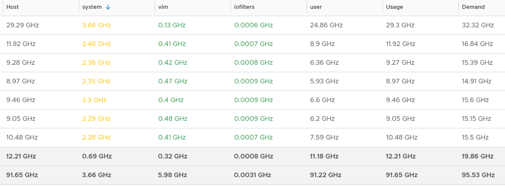
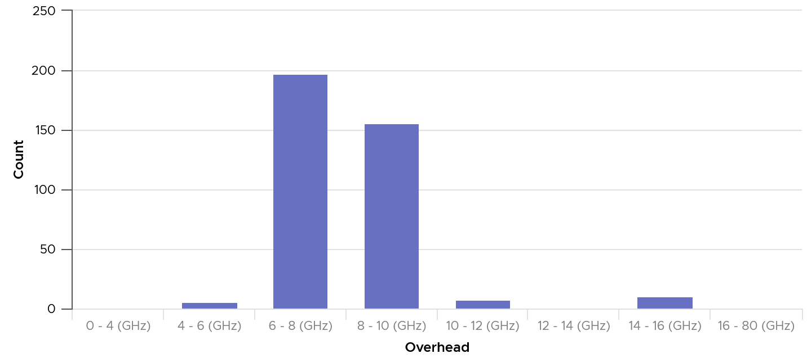
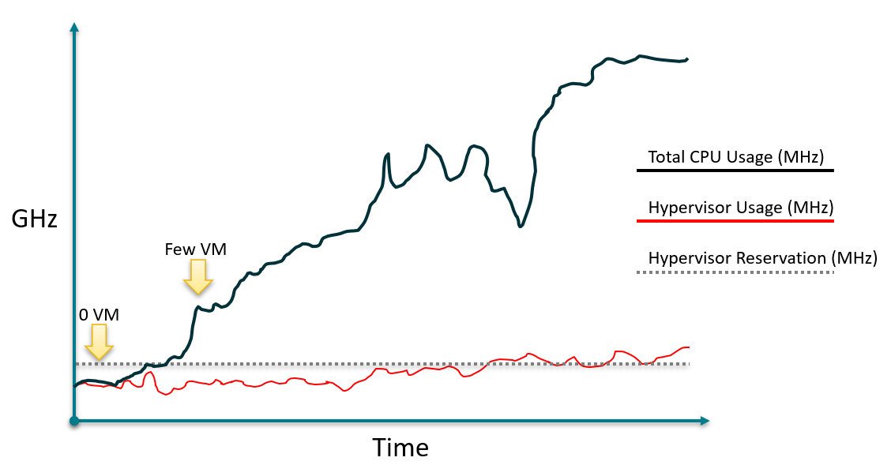
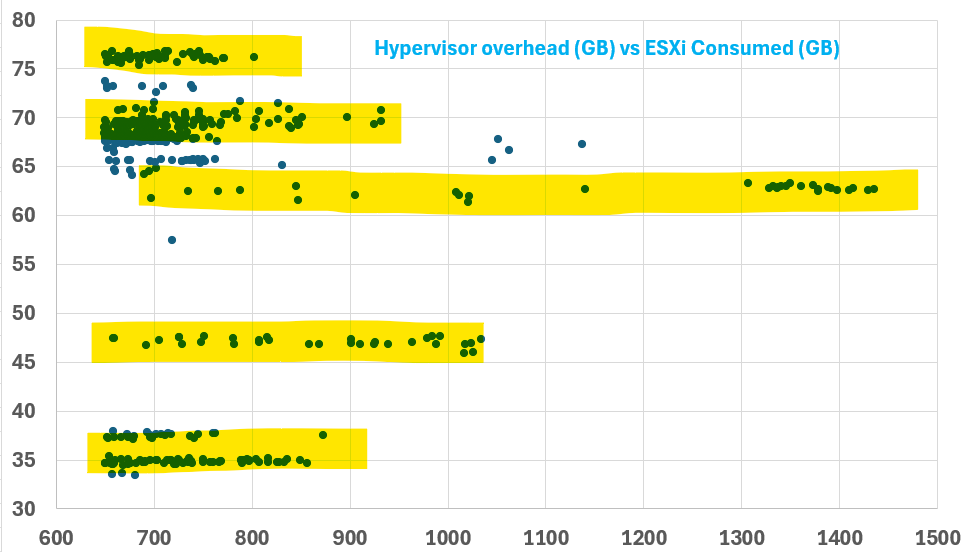
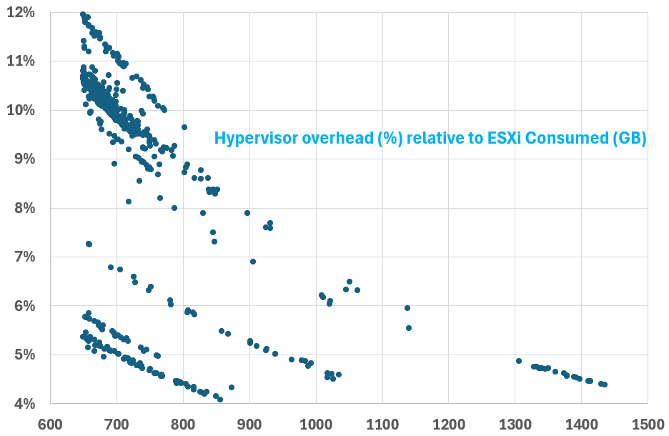

# Overhead

## Definition
- The word "overhead" takes on a different meaning in enterprise-grade system. Many components that are not 100% technically required just to run system become mandatory. These components cover availability, recoverability, security, observability, governance, and IT operations management. It also includes additional copy of the environments for development, test and QA.
- Virtualization, being a layer in between Operating Systems and physical hardware, logically brings its own unique overhead. 
- Do not label every additional load as overhead.
- Overhead: mandatory (cannot be avoided) AND has negative impact (slower performance or more resource required).
- Not overhead: optional. You choose to use it. Typically brings a capability not possible without virtualization. The capability typically consumes resource, which is often mistaken as overhead.

## Overhead
| Item | Note |
|---|---|
| ESXi kernel | Delivers value, but not optional and not negligible. Reduces usable capacity. |
| IO processing by the hypervisor | Extra processing by the kernel. Can cause the IO blender effect. Does not reduce the resources allocated to the Guest OS. |
| VM CPU and memory overhead for the VM Monitor (VMM) | Small. Operationally negligible. |
| vSAN processes | ESXi memory consumed and CPU used by vSAN processes. |
| VM log files | The VM is a layer of its own; its logs provide necessary observability. It is not however, an additional overhead as physical servers will have their equivalent log files.|

## Not overhead
| Item | Note |
|---|---|
| VM snapshot | Optional. Delivers functionality not available in the Guest OS. |
| VM swap file (`.vswp`) | Enables memory overcommit at ESXi level. |
| vSphere HA spare capacity | Extra ESXi hosts provide availability protection. |
| vSAN Failures-to-Tolerate (FTT) policy | Availability protection, because vSAN does not use hardware-level redundancy. For transient VMs with a master template, FTT can be 0 (no protection). |

## Buffers
- Buffers are a separate category, in addition to overhead. Four types:

| Buffer | Effect |
|---|---|
| Capacity buffer | Reduces Usable Capacity. |
| Cost buffer | Reduces Sellable Capacity. Typically on top of the capacity buffer. |
| Disaster Recovery buffer | — |
| Security Attack buffer | Also called the clean room. |

## vMotion
- Not overhead to the VM. Can change VM metrics on the destination host.
- Unshared swapped page on the source can become a regular memory page on the destination → VM Memory Consumed increases.
- Source and destination ESXi versions can use different memory compression algorithms → a compressed page can become a regular page → consumption increases.

## The term hypervisor
- More than the kernel: user-level processes run on top of it.
- The word VMkernel traditionally excludes vSAN and NSX (vSAN processes sit under /opt).
- The hypervisor threads have the highest priority. Per-process ready time can be seen in esxtop.

## Metric for usable capacity
| Metric | Problem |
|---|---|
| Utilization | Changes every second. Usable capacity cannot be volatile. |
| Limit | Does not make sense: hypervisor features affect all VMs and must have priority. |
| Reservation | Steady: does not follow use. Use can pass it or stay far below it. |

- The kernel reservation is too low as usable-capacity input where hypervisor use passes it: CPU use at high load with vSAN and NSX (section CPU metrics), and the memory of the NSX agents and vSAN services, which sit outside host/system (section Memory metrics).
- The kernel reservation is too high where use stays below it: memory on the ESXi-only lab host and on the other hosts measured (section Memory metrics).
- Practice: enter a static value manually.

## Metric types
| Type | Facts |
|---|---|
| Utilization | Actual consumption. Can be below reservation, not above allocation. ESXi utilization covers hypervisor and VMs; separate them only when migrating to another architecture. VM contention serves as the contention proxy (the hypervisor has priority), assuming no manual VM limits. |
| Reservation | Minimum guaranteed so the hypervisor runs when VMs demand 100%. A minimum, not a cap: utilization can be below or above it. CPU is used only when running; memory senses in section Memory metrics. |
| Allocation | Maximum (limit). Useful for VMs (overcommit). Not for non-VM worlds; some show blank or 0 limits. |

## Size variability
- Some services have static values.
- Some scale with host memory.
- Some scale with the number of active VMs.
- Some grow with work done (storage and network stacks).
- Some depend on configuration (vSAN deduplication and compression).

## Resource groups
| Group | Content |
|---|---|
| host/system | Low-level services and drivers: minfree, kernel, helper, FT, vMotion, Storage vMotion, vmk API modules, idle, drivers. vSAN data plane (no separate counter). Concurrent vMotions raise vmotion use. |
| host/vim | Host management: HA (aam), vpxa, hostd, VIM user (DCUI, shell, SSH, Tools), authd, tmp, envoy, GPU manager, tokend, healthd. vmvisor includes NSX and vSAN management plane. |
| host/user | All running VMs, including VM overhead. Only one metric; no breakdown. |
| host/opt | Mostly vSAN (opt/vsan, for example vsanperfsvc). Since vSphere 8.0.1. |
| host/iofilter | IO filter framework for third-party IO interception. |

- vSphere Client shows no CPU or memory reservation metrics for user and iofilter groups.

| Group | CPU | Memory |
|---|---|---|
| System | Low, can be well below 1 GHz | High, about 20-30 GB |
| VIM | High, about 4-12 GHz | Low, can be 0 GB; no memory reservation |

## CPU metrics
- Kernel CPU: plot host/iofilters, host/system and host/vim, stacked. Sub-pools are part of them and small (well below 0.5 GHz).
- Example: top 7 of about 400 hosts by system group: system up to 3.66 GHz, vim up to 0.48 GHz, iofilters near 0; user dominates Usage.

- Counters: Usage, Running, Active. Use Usage: it covers all groups. Running and Active lack host/user and host/opt; Active rolls up as Latest.
- Latest roll-ups tend to read higher than averages.
- Host CPU | Usage (MHz) equals System | Resource CPU Usage (Average) (MHz) at host level: it includes VMs.
- 364 hosts, each above 100 GHz with vSAN and NSX: kernel mostly below 10% of total; absolute values vary widely.
- 557 hosts above 100 GHz: most kernel values below 25 GHz; 2 outliers above 40 GHz. No correlation between total and hypervisor CPU use.
- Network: above 40 Gbps and 3 million packets: kernel below 8 GHz.
- Storage: above 200K IOPS: kernel above 10 GHz.
- Reservation is stable; usage fluctuates every 20 s and exceeds reservation at high load. Maximum limited stays flat: kernel processes have no limit.
- host/system CPU reservation is low; host/vim about 6.6 GHz. Across about 400 hosts: mostly 6-10 GHz, usually stable.



## Memory metrics
- Roll-ups are Latest and stat type Absolute: memory is space.
- Allocation maximum = limit. Allocation minimum = reservation. Shares: internal; do not change.
- Consumed: actual use; can be below reservation. Mapped: no operational use of its own; at host group level it equals ESXi Memory Granted ([`vsphere/technology/memory/metrics/host/granted`](../technology/memory/metrics/host/granted.md)). Also Overhead, Share Saved, Shared, Swapped, Touched, Zero.
- 607 hosts with vSAN and NSX, 650-1,450 GB consumed: kernel overhead falls below 10% once consumed exceeds 800 GB; absolute values plateau in about 5 levels (likely vSAN configuration).

- Kernel reservation: the host/system Resource memory allocation minimum in vCenter. The host page Configure > System > System Resource Reservation shows it (about 4.2 GB on a 9.1 lab host, 4.17 to 4.18 GiB in the counter). It is a reservation, not consumption: the same host's host/system group consumed 2.2 GB.
- Kernel reservation, admission sense: admission control counts the full kernel reservation, used or not, so it is not available for VM reservations. vCenter `mem.unreserved` is the reservation not used by the VMkernel, vSphere services and powered-on VMs (API 9.1).
- Kernel reservation, page sense: pages are granted on demand, not set aside at boot. The part the kernel has not consumed is free memory that VMs can consume, as with the untouched part of a VM reservation ([`vsphere/technology/memory/metrics/host/reservation`](../technology/memory/metrics/host/reservation.md), section Three reservation counters).
- The kernel memory reservation covers host/system only. host/system holds the VMkernel modules of vSAN and NSX: the vSAN data plane, the NSX datapath and the NSX firewall heaps.
- The NSX agents run in their own groups under host/vim/vmvisor (for example opsagent, nsx-datapath-ctrs), each with its own memory cap, and vSAN services run in host/opt. Both sit outside the kernel reservation.
- Hypervisor memory use can pass the kernel reservation: a reservation is a minimum, not a cap, and on a host with vSAN and NSX the agents and services in host/vim and host/opt add use the kernel reservation does not count.
- On the hosts measured, the kernel memory reservation sat above kernel use: a host without VMs ([`vsphere/technology/memory/metrics/host/consumed`](../technology/memory/metrics/host/consumed.md), section Behaviour) and the 185-host average ([`vsphere/technology/memory/metrics/comparisons/host-memory-metrics`](../technology/memory/metrics/comparisons/host-memory-metrics.md)).
- VCF Operations shows the kernel reservation as Memory | ESX System Usage (`mem|host_systemUsage`), a metric VCF Operations computes. vCenter has no counter of that name. Across 500+ hosts: 6-88 GB; a 12 TB host with vSAN and NSX: 300 GB.
- On the ESXi-only lab host, host/vim had an allocation minimum of 0: its management agents (hostd, vpxa, envoy, healthd and others) held no reservation and consumed 0.45 GB.
- Reservation consumed (VMs only) does not contain the kernel reservation, and a VM reservation is not in Consumed, Granted or VMkernel consumed ([`vsphere/technology/memory/metrics/comparisons/host-memory-metrics`](../technology/memory/metrics/comparisons/host-memory-metrics.md), section VM reservation across counters).
- The kernel memory reservation does not follow kernel use: it stayed steady while kernel use dropped 90% (40 GB to single digits), and when all VMs were gone.
- Actual use: stack Resource Memory Consumed per group; system dwarfs the others.
- Memory | VMkernel consumed is vCenter `mem.sysUsage`: host memory used by the VMkernel for core functionality, without VMs and vSphere services (API 9.1). It is smaller than the host/system group: 0.70 GB against 2.2 GB of Resource memory consumed on the 9.1 lab host. It is use, not the kernel reservation (4.2 GB there), and it does not cover vSAN.


## Recommended static values
| Stack | CPU (at 2.5 GHz) | Memory |
|---|---|---|
| ESXi + vSAN + NSX | 12 threads | 64 GB |
| ESXi only | 4 threads | about 20 GB (not backed by field data) |

- NSX Enhanced Data Path adds 2-4 cores: it polls the NIC.
- Size vSphere Replication and HCX separately.
- vSAN File Services is a VM: 2 vCPU, set a reservation.
- In monitoring, watch contention: the estimate may be too aggressive or conservative.

## CPU virtualization overhead: Definition
- CPU virtualization overhead depends on two things:
  - the share of the VM workload that runs directly on the physical processor,
  - the cost of virtualizing the rest of the workload.

## Workload classes
| Class | Effect of overhead | Result |
|---|---|---|
| Most workloads | Very small | Performance essentially comparable to native |
| Workloads that spend most time waiting for external events (user interaction, device input, data retrieval) | Absorbed by otherwise unused CPU cycles | Throughput similar to native; possible slight latency increase |
| CPU-bound workloads where virtualization adds overhead | Not absorbed | Possible noticeable degradation in throughput and latency |

## Commitment and overcommit
- Full commitment: total vCPUs on the host equal total physical cores on the host.
- Full commitment is allowed in most environments.
- Overcommit: total vCPUs on the host exceed total physical cores on the host.
- Significant overcommit is allowed in most environments without impacting VM performance.
- Saturation: if the VMs on a host consume all their allocated CPU, the host becomes CPU saturated.
- A saturated host reduces the performance of some or all VMs on it.
- Latency-sensitive workloads are hit hardest by saturation.
- Leave some CPU resources for ESX.
- Commit physical cores fully only where VMs rarely, if ever, use all their allocated CPU at the same time.
- Remedies named by Performance Best Practices for vSphere 9.1:
  - power off some VMs,
  - migrate VMs to another host. DRS can do this automatically.

## Host CPU monitoring
- Moved to [`vsphere/object-types/esxi/esxi-health-check`](../object-types/esxi/esxi-health-check.md), section Documentation guidance (esxtop).

## Misconceptions
- "Snapshots, HA spare hosts and vSAN FTT are virtualization overhead" → they are optional capabilities that consume resources; overhead is mandatory and brings no capability.
- "All hypervisor work for a VM outside the guest is overhead" → that work (area C in [`vsphere/architecture/vm-vs-guest-os`](vm-vs-guest-os.md)) includes optional capabilities such as snapshot work, which are not overhead.
- "Use kernel reservation as overhead" → it does not follow use: hypervisor use can pass it (CPU at high load; NSX agents and vSAN services outside host/system) or stay far below it.
- "The kernel reservation is memory VMs can never use" → admission control withholds it from VM reservations, used or not; the pages the kernel has not consumed stay free, and VMs can consume them.
- "The kernel reservation caps kernel memory" → it is a minimum, not a cap: kernel use can pass it, and it covers host/system only.
- "Memory | VMkernel consumed = all hypervisor memory" → it is the VMkernel's own use, less than the system group and without the management agents (host/vim).
- "System Resource Reservation is memory the kernel consumes" → it is a reservation (host/system allocation minimum), above the group's consumption on the lab host.
- "ESX System Usage is a vCenter counter" → it is a VCF Operations metric. In vCenter, read the kernel reservation as host/system Resource memory allocation minimum, and kernel use as VMkernel consumed.
- "Overcommit is never safe" → overcommit is allowed in most environments. The risk is saturation, which happens when VMs use their full allocations at the same time.
- "Host average CPU looks fine, so there is no saturation risk" → saturation risk depends on how many VMs can use their full allocation at once, not only on the average.

## Metadata
```yaml
id: vsphere/architecture/overhead
retriever_guide: how-it-works
scope: vsphere
technology:
- cpu
- memory
- storage
- system
pillar:
- capacity
- value
- performance
product:
- vsphere
- vsan
- nsx
object:
- VirtualMachine
- HostSystem
- ClusterComputeResource
internal_derive:
- vsphere/architecture/kernel-worlds
related:
- vsphere/architecture/vm-vs-guest-os
- vsphere/technology/memory/metrics/virtual-motherboard/usage
- sp5-framework/capacity/supply
- vsphere/technology/memory/metrics/host/utilization
- vsphere/technology/memory/metrics/host/consumed
- vsphere/technology/cpu/concepts/idle-and-unused-vcpus
- vsphere/technology/cpu/concepts/numa
images:
- path: images/esxi-cpu-usage-by-resource-group-system-vim-iofilters-user.png
  product:
  - vsphere
  object:
  - HostSystem
  metric:
  - ESXi CPU Usage
  - ESXi CPU Demand
  - ESXi Resource Group CPU Usage
  image_type: table
  sample: top 7 of about 400 hosts
- path: images/esxi-hypervisor-cpu-overhead-distribution-across-hosts.png
  product:
  - vsphere
  object:
  - HostSystem
  metric:
  - ESXi Resource Group CPU Reservation
  topic: Hypervisor overhead
  image_type: distribution
  sample: about 400 hosts
- path: images/esxi-hypervisor-cpu-reservation-vs-use-no-correlation.png
  product:
  - vsphere
  object:
  - HostSystem
  metric:
  - ESXi Resource Group CPU Reservation
  - ESXi Resource Group CPU Usage
  topic: Hypervisor overhead
  image_type: scatter
- path: images/esxi-hypervisor-memory-overhead-vs-consumed-scatter-levels.png
  product:
  - vsphere
  object:
  - HostSystem
  metric:
  - ESXi Memory Consumed
  - ESXi Resource Group Memory Consumed
  topic: Hypervisor overhead
  image_type: scatter
  sample: 607 hosts
- path: images/esxi-hypervisor-memory-overhead-relative-to-consumed-across-hosts.png
  product:
  - vsphere
  object:
  - HostSystem
  metric:
  - ESXi Memory Consumed
  - ESXi Resource Group Memory Consumed
  topic: Hypervisor overhead
  image_type: scatter
  sample: 607 hosts
source:
  document: Knowledge base; Performance Best Practices for VMware vSphere 9.1 (revision 20260624); vSphere Web Services API 9.1; Broadcom KB 419794, 447622 and 404061 (NSX 4.x); Broadcom KB 420935
  path: The World of Metrics > Metrics Nuances > Virtualization Impact > Overhead vs Not Overhead; Provider Objects > Capacity > Hypervisor; CPU > Hypervisor; Memory > Hypervisor Metrics (from former vsphere/architecture/overhead); ESX CPU Considerations (pp. 27-28) (from former vsphere/architecture/overhead); API 9.1 memory counters, unreserved (https://developer.broadcom.com/xapis/vsphere-web-services-api/9.1/memory_counters.html); KB 419794, group host/vim/vmvisor/opsagent (https://knowledge.broadcom.com/external/article/419794); KB 447622, group host/vim/vmvisor/nsx-datapath-ctrs (https://knowledge.broadcom.com/external/article/447622); KB 404061, NSX firewall heap vsip-kentries (https://knowledge.broadcom.com/external/article/404061)
corrections:
- 'Section ''Recommended static values'': Broadcom KB 420935 (ESXi 8.x, 9.x) sets aside host memory for ESXi by socket count, from 2 sockets up (64-256 GB for 2 sockets, default 128 GB; 128-384 GB for 4; 256-768 GB for 8). Its socket counts are out of date: 4-socket ESXi hosts are gone, 2-socket hosts are rare and most are single socket. The knowledge base keeps 64 GB for ESXi + vSAN + NSX; kept until the KB is updated.'
review_notes:
- 'To check: Section ''Memory metrics'': the formula of the VCF Operations metric mem|host_systemUsage (ESX System Usage) is not published; check on a 9.1 host that it equals host/system Resource memory allocation minimum (the kernel reservation). VCF Operations 9.1, Host System metrics (https://techdocs.broadcom.com); https://developer.broadcom.com/xapis/vsphere-web-services-api/9.1/memory_counters.html'
- 'To check: Section ''Memory metrics'': which part of the host/system group VMkernel consumed (mem.sysUsage) covers; it read less than the group''s Resource memory consumed on a 9.1 lab host. The kernel reservation on the page and in the counter differ by under 1%: page rounding or sample time, not checked.'
- 'To check: Section ''Memory metrics'': that the NSX datapath and firewall heaps count in host/system rests on their being VMkernel heaps (KB 404061 shows the vsip-kentries heap in vmkernel.log); no vendor text names their resource group. https://knowledge.broadcom.com/external/article/404061'
status: draft
```
