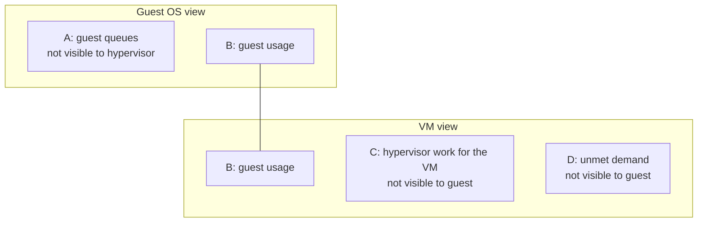

# VM vs Guest OS

## Definition
- A VM is a virtual motherboard: a circuit board with electronics mounted on it.
- A VM is not a complete machine. It is not an operating system.
- The Guest OS (Windows, Linux) is a separate layer running on the VM.
- VM and Guest OS have a 1:1 relationship and are adjacent layers. They are still distinct.
- Common mistake: the word "machine" suggests a complete entity (like a washing machine or ATM). That mental model makes people mix up VM and Guest OS.

## Consequences for metrics
- OS-level metrics are not VM metrics. Examples that do not apply to a VM:
  - processes,
  - threads,
  - system calls per second.
- A VM introduces its own metrics and properties.
- Resources consumed by the Guest OS ≠ resources consumed by the VM. Power management and CPU SMT add to the difference.
- See [`vsphere/architecture/vm-vs-guest-os`](vm-vs-guest-os.md) for what each layer can and cannot see.

## Two realms
- VM (virtual motherboard) and Guest OS are 2 different realms. Each has its own kernel and its own metrics.
- The VM realm is managed by the VMkernel. It sees physical cores, physical threads, frequency and other VMs.
- The Guest OS realm is managed by Windows or Linux. It sees only vCPUs. It does not see physical threads, so it is unaware of Hyper-Threading.
- A statement about one realm does not transfer to the other. Example: Guest OS CPU Usage is not Hyper-Threading aware; VM CPU Usage and VM CPU Demand are, because they live in the VM realm.
- Before comparing two metrics, place each in its realm. Mixing realms gives contradictory answers.

## Availability: VM
- The virtual motherboard is unavailable in only two states:

| State | Meaning |
|---|---|
| Powered off | BIOS not running. |
| Frozen | System clock paused. Occurs during the actual downtime of vMotion (not stun time, not copy time). About 0.2 s when healthy. |

- If the BIOS is running, the VM is 100% available, even if Windows or Linux has not booted.

## Availability: Guest OS
- Requires checking that the kernel, scheduler, disk subsystem and core IPC/management layers are responding.

| OS | Command | Meaning |
|---|---|---|
| Windows | `sc query RpcSs` | `sc.exe` queries the Service Control Manager (SCM), the Windows subsystem managing background services, drivers and startup processes. |
| Linux | `systemctl is-system-running` | Queries systemd's state manager across all managed daemons. |

- `systemctl is-system-running` results:
  - `running`: all initialized daemons active.
  - `degraded`: kernel and main system up; at least one service failed or crashed.
  - `starting` / `stopping`: booting or shutting down.

## Visibility layers: Definition
- Guest OS and VM see different parts of the same resource activity.
- Each layer has visibility the other layer does not have.
- Important: "demand" and "usage" here are plain-English words.
  - They are NOT the vSphere or VCF Operations metrics with the same names.
  - Those metrics were created for different purposes.

## The four areas
| Area | What it is | Visible to Guest OS | Visible to hypervisor |
|---|---|---|---|
| A | Queues inside the Guest OS: CPU run queue, RAM page file, disk queue length, driver queue, network card ring buffer. | Yes | No |
| B | What the Guest OS uses. | Yes | Yes |
| C | Work done by the hypervisor for the VM, outside the guest: CPU System, CPU MKS, CPU VMX, RAM Overhead, Disk Snapshot. | No | Yes |
| D | Unmet demand: CPU Ready, CPU Co-Stop, CPU Overlap, CPU VM Wait, RAM Contention, VM Outstanding IO. | No (Guest OS only experiences frozen time or slowness, cannot account for it) | Yes |

## Visibility layers: Formula
```text
Guest OS view:  usage  = B
                demand = A + B
VM view:        usage  = B + C
                demand = B + C + D
```



## Area details
- A: these requests have not been sent to the hypervisor yet.
  - Example: Oracle sends IO to Windows. The Windows storage subsystem is full. Windows does not pass the IO down.
  - Result: VM-level disk IOPS under-reports demand.
- B: Guest OS CPU utilization roughly translates into VM CPU Run.
  - The two are calculated independently, likely sampled at different times, with different rollup techniques.
- C: VMware Tools adds new metrics inside Windows/Linux for some visibility.
  - Tools does not modify existing Windows/Linux metrics. Those remain unaware of virtualization.
- D: The guest experiences frozen time or slowness, but cannot identify or account for it.

## Visibility layers: Consequences for metrics
- You size the Guest OS, but you reclaim the VM.
  - Sizing uses what happens inside the VM.
  - Reclamation uses the footprint on ESXi (outside the VM).
- Normal VM-level metrics do not prove the full IO path is healthy. Area A is invisible to the hypervisor.
- Applications that manage their own resources (Java VM, databases) add another layer not shown here.
- Containers add yet another virtualization layer.

## Reference
- Detailed scientific treatment: Benjamin Serebrin and Daniel Hecht, https://link.springer.com/chapter/10.1007%2F978-3-642-29737-3_26

## Misconceptions
- "Guest OS crashed, so the VM is down" → wrong. The VM is available while BIOS runs; the Guest OS is unavailable.
- Asking for VM process or thread counts → wrong layer. Those are Guest OS metrics.
- "Demand is not affected by Hyper-Threading because the Guest OS cannot see threads" → mixes realms. Demand is a VM-realm kernel counter; the VMkernel sees threads.
- "VM disk IOPS and latency are normal, so storage is not the problem" while the guest disk queue is high → incomplete. The IO may still be queued in area A.
- Equating the plain-English demand/usage above with the vSphere Demand/Usage metrics → wrong.

## Metadata
```yaml
id: vsphere/architecture/vm-vs-guest-os
retriever_guide: how-it-works
scope: vsphere
technology:
- cpu
- memory
- storage
- network
pillar:
- availability
- performance
- capacity
product:
- vsphere
- windows
- linux
object:
- VirtualMachine
- HostSystem
internal_derive: []
related:
- vsphere/architecture/kernel-worlds
- vsphere/technology/cpu/concepts/guest-os-vs-vm-cpu
- vsphere/architecture/overhead
- sp5-framework/observability/thresholds
source:
  document: Private Cloud Management by Iwan Rahabok (https://isvara.io/download)
  path: The World of Metrics > Metrics Nuances > Virtualization Impact > What, exactly, is a VM?; The World of Metrics > Metrics Nuances > Virtualization Impact > Visibility (from former vsphere/architecture/vm-vs-guest-os)
corrections:
- '2026-11-02: Layer C is work done outside the guest that the guest cannot see. It is not ''overhead'' in the strict sense. Disk snapshot is not overhead (see vsphere/architecture/overhead). Uploaded document labels layer C ''hypervisor overhead''.'
review_notes: []
status: draft
```
