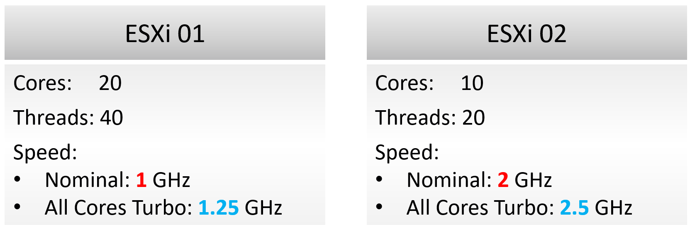

# CPU capacity: threads, not hertz

## vSphere's number
- ESXi CPU total capacity = base frequency × cores. No Turbo, no Hyper-Threading.
- Conservative: suits mission-critical clusters. Other workloads can be packed more.
- Sum of VM CPU Usage can exceed ESXi total capacity: total capacity is nominal.

## Example

- ESXi 1: 20 cores × 1 GHz = 20 GHz. ESXi 2: 10 cores × 2 GHz = 20 GHz. Same by vSphere's measure.
- On ESXi 2, VMs run 2x faster, but only half as many fit. The same vCPU count on ESXi 2 gives about 50% CPU Ready, unpredictable performance and very high context switching.
- ESXi 2 has 2x performance and 0.5x capacity. Performance and capacity do not correlate: one number cannot measure both.
- Capacity (space): ESXi 1 = 40 threads, ESXi 2 = 20 threads.

## Rules
- Capacity is counted in physical threads: where a vCPU can run. Speed is performance.
- Running 40 vCPU on 40 threads is not overcommit (ignoring hypervisor overhead): no Ready. They run slower, like on slower hardware.
- AWS also counts threads and sells allocation without overcommit.
- Do not express capacity in MHz: Hyper-Threading adds only 1.25x while each thread slows 37.5%, and All-Core Turbo varies per model. GHz mixes performance and capacity.
- Enable Hyper-Threading, but set customer expectations on speed. Future CPUs may drop HT (some new Intel Xeon use performance and efficiency cores; AMD keeps SMT).
- Reservation is in hertz; allocation is in vCPUs. After vMotion to a faster host, adjust reservations manually if they do not scale.

| Metric | Allocation model | Demand model |
|---|---|---|
| Total capacity | Physical threads in the host | Core and thread utilization. Not GHz. |
| Hypervisor overhead | Threads assigned manually | Already in ESXi counters |
| Consumption | Sum of running VM vCPUs | Core and thread utilization; max(Usage, Reservation) per running VM. Usage tends to over-report. |
| Performance | Not applicable | Ready + Co-stop (Swap Wait and Other Wait are not CPU causes) |
- Do not add VM CPU contention to consumption; track performance explicitly.

## Traps
- "Faster CPU = more capacity" → more speed, not more space.
- "Sum of VM Usage above total capacity is impossible" → total is nominal; Turbo exceeds it.

## Metadata
```yaml
id: vsphere/cpu/concepts/cpu-capacity
retriever_guide: how-it-works
scope: vsphere
technology:
- cpu
pillar:
- capacity
- performance
product:
- vsphere
- vcf-operations
object:
- HostSystem
- ClusterComputeResource
internal_derive:
- vsphere/cpu/concepts/cpu-measurement-levels
- vsphere/cpu/concepts/esxi-thread-core-accounting
related:
- vsphere/system/concepts/capacity-model
- vsphere/system/concepts/hypervisor-overhead
- vsphere/cpu/metrics/host/core-utilization
source:
  document: PART 3 - Counters.docx
  path: Provider Objects > Capacity > CPU
corrections: []
review_notes: []
status: draft
```
