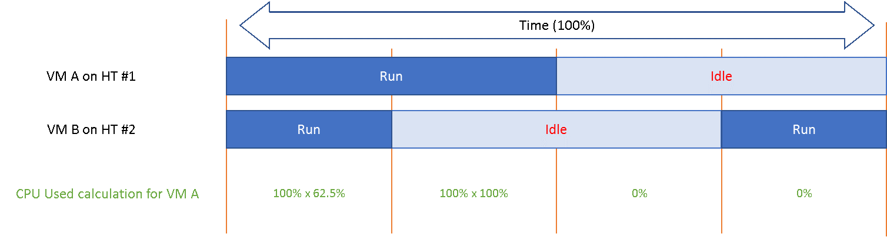
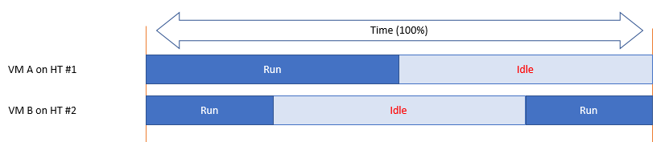

# CPU efficiency: Hyper-Threading accounting

## Mechanism
- SMT (Intel: Hyper-Threading) raises the total throughput of a core.
- It lowers the throughput of each thread.
- The real gain varies with the load.
- The gain is hard to measure: the core frequency does not change.

## Accounting
- ESXi records the core gain as 1.25x, regardless of the real gain.
- The real gain for an application can be lower or higher. The counter still reports 1.25x.
- Both threads running: the core records 1.25x. Each thread gets 62.5% of the core.
- From each VM's vantage point, an idle sibling thread is better: 100% instead of 62.5%.
- The drop can be significant. So the latency sensitivity setting gives the vCPU a full core reservation. The scheduler runs nothing on the sibling thread.

## Run vs Used
- Run is unaware of Hyper-Threading. It counts time only.
- Used accounts for the shared core.

## Worked example


- 2 VMs share one physical core. Each runs on one thread.
- 4 combinations are possible: both run, only A runs, only B runs, both idle.
- Each VM runs half the time. Half of VM A's runtime overlaps with VM B.

```text
VM A Run  = 50%
VM A Used = 25% × 0.625  (B also running)
          + 25% × 1.0    (B idle)
          = 15.625% + 25%
          = 40.625%
```

| Scenario | Run | Used |
|---|---|---|
| Each VM runs half the time, half of it overlapping | 50% | 40.625% |
| Both threads run all the time | 100% | 62.5% |

## Traps
- "Run 50% means the VM got 50% of a core" → Run ignores the shared core. Used shows 40.625%.
- "Hyper-Threading gain is 25% for every workload" → 1.25x is a hardcoded accounting value.
- "Ready shows Hyper-Threading contention" → Ready does not change when the sibling thread is busy. Use CPU Latency.

## Metadata
```yaml
id: vsphere/cpu/concepts/cpu-efficiency
retriever_guide: how-it-works
scope: vsphere
technology:
- cpu
pillar:
- performance
- capacity
product:
- vsphere
object:
- VirtualMachine
- HostSystem
internal_derive:
- vsphere/cpu/concepts/hyper-threading
- vsphere/cpu/concepts/run-time-vs-run-quality
related:
- vsphere/cpu/configuration/latency-sensitivity
- vsphere/cpu/concepts/frequency-and-ht-impact-on-vm
- vsphere/cpu/metrics/virtual-machine/run
- vsphere/cpu/metrics/virtual-machine/used
- vsphere/cpu/metrics/virtual-machine/usage
- vsphere/cpu/metrics/virtual-machine/latency
source:
  document: PART 3 - Counters.docx
  path: CPU > Architecture (pp. 75-77) > CPU Efficiency
corrections: []
review_notes:
- "Section 'Worked example': the book gives the result (40.625%). The formula line is Claude's reconstruction from the book's description: VM A runs 50% of the time, half of it with VM B running."
- "Hyper-Threading figures (1.25x, 62.5%) are not in Performance Best Practices for vSphere 9.1. Open item in docs/todo.md."
status: draft
```
