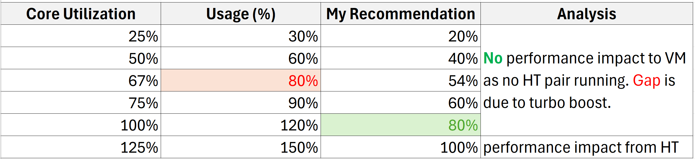

# CPU frequency and Turbo

## Three speeds
| Speed | Meaning | Facts |
|---|---|---|
| Base (nominal) | The frequency vSphere uses as total capacity. Most commonly shown. | The CPU rarely runs at it. It runs above it. |
| Single-Core Turbo | Marketing figure. Single-thread benchmarks use it. | AMD EPYC 9000 series: 7%-64% above base. Intel Xeon Platinum 8593Q: 77% above base. |
| All-Core Turbo | The speed that matters for a loaded host. | AMD publishes All-Core Boost. Intel no longer does. AMD EPYC 9000 series: 1%-48% above base. |

- Intel does not expose All-Core Turbo via API. So it cannot be used in capacity calculations.
- Intel Turbo Boost raises clock speed dynamically, with no installation or configuration.
- Intel Turbo Boost inputs: the heat the system tolerates and the number of active cores. It boosts to the maximum safe level.

## Per-core frequency
- Each core can run at its own frequency.
- Rolling up to ESXi level is therefore complex.
- One throughput counter cannot be derived from another. Each must be calculated at core level.

## Total capacity
- All else equal, a CPU at 1 GHz is 50% slower than at 2 GHz.
- Turbo raises the clock above the stated frequency.
- Turbo works with power saving in the same socket: some cores sleep, and the saved power boosts other cores.
- The power envelope of the socket stays the same.
- The gap between base and highest Turbo is about 2x.

## History
| Year | Change |
|---|---|
| 2008 | Intel Nehalem introduces Turbo. Early Turbo forced all active cores to the same frequency. |
| 2014 | Intel Per-Core P-States (PCPS), Haswell-EP (Xeon E5-2600 v3). Each core has its own power state and frequency. |
| 2017 | AMD Zen (EPYC, Ryzen). Hundreds of sensors adjust clock speed per core in 25 MHz steps. |

| Attribute | 2006 | 2026 |
|---|---|---|
| Examples | Intel Xeon 5160, AMD Opteron 2220 | Intel Xeon 6, AMD EPYC 9005 |
| Typical base clock | 3.0 GHz | 2.0-2.3 GHz |
| Max Turbo clock | None (locked at base) | 3.9-5.0 GHz |
| Core count | 2 | 128-192 |
| Turbo / base ratio | 1.0x | about 1.7x-2.2x |

## Turbo
- Turbo is large enough that both performance and capacity must account for it.
- Within a core: the frequency cannot be predicted. It depends on the instructions and on what other cores do.
- Within a socket: which cores run faster cannot be predicted. A 20-core socket runs at more than one frequency in practice.
- Example, Intel Xeon Platinum 8260 (base 2.4 GHz):
  - all cores: 1.29x (3.1 GHz).
  - one core: 1.62x.
- The High Performance policy is static: the same frequency throughout. Weigh the Turbo benefit before disabling power management.
- Power, Xeon Platinum 8260 (165 W):
  - at 2.4 GHz base: under 165 W for standard math; up to 165 W for heavy math.
  - at 3.1 GHz all-core Turbo: the full 165 W budget.
  - heavy instructions such as AVX-512: 3.1 GHz cannot be held within 165 W. The CPU lowers the frequency to stay under the limit.
- Example, Intel Xeon 6520P (base 2.4 GHz): 3.4 GHz, 42% above base.
- ESXi has no setting to enable or disable Turbo Boost directly. Turbo is on by default. Control it through the power management policy.
- Turbo can still engage with the BIOS set to static high performance. Field observation: esxtop %A/MPERF showed all cores at 129%.

## All-Core Turbo
- A loaded CPU runs above base frequency: more capacity than vSphere shows.
- All-Core Turbo is not always exposed via the CPU API.
- A CPU rarely runs at base clock. Under load it spends most of its time at All-Core Turbo.
- All-Core Turbo is the frequency every core can hold at the same time. Single-Core Turbo is reached only when few cores are active and the rest are idle.
- Turbo works under the Balanced policy too. Balanced also reaches Max Turbo, and is likely to, because power per core is more flexible.
- Balanced does not mean lower performance for every workload. Most workloads suit it.

## Likely vCPU speed on a busy cluster
- Scenario: many cores busy, most running 2 threads, Balanced policy, OS Controlled BIOS.
- Starting point: All-Core Turbo, not base and not Single-Core Turbo.
- Hyper-Threading delivers 1.25x per core in total. Each vCPU on a shared core realistically gets 80% (1 / 1.25) of All-Core Turbo.
- Formula: likely vCPU speed = All-Core Turbo × 0.8.
- Example: base 2.0 GHz, All-Core Turbo 3.0 GHz, Single-Core Turbo 4.0 GHz → about 2.4 GHz, as reported by VM CPU Usage (MHz).
- Base 2.0 GHz understates it. 3.0 GHz ignores Hyper-Threading: VM CPU Usage is Hyper-Threading aware. 4.0 GHz does not apply while most cores are busy.

## TDP
- TDP is Thermal Design Power, not maximum power draw.
- Intel definition: the average power the processor dissipates at Base Frequency with all cores active, under an Intel-defined high-complexity workload.
- Power and frequency are not linear. At Single-Core Turbo, total power can be below TDP because the other cores are idle.

## Impacts on ESXi

- Example with All-Core Turbo at 20% above base.
- The table shows actual values.
- The reported Usage (%) metric is capped at 100%. Actual usage above 100% is hidden by the cap.

| Core Utilization | Actual usage | Analysis |
|---|---|---|
| 25% | 30% | No performance impact on VMs: no HT pair running. The gap is Turbo. |
| 50% | 60% | Same. |
| 67% | 80% | Same. |
| 75% | 90% | Same. |
| 100% | 120% | Same. |
| 125% | 150% | Performance impact from Hyper-Threading. |

## Traps
- "Base frequency is the capacity" → the CPU runs above base most of the time. Base understates capacity.
- "Turbo can be turned off in ESXi" → no direct setting. Use the power policy or BIOS.
- "BIOS static high performance means no Turbo" → Turbo was observed at 129% (%A/MPERF).
- "All cores run at the same frequency" → frequency is per core and changes with load.
- "A busy vCPU runs at base speed" → it runs near All-Core Turbo; with Hyper-Threading, about 80% of it.
- "TDP is the maximum power the CPU draws" → TDP is thermal design power at base frequency.
- "Only High Performance reaches Max Turbo" → Balanced reaches it too.
- "Usage (%) above Core Utilization means a problem" → the gap is Turbo.
- "Usage (%) at 100% means the host is at its limit" → the metric is capped. Actual usage can be higher due to Turbo.

## Metadata
```yaml
id: vsphere/cpu/concepts/cpu-frequency
retriever_guide: how-it-works
scope: vsphere
technology:
- cpu
pillar:
- performance
- capacity
product:
- vsphere
object:
- HostSystem
internal_derive:
- vsphere/cpu/concepts/run-time-vs-run-quality
related:
- vsphere/cpu/concepts/power-states
- vsphere/cpu/configuration/host-power-management
- vsphere/cpu/concepts/frequency-and-ht-impact-on-vm
- vsphere/cpu/concepts/cpu-measurement-levels
- vsphere/cpu/metrics/host/usage
- vsphere/cpu/metrics/host/core-utilization
images:
  - path: ../images/esxi-cpu-core-utilization-vs-actual-usage-with-turbo.png
    product: [vsphere]
    object: [HostSystem]
    metric: ['ESXi CPU Core Utilization', 'ESXi CPU Usage']
    topic: 'Turbo Boost'
    image_type: diagram
source:
  document: PART 3 - Counters.docx
  path: CPU > Architecture (pp. 68-75) > CPU Frequency; Total Capacity; Turbo; All Cores Turbo; Impacts on ESXi
corrections: []
review_notes:
- "Section 'Impacts on ESXi': author (2026-11-02): the table shows actual values. The Usage (%) metric is capped at 100%. The book's 'My Recommendation' column (a single-counter recommendation) is left out until later; see docs/todo.md."
- "Section 'Turbo': whitepaper 'Host Power Management in VMware vSphere 7.0' (2021), pp. 12 and 24: https://www.vmware.com/docs/hpm-vsphere7-perf. A search on 2026-11-02 found no newer standalone version; vSphere 8 and 9 cover host power management inside Performance Best Practices."
- "Section 'Turbo': %A/MPERF is the esxtop ratio of actual to nominal frequency (APERF/MPERF registers). From Claude's own knowledge."
- "Section 'Three speeds': figures for AMD EPYC 9000 series and Intel Xeon Platinum 8593Q are from the book. Not checked against vendor pages."
- "Section 'Turbo': Intel Xeon 6520P spec page from the book: https://www.intel.com/content/www/us/en/products/sku/242640/intel-xeon-6520p-processor-144m-cache-2-40-ghz/specifications.html"
- "Section 'Three speeds': Intel Turbo Boost description from https://www.intel.com/content/www/us/en/gaming/resources/cpu-clock-speed.html (quoted in the book)."
- "Section 'All-Core Turbo': the book cites https://ioflood.com/blog/what-is-all-cores-turbo-base-clock-max-turbo-and-all-cores-turbo-explained/ (third-party)."
- "Sections 'All-Core Turbo', 'Likely vCPU speed on a busy cluster', 'TDP': author (2026-11-03), quiz answers CPU Q2 and Q4 (vSphere Metric Quiz.docx). Author confirmed 2.4 GHz (All-Core Turbo x 80%) in Q034."
- "Section 'Likely vCPU speed on a busy cluster': `vsphere/cpu/metrics/virtual-machine/used` and `usage` describe a 62.5% charge per thread when both threads run. The author confirmed 80% for the tenant-facing likely speed (Q034). Relationship between the two figures not yet written."
status: draft
```
