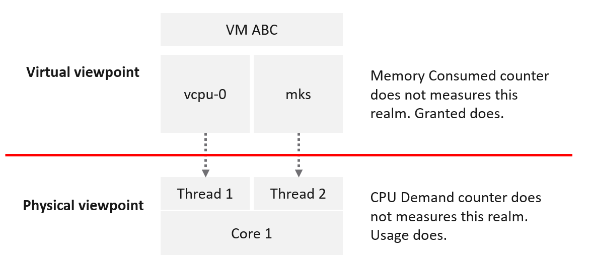
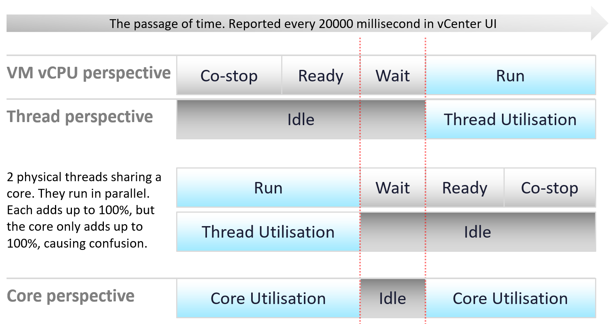
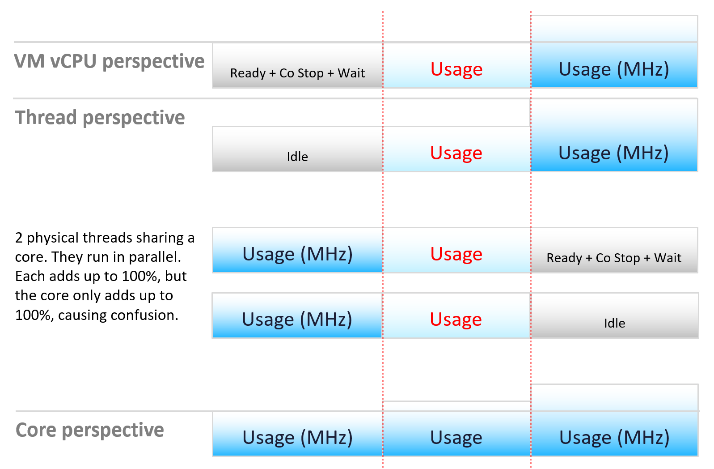
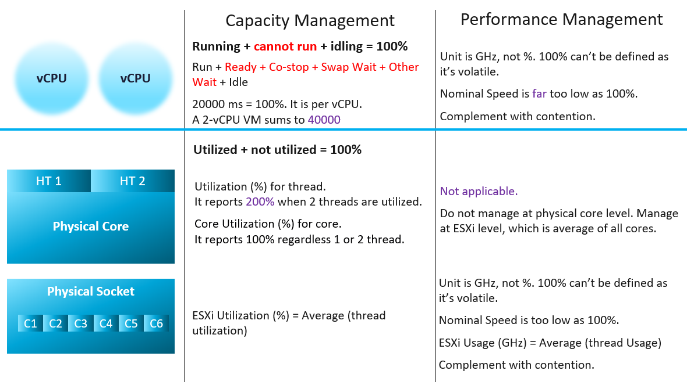

# CPU measurement levels: vCPU, thread, core

## ESXi is not VM + kernel

- VM and ESXi metrics come from different vantage points. They measure different things.
- So an ESXi CPU counter is not the sum of its VM counters plus the kernel.
- VM: consumer view. It sees the virtual layer. Example: 2 vCPUs, unaware of Hyper-Threading.
- VMs compete with one another but are unaware of one another.
- ESXi: provider view. It sees the physical layer. Example: 1 core with 2 threads, aware of Hyper-Threading.
- Ready and Wait do not apply to ESXi. A core either runs or is idle.
- The kernel has the highest priority. It practically does not experience contention.

## Three levels

| Level | Side | Behaviour |
|---|---|---|
| VM vCPU | Consumer | When it does not get the runtime it demands, the gap is accounted. Hence Ready and Co-stop. |
| ESXi thread | Provider | Physical thread of a core. Never experiences contention. It runs or it does not. |
| ESXi thread | Provider | Threads run in parallel. Each gets its own 100%. Two busy threads show 200% in esxtop. Not wrong, but read the core instead. |
| ESXi core | Provider | The core does the actual work, not the thread. A core registers 100%, not 50%, when only one of its threads runs. |

## Two meanings of thread
- Physical thread (hardware thread of a CPU core): a provider.
- Software thread (in the VMkernel, Windows, Linux): a consumer.
- Read the context before deciding which side a thread is on.

## Frequency and efficiency

- A running core can run at different frequency and efficiency.
- Usage (MHz) captures this. Read "Usage" as throughput: cycles completed.
- Two threads sharing a core run in parallel. Each thread adds up to 100%. The core adds up to 100%. This is the source of confusion.

## Capacity vs performance

| Level | Capacity management | Performance management |
|---|---|---|
| VM vCPU | Running + cannot run + idling = 100%. | Unit is GHz, not %. 100% cannot be defined: it is volatile. |
| VM vCPU | Run + Ready + Co-stop + Swap Wait + Other Wait + Idle = 100%. | Nominal speed is far too low as 100%. |
| VM vCPU | 20,000 ms = 100%, per vCPU. A 2-vCPU VM sums to 40,000 ms. | Complement with contention counters. |
| Physical core | Utilized + not utilized = 100%. | Not applicable. Do not manage at physical core level. |
| Physical core | Utilization (%) per thread. Reports 200% when 2 threads are utilized. | Manage at ESXi level: the average of all cores. |
| Physical core | Core Utilization (%). Reports 100% with 1 or 2 threads running. | - |
| ESXi (all sockets) | ESXi Utilization (%) = average of thread utilization. | Unit is GHz, not %. Nominal speed is too low as 100%. |
| ESXi (all sockets) | - | ESXi Usage (GHz) = average of thread Usage. Complement with contention counters. |

## Rules
- Capacity uses static counters. That is why % works as the unit.
- VM capacity: consumption of the configured vCPUs.
- ESXi capacity: utilization of the threads.
- CPU frequency is about performance, not capacity. So Usage and Demand are not used for capacity.
- Performance is about speed, not space. So CPU frequency must be included.
- CPU speed varies over time and among cores. The upper limit cannot be determined, so there is no 100%.
- Even where the limit could be determined, no API exposes it.
- So % cannot be the unit for performance.
- With no known upper limit, complement with contention counters (for example Ready and Overlap) to manage proactively.

## Traps
- "ESXi CPU = sum of VM CPU + kernel CPU" → different vantage points. The sum does not hold.
- "esxtop shows 200% on a core, so the core does 2x the work" → each thread reports its own 100%. Read Core Utilization.
- "Core Utilization 50% when one of two threads runs" → the core registers 100%.
- "Use Usage or Demand for capacity" → they include frequency. Capacity uses static counters (Run, Utilization).
- "Usage (%) near 100% means no headroom" → nominal speed is not the upper limit. Check contention counters.

## Metadata
```yaml
id: vsphere/cpu/concepts/cpu-measurement-levels
retriever_guide: how-it-works
scope: vsphere
technology:
- cpu
pillar:
- performance
- capacity
product:
- vsphere
object:
- VirtualMachine
- HostSystem
internal_derive:
- vsphere/foundations/provider-consumer
related:
- vsphere/cpu/concepts/vcpu-states
- vsphere/cpu/concepts/run-time-vs-run-quality
- vsphere/cpu/concepts/cpu-frequency
- vsphere/cpu/concepts/hyper-threading
- vsphere/cpu/metrics/host/core-utilization
- vsphere/cpu/metrics/host/utilization
- vsphere/cpu/metrics/host/usage
- vsphere/cpu/metrics/host/demand
- vsphere/cpu/metrics/comparisons/consumption-metrics
source:
  document: PART 3 - Counters.docx
  path: CPU > Architecture (pp. 52, 55-57) > Architecture intro; ESXi ≠ VM + Kernel
corrections: []
review_notes:
- "Section 'Three levels': author (2026-11-02): a physical thread of a CPU core is a provider. A software thread in an OS (VMkernel, Windows) is a consumer."
- "Section 'Capacity vs performance': the infographic says 'ESXi Usage (GHz) = Average (thread Usage)'. An average of GHz values is unusual; a sum is expected for GHz. Written as in the book. Author to confirm."
status: draft
```
