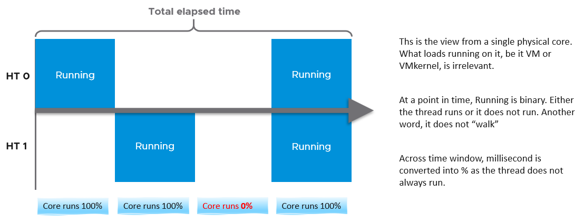
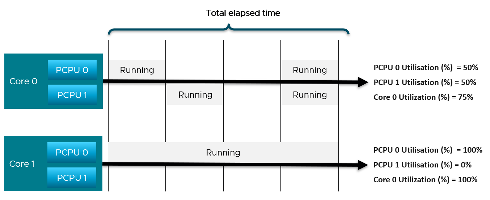
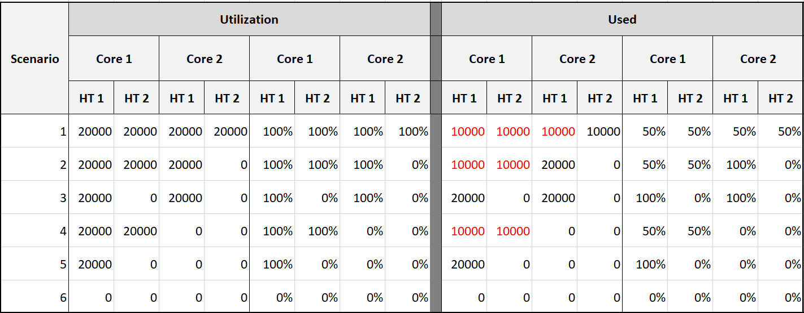
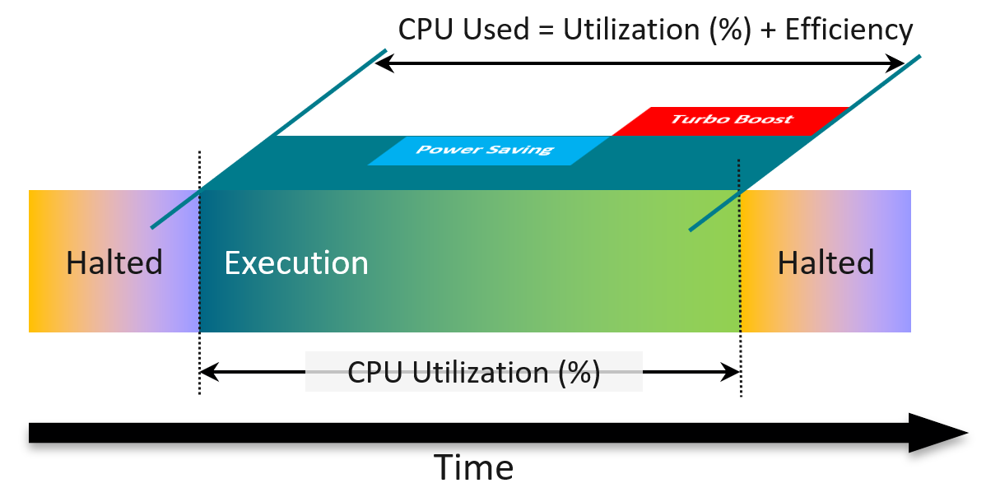
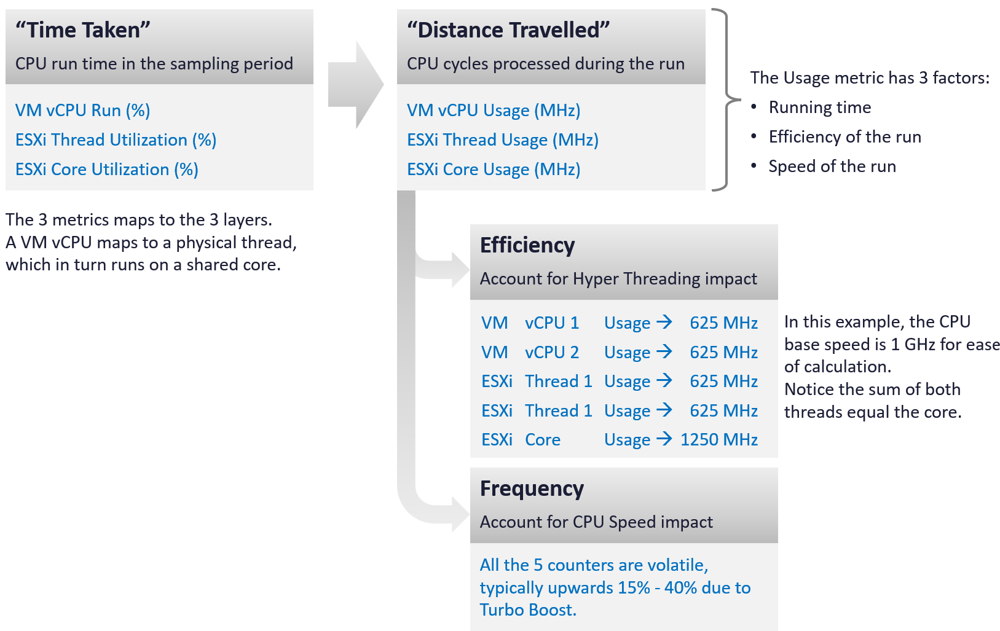

# ESXi CPU accounting: thread vs core

## Provider has no contention
- ESXi is the provider. A physical thread runs or is halted. It does not wait to be served.
- The consumer (VM) faces contention. So ESXi consumption metrics come first; ESXi contention metrics are sums of VM metrics.

## Time base
- Basic unit: 20,000 ms per sample (vCenter real-time).
- 20,000 ms = 100% at core level. The core keeps 20,000 ms whether Hyper-Threading is on or off.
- With Hyper-Threading, each thread is allocated 10,000 ms of Idle. A fully idle thread shows at most 10,000 ms Idle.
- A thread running alone can show Used up to 20,000 ms.
- At thread level: 100% Used = 20,000 ms, but 100% Idle = 10,000 ms. Thread-level values are confusing for this reason.
- Hyper-Threading and power management act at core level, not thread level. Rolling thread counters up to cores is complex.

## Thread Utilization
- The vCenter counter is named Utilization (%). Read it as Thread Utilization (%).
- The ESXi equivalent of VM CPU Run.
- Binary per moment: a thread is running (unhalted) or not (halted).
- Averaged over the sample. 50% means running half the time, not running at half speed.
- Ignores frequency and Hyper-Threading.
- Relevant only when Hyper-Threading is enabled. Without it, Thread Utilization equals Core Utilization.

## Core Utilization
- 100% when one thread runs. 100% when both run.

## Example: one core
- In 20 s, thread 0 runs 10 s, thread 1 runs 10 s, overlapping 5 s.


```text
Thread Utilization (HT 0) = 10 s / 20 s = 50%
Thread Utilization (HT 1) = 10 s / 20 s = 50%
Core Utilization          = 15 s / 20 s = 75%
```

- vSphere Client cannot select a core when Hyper-Threading is on. It lists PCPUs (threads).
- Core Utilization shown per thread is duplicated, not split. Both threads show the core value.
- Do not sum the 2 threads' Thread Utilization. Each is in the context of one thread.

## Example: ESXi with 2 cores
- Core 1: threads at 50% and 50% (core 75%). Core 2: threads at 100% and 0% (core 100%).


```text
Thread Utilization (ESXi) = (50% + 50% + 100% + 0%) / 4 = 50%
Core Utilization (ESXi)   = (75% + 100%) / 2          = 87.5%
```

- Thread Utilization counts each thread independently. It ignores that Hyper-Threading does not deliver 2x.
- So Core Utilization tends to be consistently higher than Thread Utilization.

## Imbalance signal
- Core Utilization below 2 × Thread Utilization: some cores run 2 threads while other cores are idle.
- A VM runs on as few cores as possible, not spread over all cores. Fewer context switches.

## Used per thread
- Used splits a core's time when both threads run: 10,000 ms each, not 20,000.
- ESXi considers Hyper-Threading to deliver 1.25x. The author finds 12,500 ms per thread easier to read.
- At ESXi level the split is normalized back.


| Scenario | Utilization (ms) C1-HT1, C1-HT2, C2-HT1, C2-HT2 | Used (ms) |
|---|---|---|
| 1 | 20000, 20000, 20000, 20000 | 10000, 10000, 10000, 10000 |
| 2 | 20000, 20000, 20000, 0 | 10000, 10000, 20000, 0 |
| 3 | 20000, 0, 20000, 0 | 20000, 0, 20000, 0 |
| 4 | 20000, 20000, 0, 0 | 10000, 10000, 0, 0 |
| 5 | 20000, 0, 0, 0 | 20000, 0, 0, 0 |
| 6 | 0, 0, 0, 0 | 0, 0, 0, 0 |

## Used and Usage vs Utilization
- Used is calculated from a hardware counter: Non-Halted Core Cycles (NHCC). Higher clock speed completes more cycles, so Used rises with Turbo.
- Used and Usage add 2 factors that Utilization ignores:
  - efficiency: a thread executes less efficiently when its sibling runs.
  - speed: power management lowers or raises the clock while running.
- A physical thread has no Overlap. System does not apply: it runs in the kernel.


## Time taken vs distance travelled
| Time taken (run time) | Distance travelled (cycles) |
|---|---|
| VM vCPU Run (%) | VM vCPU Usage (MHz) |
| ESXi Thread Utilization (%) | ESXi Thread Usage (MHz) |
| ESXi Core Utilization (%) | ESXi Core Usage (MHz) |

- A VM vCPU maps to a physical thread, which runs on a shared core.
- Example, 1 GHz base, both threads busy: each vCPU and each thread 625 MHz; the core 1,250 MHz. The 2 threads sum to the core.
- Usage has 3 factors: running time, efficiency of the run, speed of the run.
- The cycle-based counters are volatile: typically 15%-40% upward from Turbo Boost.


## Traps
- "Sum thread utilization to get core utilization" → each thread has its own 100%. Read Core Utilization.
- "Core Utilization shown on a PCPU is half the core" → it is duplicated on both threads.
- "Thread Idle 10,000 ms means half idle" → 10,000 ms is a fully idle thread with Hyper-Threading on.

## Metadata
```yaml
id: vsphere/cpu/concepts/esxi-thread-core-accounting
retriever_guide: how-it-works
scope: vsphere
technology:
- cpu
pillar:
- capacity
- performance
product:
- vsphere
object:
- HostSystem
internal_derive:
- vsphere/cpu/concepts/cpu-measurement-levels
- vsphere/cpu/concepts/cpu-efficiency
related:
- vsphere/cpu/metrics/host/utilization
- vsphere/cpu/metrics/host/core-utilization
- vsphere/cpu/metrics/host/used
- vsphere/cpu/metrics/host/usage
- vsphere/cpu/metrics/host/idle
- vsphere/cpu/metrics/comparisons/host-consumption-metrics
source:
  document: PART 3 - Counters.docx
  path: CPU > ESXi > Consumption Metrics > Core vs Thread; Thread Utilization; Used | Usage; Summary
corrections: []
review_notes:
- 'Section ''Time base'': the book states a thread running alone can reach 20,000 ms Used and that the author has not tested what the sibling thread then shows.'
status: draft
```
