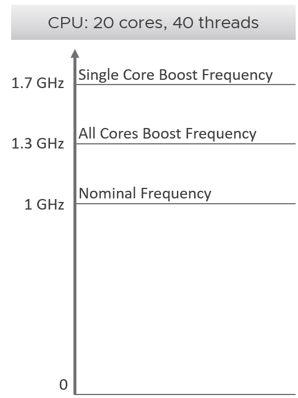
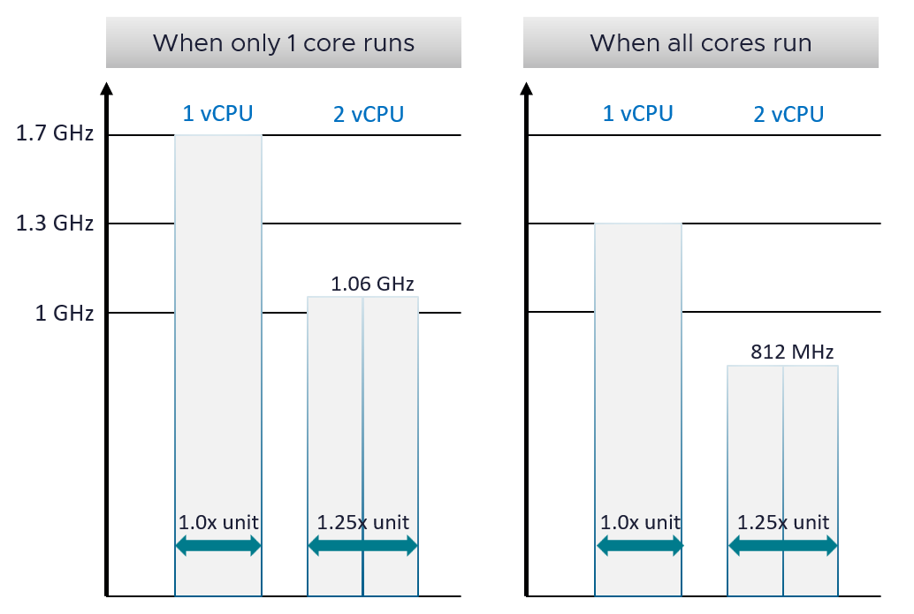
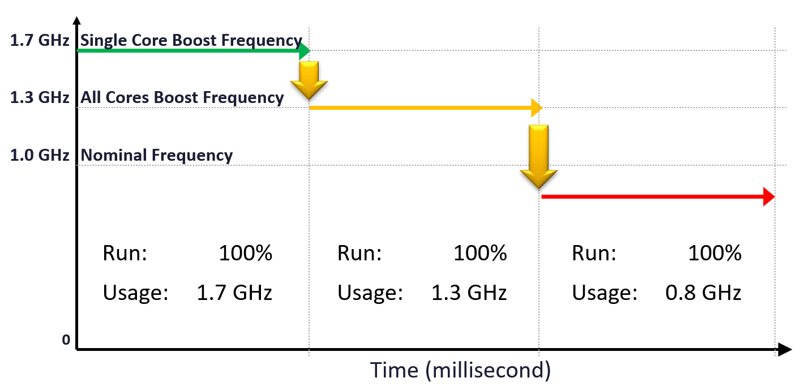

# Impact of frequency and Hyper-Threading on a VM

## Sample CPU

- 20 cores. Nominal clock speed 1 GHz, for ease of calculation.
- All 20 cores busy: 30% above nominal (1.3 GHz).
- One core busy: up to 70% above nominal (1.7 GHz).
- The vSphere Client shows the nominal speed and treats it as 100%.
- Using nominal speed as total capacity understates capacity.
- A real CPU with this boost profile: AMD EPYC 9634.

## Scenarios

- Assumption: the vCPU runs 100% with 0% contention.
- 2-vCPU cases assume both vCPUs land on the 2 threads of one core.

| Socket load | vCPUs | Throughput per vCPU | VM CPU Demand | Total |
|---|---|---|---|---|
| 1 core of 20 busy | 1 | 1.7 GHz | 170% | 1.7 GHz |
| 1 core of 20 busy | 2, same core | 1.06 GHz (1.7 × 0.625) | - | 2.12 GHz, not 3.4 GHz |
| All cores busy | 1 | 1.3 GHz | 130% | 1.3 GHz |
| All cores busy | 2, same core | 812 MHz (1.3 × 0.625) | about 81% | 1.625 GHz |

## Mechanism
- VM CPU Demand is based on the 1 GHz nominal speed. So it reports 170% or 130%.
- Demand above 100% suggests more vCPUs. Adding a vCPU can make it worse: the Hyper-Threading penalty applies when both vCPUs share a core.
- When all cores are busy, the chance that 2 vCPUs of one VM share a core rises.
- In the last case each vCPU runs at about 81% and the VM seems maxed out.

## Over time

- Run stays at 100% throughout.
- Throughput falls: 1.7 GHz → 1.3 GHz → 1.06 GHz → 0.81 GHz.
- Cause: VMs are added to the cluster over time, and the ESXi scheduler maximizes total throughput.
- A VM can run 100% for hours while the work it completes varies by the second. This is why VM performance feels unpredictable.
- CPU Usage (%) masks this degradation.

## Traps
- "Demand 170%, so add vCPUs" → the vCPU already runs on a boosted core. A second vCPU on the same core gets 0.625x.
- "Run 100% means constant performance" → throughput varies with frequency and Hyper-Threading.
- "2 vCPUs give 2x the throughput of 1 vCPU" → 2.12 GHz vs 1.7 GHz in the single-core case.
- "Usage (%) stable, so performance stable" → Usage (%) masks the drop in GHz.

## Metadata
```yaml
id: vsphere/cpu/concepts/frequency-and-ht-impact-on-vm
retriever_guide: how-it-works
scope: vsphere
technology:
- cpu
pillar:
- performance
- capacity
product:
- vsphere
object:
- VirtualMachine
internal_derive:
- vsphere/cpu/concepts/cpu-frequency
- vsphere/cpu/concepts/cpu-efficiency
- vsphere/cpu/concepts/run-time-vs-run-quality
related:
- vsphere/cpu/metrics/virtual-machine/usage
- vsphere/cpu/metrics/virtual-machine/run
- vsphere/cpu/concepts/cpu-measurement-levels
- vsphere/cpu/concepts/idle-and-unused-vcpus
images:
  - path: ../images/cpu-turbo-boost-example-nominal-all-core-single-core.png
    product: [vsphere]
    object: [HostSystem]
    topic: 'Turbo Boost'
    image_type: diagram
  - path: ../images/vcpu-throughput-one-core-vs-all-cores-running.png
    product: [vsphere]
    object: [VirtualMachine]
    topic: 'Turbo Boost'
    image_type: table
  - path: ../images/vm-cpu-run-flat-while-usage-falls-with-frequency.png
    product: [vsphere]
    object: [VirtualMachine]
    metric: ['VM CPU Run', 'VM CPU Usage']
    image_type: diagram
source:
  document: PART 3 - Counters.docx
  path: CPU > Architecture (pp. 77-78) > Impacts on VM
corrections: []
review_notes:
- "Section 'Scenarios': the 'Total' column is Claude's arithmetic from the book's per-vCPU values (2 × 0.8125 = 1.625 GHz)."
- "Section 'Scenarios': the book names VM CPU Demand (170%, 130%). No VM Demand metric file exists yet. Create it when the book's VM section is extracted."
- "Section 'Sample CPU': example CPU from the book: AMD EPYC 9634, https://www.amd.com/en/products/processors/server/epyc/4th-generation-9004-and-8004-series/amd-epyc-9634.html"
status: draft
```
