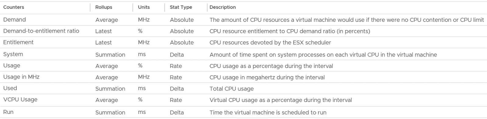

# CPU consumption metrics: VM and ESXi

## The choices
- VM: 5 consumption metrics: Run, Used, Usage, Usage (MHz), Demand.
- ESXi: 7 consumption metrics: Core Utilization, Utilization, Used, Usage, Usage (MHz), Consumed, Demand.

## Source of each
- ESXi provides Run (ms), Used (ms), Demand (MHz).
- vCenter adds Usage (MHz) and Usage (%).

## Reservation
- CPU reservation is on demand. It is not included in Run, Used, Demand or Usage.

## VM consumption counters (vCenter)
| Counter | Unit | Source | Instance |
|---|---|---|---|
| Run | ms | ESXi | vCPU (VM = sum of vCPUs) |
| Used | ms | ESXi | vCPU, VM |
| Usage | MHz | vCenter | vCPU, VM |
| Usage | % | vCenter | VM |
| Demand | MHz | ESXi | VM |

- VM-level Used and Usage include System time and other charges not tied to a vCPU. Summing vCPUs leaves a small gap to the VM value.
- vCenter lists 9 VM CPU consumption counters, including Demand-to-entitlement ratio, Entitlement, System and VCPU Usage. Some exist for the kernel scheduler, not for operations. Their names follow the scheduler's view.
- Reservation and allocation are properties, not metrics.
- VM CPU reservation is set in MHz or GHz, not in vCPUs. Moving the VM to a host with a different frequency requires a manual adjustment.


## Metadata
```yaml
id: vsphere/cpu/metrics/comparisons/consumption-metrics
retriever_guide: metric-meaning
scope: vsphere
technology:
- cpu
pillar:
- performance
- capacity
product:
- vsphere
object:
- VirtualMachine
- HostSystem
metric_class: consumption
internal_derive:
- vsphere/foundations/metric-sources
- foundations/metric-volume
same_name: []
same_meaning: []
related:
- vsphere/cpu/metrics/virtual-machine/run
- vsphere/cpu/metrics/virtual-machine/used
- vsphere/cpu/metrics/virtual-machine/usage
- vsphere/cpu/metrics/host/usage
- vsphere/cpu/metrics/host/demand
- vsphere/cpu/metrics/host/core-utilization
- vsphere/cpu/concepts/run-time-vs-run-quality
- vsphere/cpu/concepts/cpu-measurement-levels
- vsphere/cpu/metrics/virtual-machine/demand
- vsphere/cpu/metrics/virtual-machine/net-run
- vsphere/cpu/metrics/virtual-machine/system
- vsphere/cpu/metrics/virtual-machine/usage-disparity
- vsphere/cpu/metrics/comparisons/vm-vs-esxi-ht-ramp-test
source:
  document: PART 3 - Counters.docx
  path: The World of Metrics > Metrics Nuances > Complexity > Other Nuances; CPU > VM (pp. 78-118) > Consumption Metrics
corrections: []
review_notes:
- 'Section ''VM consumption counters (vCenter)'': from CPU > VM.'
status: draft
```
