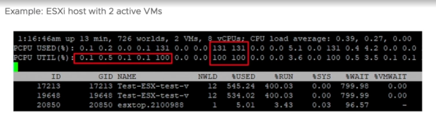
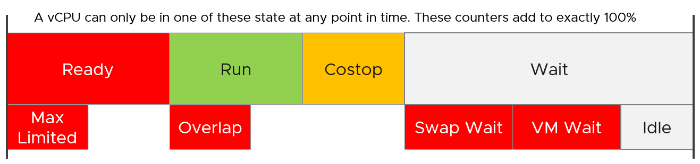
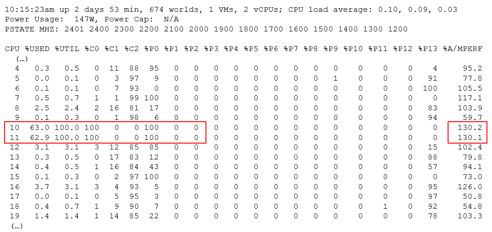

# esxtop CPU, power and interrupt counters

## Summary lines (provider view)
- Line 1: physical CPU load average over 1, 5 and 15 minutes.
- Then PCPU USED (%), PCPU UTIL (%) and CORE UTIL (%). Used builds on Utilization and is more complex.
- Used (%) can exceed 100% (example 131%) while Utilization maxes at 100%.
- Used (%) maps to vSphere Client Usage (%); Utilization (%) maps to Utilization (%).
- PCPU = hardware execution context: a core with SMT off, a thread with SMT on. Not a socket. 10 cores × 2 threads = 20 PCPUs.
- Each line ends with per-NUMA-node averages and AVG for the whole host: spots an overloaded NUMA node.


## Detail table (consumer view)
- Mixes VM and non-VM worlds. Non-VM worlds have Ready but no VM Wait.
- The system group shows high Ready because it contains the idle thread.

## State counters

| Counter | Meaning |
|---|---|
| %USED | Not a state: affected by power management and Hyper-Threading. |
| %RUN | Run. See `vsphere/cpu/metrics/virtual-machine/run`. |
| %SYS | System. See `vsphere/cpu/metrics/virtual-machine/system`. |
| %WAIT | Wait = %VMWAIT + %IDLE. %VMWAIT includes %SWPWT. |
| %VMWAIT, %SWPWT, %IDLE | Components of Wait. VCF Operations uses a VM Wait that excludes Swap Wait: different remediation. |
| %RDY | Ready, summed over vCPUs: can exceed 100%. |
| %CSTP | Co-stop, 100% per vCPU. |
| %OVRLP | Overlap. |
| %MLMTD | Max Limited: halted by a manual limit, not by lack of CPU. Limits should not be set. |

## Event counts
| Counter | Meaning |
|---|---|
| SWTCH/s | World switches per second. Lower is better. Likely correlates with overcommit, VM count and load. |
| MIG/s | NUMA and core migrations per second. |
| WAKE/s | Wake-ups per second (Wait to Ready). High values can hurt performance. |
- QEXP/s was removed in ESXi 6.5.
- Microbursts can make Ready high relative to Run: many scheduling events, each cheap. Check these counters.

## Summary stats
| Counter | Meaning |
|---|---|
| %LAT_C | CPU Latency. See `vsphere/cpu/metrics/virtual-machine/latency`. |
| %LAT_M | Memory Latency. See `vsphere/memory/metrics/virtual-machine/latency`. |
| %DMD | Demand. See `vsphere/cpu/metrics/virtual-machine/demand`. |
| EMIN | Minimum MHz the world gets when there is not enough for all. |
| TIMER/s | Timer rate of the world. |
| AFFINITY BIT MASK | Current scheduling affinity. Not set for Latency Sensitivity High VMs. |
| CPU | PCPU the world ran on (often blank). |
| EXC_AF | Yes: exclusive affinity (Latency Sensitivity). |
- HTQ (quarantine) is no longer shown since ESXi 7.0.
- Only EMIN to EXC_AF are absent from vSphere Client and VCF Operations.

## Allocation
| Counter | Meaning |
|---|---|
| AMIN | Reservation. |
| AMAX | Limit. |
| ASHRS | Shares. |
| AMLMT | Max limited. |
| AUNITS | MHz for VMs; percent for kernel modules. |

## Power
- Power stats (per VM and kernel module): POWER = current CPU power in watts (CPU only).
- Power panel (per PCPU): Power Usage (W) and Power Cap (hard limit, only when rack power is short). PSTATE MHZ lists the frequency per P-state.
| Counter | Meaning |
|---|---|
| %USED | Used (%). |
| %UTIL | Thread utilization, not core. |
| %CState, %PState, %TState | Time in each state. |
| %A/MPERF | Actual / nominal performance. Above 100%: Turbo. Below: power saving. Valid only in C0. Per PCPU, not per vCPU. Since ESXi 6.5; not in vSphere Client. |
- Example: PCPU 10 and 11 share core 6, both Utilization 100%, %A/MPERF 130%, C0 and P0. Used shows 63.0% and 62.9%: Used adds to 100% per core (50% per thread) × 130% Turbo = 65%.


## Interrupts
| Counter | Meaning |
|---|---|
| COUNT/s | Interrupts per second, all CPUs. |
| COUNT_x | Interrupts per second on CPU x. |
| TIME/int | Average processing time per interrupt (µs). |
| TIME_x | Average per interrupt on CPU x (µs). |
| DEVICES | Devices on the vector; angle brackets mean not enabled. |
- Device list: `sched-stats -t sys-service-stats` (service, count, time, name such as VMK-igbn-rxq0, TCPIPRX, Netpoll, SCSI).
- Some services are reported under VMK-timer, for example vDS IOChain.

## Traps
- "%RDY 300% is impossible" → summed over vCPUs.
- "%A/MPERF per VM" → per physical CPU only.

## Metadata
```yaml
id: vsphere/cpu/metrics/comparisons/esxtop-cpu
retriever_guide: metric-meaning
scope: vsphere
technology:
- cpu
- system
pillar:
- performance
product:
- vsphere
object:
- HostSystem
- VirtualMachine
metric_class: contention
internal_derive:
- vsphere/cpu/concepts/vcpu-states
- vsphere/cpu/concepts/esxi-thread-core-accounting
same_name: []
same_meaning: []
related:
- vsphere/system/concepts/esxtop
- vsphere/cpu/concepts/power-states
- vsphere/cpu/concepts/cpu-frequency
source:
  document: PART 3 - Counters.docx
  path: Provider Objects > esxtop > CPU
corrections: []
review_notes:
- 'Section ''Summary stats'': the book is unsure what the CPU column shows (always blank for the author) and whether AMLMT shows when a limit is applied.'
status: draft
```
