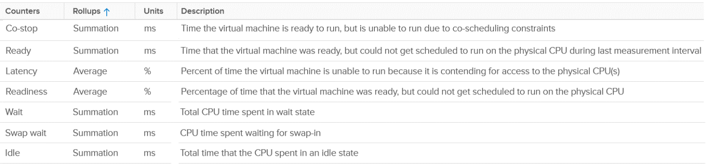

# ESXi CPU contention metrics

## The set
- vSphere Client host-level counters: Co-stop, Ready, Latency, Readiness, Wait, Swap wait, Idle.
- They are aggregates of the VMs. The host itself has no contention.
- Co-stop and Ready exclude contention faced by non-VM worlds.


## Lagging, not leading
- Averaged over all running VMs. By the time they are high, the problem is serious.
- Leading indicators are covered at cluster level (book: vSphere Cluster chapter).

## Why consumption and contention do not correlate at host level
- Physical vs virtual: ESXi metrics look at physical CPU; contention metrics look at vCPUs.
- Hyper-Threading and power management.
- Imbalance: many VMs on one host have different experiences.
- Limits, directly or through resource pools.
- CPU pinning (rare).
- Averaging hides peaks.

## Example
- Host total capacity 111 GHz. Demand reached 315%. Sum of VM CPU Usage reached 143%. Ready and Co-stop were high.
- Both exceed total capacity: Demand sums VM demand, and Usage includes Turbo above base frequency.
- Per-vCPU view: Ready of 128 s across 250 vCPUs = 514 ms per vCPU = about 2.5%.

## Traps
- "Host Ready is the host waiting" → it is the VMs' Ready summed.
- "Host contention low, so all VMs are fine" → averages hide individual VMs.

## Metadata
```yaml
id: vsphere/cpu/metrics/comparisons/host-contention-metrics
retriever_guide: metric-meaning
scope: vsphere
technology:
- cpu
pillar:
- performance
product:
- vsphere
object:
- HostSystem
metric_class: contention
internal_derive:
- vsphere/foundations/provider-consumer
same_name: []
same_meaning: []
related:
- vsphere/cpu/metrics/comparisons/vm-contention-metrics
- vsphere/cpu/metrics/virtual-machine/ready
- vsphere/cpu/metrics/virtual-machine/co-stop
source:
  document: PART 3 - Counters.docx
  path: CPU > ESXi > Contention Metrics
corrections: []
review_notes:
- 'Section ''Example'': the explanation of 315% and 143% combines the book''s reasons with the Demand and Usage behaviour from the same section.'
status: draft
```
