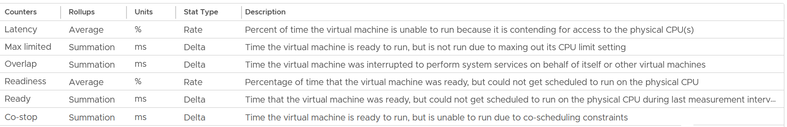
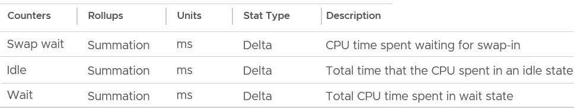

# VM CPU contention metrics compared

## The set
- vCenter has 6 VM CPU contention counters: Latency (%), Max Limited (ms), Overlap (ms), Readiness (%), Ready (ms), Co-stop (ms).
- Wait counters mix contention and consumption: Swap Wait (ms), Idle (ms), Wait (ms).
- VCF Operations adds Contention (%) and Other Wait (VM Wait).



## Which state each metric includes
| Component | Ready | Latency | Contention (VCF Operations, from July 2024) | Stable sum |
|---|---|---|---|---|
| Ready, not from limit | Yes | Yes | Yes | Yes |
| Ready from limit (Max Limited) | Yes | No | Yes | Yes |
| Co-stop | No | Yes | Yes | Yes |
| Overlap | No | Yes | Yes | Yes |
| Other Wait | No | No | Yes (if less than 1%) | Yes |
| Swap Wait | No | No | No (memory contention) | Yes |
| Hyper-Threading effect | No | Yes | No | No |
| Frequency below nominal | No | Yes | No | No |

- Stable sum = Ready + Co-stop + Overlap + Other Wait + Swap Wait. The book's more stable contention measure. All in ms.

## Ranking
- Ready and Co-stop are the main counters.
- Overlap and Other Wait usually show much lower values.
- Typical observation: Ready and Co-stop both very high, Overlap near 0.

## Context
- Judge contention against consumption. 2% Ready on 10% Run is bad. 2% Ready on 98% Run is good.
- Guest OS does not see Ready, Co-stop, Overlap, Other Wait or Swap Wait. Each is a freeze.
- Include all of them in Guest OS CPU sizing: runtime the guest demanded.
- If VM utilization is low, reduce vCPUs, following NUMA best practice.

## Choice
- Performance SLA: Ready.
- Troubleshooting CPU-sensitive VMs: Contention or Latency.
- Cluster performance: not Contention (includes limits). Not Latency alone (includes HT and frequency).

## Traps
- "Latency 0% and Contention 0% means no waiting" → a limit is excluded from Latency. Check Ready.
- "The vCPU states metrics are independent" → Ready on one vCPU causes Co-stop on its siblings.

## Metadata
```yaml
id: vsphere/cpu/metrics/comparisons/vm-contention-metrics
retriever_guide: metric-meaning
scope: vsphere
technology:
- cpu
pillar:
- performance
product:
- vsphere
- vcf-operations
object:
- VirtualMachine
metric_class: contention
internal_derive:
- vsphere/cpu/concepts/vcpu-states
same_name: []
same_meaning: []
related:
- vsphere/cpu/metrics/virtual-machine/ready
- vsphere/cpu/metrics/virtual-machine/co-stop
- vsphere/cpu/metrics/virtual-machine/overlap
- vsphere/cpu/metrics/virtual-machine/other-wait
- vsphere/cpu/metrics/virtual-machine/swap-wait
- vsphere/cpu/metrics/virtual-machine/latency
- vsphere/cpu/metrics/virtual-machine/contention
- vsphere/cpu/diagnosis/vm-cpu-contention-high
source:
  document: PART 3 - Counters.docx
  path: CPU > VM (pp. 78-118) > Contention Metrics; Wait Metrics
corrections: []
review_notes:
- 'Section ''Which state each metric includes'': assembled by Claude from the book''s Ready, Co-stop, Overlap, Contention and Latency sections and diagrams.'
status: draft
```
