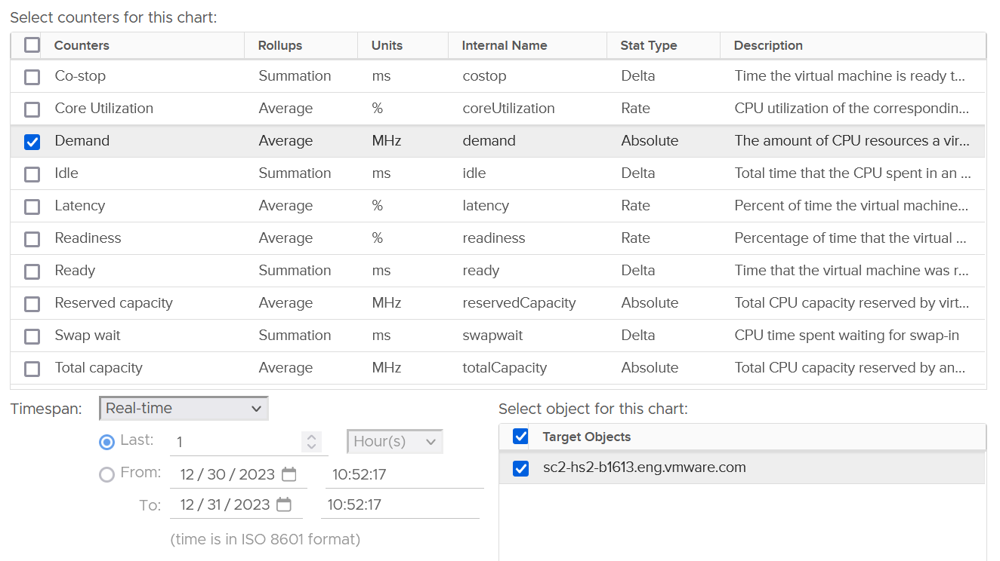

# ESXi CPU Demand

## Meaning
- A provider metric.
- Not the sum of VM worlds plus VMkernel worlds.
- An internal metric of the CPU scheduler: the ideal total demand had there been no contention at all.

## Behaviour
- Internal counter of the kernel CPU scheduler. The kernel knows Hyper-Threading costs performance, so Demand looks at a different context from Utilization and Used.
- Value at ESXi: summation over the VMs, not over physical threads. So it is not available per core or thread.
- Can exceed 500%. Example: a host running flat out with Usage (%) above 100%; Demand 4.7x higher.
- Includes reservations of running VMs and of the kernel. Usage includes actual use by running VMs and the kernel.
- Host with no VMs: Demand near 0, or flat at the kernel reservation. Example: flat 10.21% for weeks, equal to Overhead (MHz). Usage is not 0: it includes kernel work such as vSAN and NSX.
- Kernel reservation below kernel use: Demand below Usage.
- Once VMs share cores, Demand is higher than Usage.
- Not capped at 100%.


## Traps
- "ESXi Demand = VM usage + kernel usage" → wrong. Demand counts VM demand and reservations, not usage.
- "Demand above 300% means the host is 3x overloaded" → Demand sums VM demand and reservations. Check contention.
- "Host with no VMs has 0 Demand" → kernel reservation shows as Demand.

## Metadata
```yaml
id: vsphere/cpu/metrics/host/demand
retriever_guide: metric-meaning
scope: vsphere
technology:
- cpu
pillar:
- performance
- capacity
product:
- vsphere
object:
- HostSystem
metric_class: consumption
internal_derive:
- vsphere/foundations/provider-consumer
same_name: []
same_meaning: []
related:
- vsphere/cpu/metrics/comparisons/consumption-metrics
- vsphere/cpu/concepts/esxi-thread-core-accounting
- vsphere/cpu/metrics/comparisons/host-consumption-metrics
- vsphere/cpu/metrics/host/reserved-capacity
source:
  document: PART 3 - Counters.docx
  path: The World of Metrics > Metrics Nuances > Virtualization Impact; CPU > ESXi > Demand
corrections:
- '2026-11-02: ESXi CPU Demand is a provider metric (section: Meaning). Not answered in the uploaded document.'
review_notes:
- 'Section Behaviour: from CPU > ESXi.'
- 'Section ''Behaviour'' vs the correction in this file: the ESXi section calls Demand consumer-view and the sum of VMs; the author''s correction calls ESXi Demand a provider metric. Open question in docs/todo.md.'
status: draft
```
