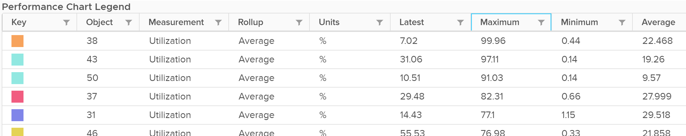

# ESXi Peak CPU Core Usage (VCF Operations)

## Meaning
- The highest CPU Usage among the physical cores of the host.

## Why
- ESXi-level utilization is an average. A host with 72 cores has 144 threads. One hot core is invisible in the average.
- Example: 3 threads above 90% while the host total hovered around 1,100% of a possible 5,600% (56 threads): about 20%.
- Imbalance among cores is normal: a VM runs on as few cores as possible, which takes fewer context switches.


## Design
- Max() is used, not the 95th percentile. Both lead to the same remediation, and Max() warns earlier.
- Which core is hot does not matter. Cores can take turns. The conclusion is the same.
- A constantly high value: one or more cores are highly utilized.
- No separate imbalance value among cores: imbalance is expected when utilization is not high.

## Traps
- "Host average 20%, so no core is busy" → check the peak core.

## Metadata
```yaml
id: vsphere/cpu/metrics/host/peak-core-usage
retriever_guide: metric-meaning
scope: vsphere
technology:
- cpu
pillar:
- performance
product:
- vcf-operations
object:
- HostSystem
metric_class: consumption
internal_derive: []
same_name: []
same_meaning: []
related:
- vsphere/cpu/metrics/host/usage
- vsphere/cpu/metrics/host/imbalance
- vsphere/cpu/concepts/esxi-thread-core-accounting
source:
  document: PART 3 - Counters.docx
  path: CPU > ESXi > Consumption Metrics > Thread Utilization > Peak Core CPU Usage
corrections: []
review_notes: []
status: draft
```
