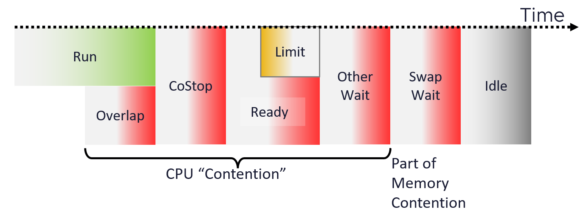

# VM CPU Contention (VCF Operations)

## Meaning
- Time the vCPU does not get CPU time.
- A VCF Operations metric. Before July 2024 it mapped to CPU Latency. From July 2024 it has its own formula.

## Formula (from July 2024)
```text
Contention (%) = Overlap + Co-stop + Ready + Other Wait (if less than 1%)
```


## Mechanism
- CPU frequency does not apply: the vCPU is not running.
- In most cases the value comes from Ready. Contention is often almost identical to Ready.
- Includes Ready caused by a limit. Reason: separate what from why. The VM faces contention; the cause (limit, shares, host load) is a separate question.
- Swap Wait is excluded. It belongs to memory contention.

## Limitation
- Because it includes limit, it cannot measure ESXi or cluster performance. A limit is unrelated to the cluster.

## Traps
- "Contention = Latency" → true only before July 2024.
- "High Contention means the cluster is overloaded" → a limit can cause it.

## Metadata
```yaml
id: vsphere/cpu/metrics/virtual-machine/contention
retriever_guide: metric-meaning
scope: vsphere
technology:
- cpu
pillar:
- performance
product:
- vcf-operations
object:
- VirtualMachine
metric_class: contention
internal_derive:
- vsphere/cpu/concepts/vcpu-states
same_name: []
same_meaning: []
related:
- vsphere/cpu/metrics/virtual-machine/ready
- vsphere/cpu/metrics/virtual-machine/latency
- vsphere/cpu/metrics/virtual-machine/overlap
- vsphere/cpu/metrics/virtual-machine/co-stop
- vsphere/cpu/metrics/virtual-machine/other-wait
- vsphere/cpu/metrics/comparisons/vm-contention-metrics
- vsphere/cpu/diagnosis/vm-cpu-contention-high
source:
  document: PART 3 - Counters.docx
  path: CPU > VM (pp. 78-118) > Contention Metrics > Contention
corrections: []
review_notes:
- 'Section ''Formula'': meaning of ''(if less than 1%)'' for Other Wait is unclear. Open question in docs/author-questions.md.'
- 'Section ''Meaning'': the book''s Latency section describes a Contention value that excludes limit. That is read as the pre-July-2024 mapping to Latency. Open question in docs/author-questions.md.'
status: draft
```
