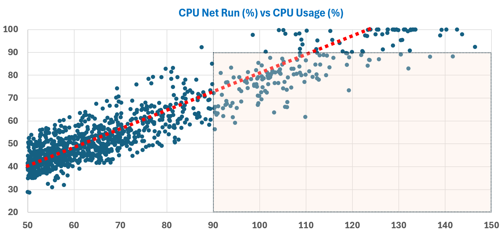

# VM CPU Usage

## Hyper-Threading
- Scenario: two vCPUs run on the two threads of the same physical core at the same time.
- VM Usage is HT-aware. When both threads run, the VM is charged a 37.5% penalty, so it shows about 62.5%.
- The VM cannot see the core or its two threads. ESXi can.
- The host view of the same core: see `vsphere/cpu/metrics/host/usage`.

## Cap
- VM CPU Usage (MHz) is not capped.

## Reservation
- CPU reservation is on demand. It is not included in Usage.

## Throughput
- Usage (MHz) counts cycles completed. Read it as throughput.
- The author's name for this metric: CPU Throughput.
- It includes frequency (Turbo, power management) and Hyper-Threading efficiency.
- It includes IO processing done by the hypervisor on behalf of the VM. Significant for heavy databases and NSX Edge.
- It is a performance metric, not a capacity metric: 100% cannot be defined.

## Masked degradation
- At Run 100%, throughput per vCPU can fall from 1.7 GHz to 0.81 GHz as the host fills up (sample CPU, 1 GHz nominal).
- Usage (%) masks this degradation.
- See `vsphere/cpu/concepts/frequency-and-ht-impact-on-vm`.

## Formula
```text
Usage = Used + work done by the kernel on behalf of the VM
Usage (%) = (sum of Usage (MHz) of each vCPU + VM-level load) / VM static CPU speed
```
- Gap to Used grows on VMs processing many network packets or storage commands.
- Usage (%): VM level only. Usage (MHz): vCPU and VM level.
- Both exist only in vCenter, not in ESXi.
- Usage (%) and Usage (MHz) are very similar but not always identical. The book's guess: Usage (%) contains VMX load.

## Turbo example
- One 24-vCPU VM fills a host: 12 cores, 2.4 GHz nominal, HT on. VM at about 100%.
- No Turbo: 12 × 2.4 GHz × 1.25 = 36 GHz. Not 57.6 GHz (24 × 2.4): HT yields 1.25x, not 2x.
- With Turbo (1.08x all-core): 12 × 2.4 × 1.25 × 1.08 ≈ 39 GHz.
- Turbo disabled during the test: Usage dropped to just below 36 GHz.
- Usage (MHz) can exceed total capacity. Total capacity is based on base clock speed.

## Usage vs Run at scale
- 1,102 VMs with Usage above 2 GHz and above 50%: Usage tends to be 25% higher than Run.
- VMs with Usage above 90% and Run below 90% are likely to be upsized without reason.


## Traps
- "VM shows 62.5%, so the metric is wrong" → wrong. Different vantage point from the host.
- "Each VM gets only 62.5% of what it demands" → the 62.5% is an accounting charge for sharing a core.
- "Use Usage for capacity" → it includes frequency. Use Run for capacity.
- "Usage (%) above 90%, so add vCPUs" → check Run. Turbo inflates Usage.
- "Usage (MHz) cannot exceed the VM capacity" → Turbo pushes it above.

## Metadata
```yaml
id: vsphere/cpu/metrics/virtual-machine/usage
retriever_guide: metric-meaning
scope: vsphere
technology:
- cpu
pillar:
- performance
- capacity
product:
- vsphere
object:
- VirtualMachine
metric_class: consumption
internal_derive:
- vsphere/cpu/concepts/hyper-threading
- vsphere/foundations/provider-consumer
- vsphere/cpu/concepts/run-time-vs-run-quality
- vsphere/cpu/concepts/cpu-frequency
same_name:
- vsphere/cpu/metrics/host/usage
same_meaning: []
related:
- vsphere/cpu/metrics/comparisons/consumption-metrics
- vsphere/cpu/metrics/host/core-utilization
- vsphere/cpu/concepts/frequency-and-ht-impact-on-vm
- vsphere/cpu/concepts/cpu-efficiency
- vsphere/cpu/concepts/guest-os-vs-vm-cpu
- vsphere/cpu/metrics/virtual-machine/net-run
- vsphere/cpu/metrics/virtual-machine/demand
- vsphere/cpu/metrics/virtual-machine/usage-disparity
- vsphere/cpu/diagnosis/oversized-vm-downsizing
source:
  document: PART 3 - Counters.docx
  path: The World of Metrics > Metrics Nuances > Complexity > Naming Complexity; CPU > Architecture (pp. 52-78) > Guest OS vs VM; ESXi ≠ VM + Kernel; CPU Throughput; Impacts on VM; CPU > VM (pp. 78-118) > Consumption Metrics > Used | Usage > Usage
corrections:
- '2026-11-02: Hyper-Threading scenario (section: Hyper-Threading) rewritten from the author. The uploaded document sentence is truncated.'
review_notes:
- The 37.5% penalty is from the author. Not found in Performance Best Practices for vSphere 9.1.
- Sections Throughput, Masked degradation, and the last trap: from CPU > Architecture.
- 'Sections Formula, Turbo example, Usage vs Run at scale: from CPU > VM.'
status: draft
```
