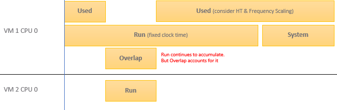

# VM CPU Used

## Meaning by instance
- Per-vCPU instance: excludes System time.
- VM aggregate: includes System time.
- Pattern: same name, same object, different formula.

## Why
- System time is charged at VM level. It does not exist at vCPU level.
- See `vsphere/foundations/kernel-worlds` for work charged to the VM rather than to a vCPU.

## Notes
- The author states CPU Used is buggy. Do not build conclusions on it alone.

## Fair Share Scheduler
- The scheduler charges each vCPU with Used, not Run, to keep relative fairness.
- Used adjusts Run for:
  - a shared physical core (Hyper-Threading): Used goes down. Used is lower than Run.
  - CPU frequency.
  - hypervisor IO done on behalf of the vCPU: Used is decreased.
- See `vsphere/cpu/concepts/run-time-vs-run-quality`.

## Hyper-Threading examples
| Scenario | Run | Used |
|---|---|---|
| Two VMs share a core, each runs half the time, half of it overlapping | 50% | 40.625% |
| Both threads busy all the time | 100% | 62.5% |
- See `vsphere/cpu/concepts/cpu-efficiency`.

## Formula
```text
Used (VM)   = Run - Overlap ± E + System + VMX + MKS + Helper
Used (vCPU) = Run - Overlap ± E
```
- E combines:
  - Turbo Boost gain. Can be 50% more when other cores in the socket are idle.
  - power-saving loss. Frequency at 40% of nominal: 60% of the CPU time counts as stolen.
  - SMT loss: 37.5%. ESXi records Hyper-Threading as 1.25x per core, so each thread gets 62.5%.


## Worlds charged to the VM
| World | Work | Size |
|---|---|---|
| MKS | Console: video frame buffer, mouse, keyboard, console graphics. | Typically negligible. |
| VMX | VM power states, configuration changes, high-level virtual hardware emulation. In esxtop, System time is charged to the VMX world. | - |
| Helper | Asynchronous IO helper worlds, virtual storage controllers, background kernel threads for the VM. | Negligible. |

## Unit
- Used accounts for actual frequency but is reported in ms.
- Conversion from cycles to ms uses the static (nominal) frequency.
- Example, nominal 2 GHz: at 3 GHz Used is 50% higher than Run. At 1.5 GHz Used is 25% lower than Run.
- Older Guest OS versions report on the nominal speed, like Run.

## Use cases
- Amount of work done.
- VM migration: the destination host must absorb the real footprint.
- Chargeback: charge the full cost of the VM, based on actual utilization, not rated clock speed.

## Traps
- "Sum of per-vCPU Used equals VM Used" → the VM value includes System time; the per-vCPU values do not.
- "Used lower than Run means the VM received less runtime" → Used is a charge adjusted for shared core, frequency and hypervisor IO.

## Metadata
```yaml
id: vsphere/cpu/metrics/virtual-machine/used
retriever_guide: metric-meaning
scope: vsphere
technology:
- cpu
pillar:
- performance
- capacity
product:
- vsphere
object:
- VirtualMachine
instance:
- aggregate
- per-vcpu
metric_class: consumption
internal_derive:
- vsphere/foundations/kernel-worlds
- vsphere/cpu/concepts/run-time-vs-run-quality
- vsphere/cpu/concepts/cpu-efficiency
same_name:
- vsphere/cpu/metrics/host/used
same_meaning: []
related:
- vsphere/cpu/metrics/comparisons/consumption-metrics
- vsphere/cpu/metrics/virtual-machine/run
- vsphere/cpu/metrics/virtual-machine/system
- vsphere/cpu/metrics/virtual-machine/overlap
- vsphere/cpu/diagnosis/run-vs-used-gap
source:
  document: PART 3 - Counters.docx
  path: The World of Metrics > Metrics Nuances > Complexity > Naming Complexity; CPU > Architecture (pp. 52-78) > Fair Share Scheduler; CPU Efficiency; CPU > VM (pp. 78-118) > Consumption Metrics > Used | Usage > Used
corrections:
- '2026-11-02: Author states the CPU Used metric is buggy. The row ''VM Used HT penalty 37.5% vs ESXi Used 50%'' was removed (section: Notes).'
review_notes:
- Sections Fair Share Scheduler, Hyper-Threading examples, and the last trap: from CPU > Architecture.
- 'Sections Formula, Worlds charged to the VM, Unit, Use cases: from CPU > VM.'
status: draft
```
