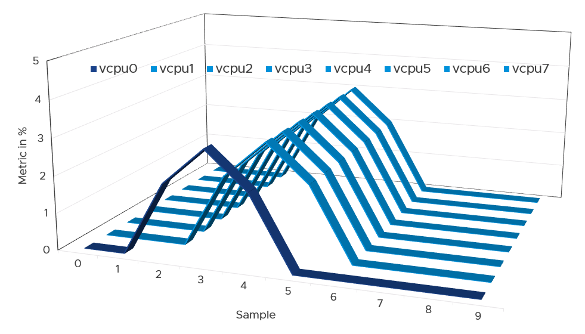
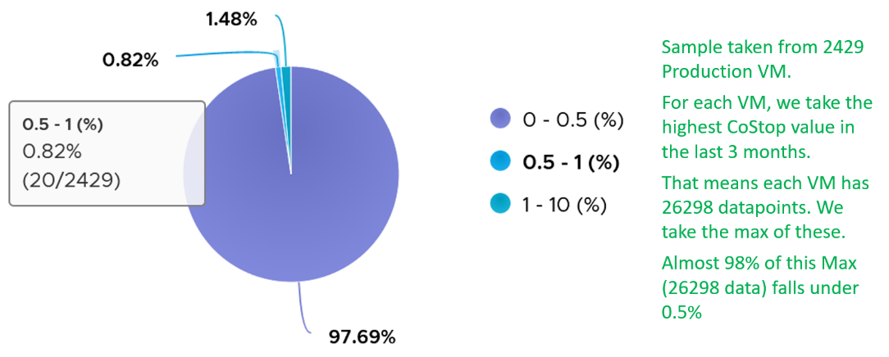

# VM CPU Co-stop

## Meaning
- Time a vCPU is paused because it is too far ahead of a sibling vCPU of the same VM.
- Contention metric. Unit: ms (summation over the sample period).

## Mechanism
- The kernel can run some vCPUs of a VM when it does not have physical threads for all of them.
- A running vCPU that gets too far ahead of a sibling that cannot be served (in Ready) is stopped.
- Reason: keep the vCPUs close enough in progress to prevent a Guest OS crash.
- Typical chain: one vCPU hits Ready. The others are co-stopped until all vCPUs are co-started.
- The co-stopped vCPUs stop even when physical threads are free for them.


## Scope
- Applies only to multi-vCPU (SMP) VMs. The Guest OS kernel runs parallel threads.
- Always 0 on a 1-vCPU VM.
- Tends to be higher on VMs with more vCPUs.

## Causes
- Ready on a sibling vCPU.
- Snapshots (Broadcom KB 2000058).
- VM size relative to the NUMA boundary.

## Effect on the Guest OS
- Same as Ready: a freeze. The Guest OS cannot tell the cause.
- Include Co-stop in Guest OS CPU sizing: it is runtime the guest demanded.

## Values
- In a high-performing environment Co-stop stays below 1%.
- Observation: 2,429 production VMs, highest Co-stop per VM over 3 months (26,298 data points each). 97.69% of VMs stayed below 0.5%. 0.82% were 0.5-1%. 1.48% were 1-10%.
- Co-stop tends to be smaller than Ready.
- Ready and Co-stop may or may not correlate with Usage.


## Traps
- "Co-stop is caused by ESXi, like Ready" → Co-stop is caused by the VM's own vCPUs drifting apart. Reduce VM size.
- "Co-stopped vCPUs had no physical thread" → threads can be free. The vCPU is held back to stay in step.
- "Co-stop applies to a 1-vCPU VM" → always 0.

## Metadata
```yaml
id: vsphere/cpu/metrics/virtual-motherboard/co-stop
retriever_guide: metric-meaning
scope: vsphere
technology:
- cpu
pillar:
- performance
product:
- vsphere
object:
- VirtualMachine
layer:
- virtual-motherboard
metric_class: contention
internal_derive:
- vsphere/cpu/concepts/vcpu-states
same_name: []
same_meaning: []
related:
- vsphere/cpu/metrics/virtual-motherboard/ready
- vsphere/cpu/metrics/comparisons/vm-contention-metrics
- vsphere/cpu/concepts/guest-os-vs-vm-cpu
- vsphere/cpu/concepts/cpu-topology
images:
  - path: ../../images/vm-cpu-vcpu0-ready-causes-sibling-vcpus-costop.png
    product: [vsphere]
    object: [VirtualMachine]
    metric: ['VM CPU Ready', 'VM CPU Co-stop']
    image_type: timeline
  - path: ../../images/vm-cpu-costop-highest-value-distribution-across-vms.png
    product: [vsphere]
    object: [VirtualMachine]
    metric: ['VM CPU Co-stop']
    image_type: distribution
    sample: '2,429 VMs'
source:
  document: PART 3 - Counters.docx
  path: CPU > VM (pp. 78-118) > Contention Metrics > Co-stop
corrections: []
review_notes:
- 'Section ''Values'': the 1% value is the book''s best practice, based on about 64 million data points (2,429 VMs × 26,298).'
status: draft
```
