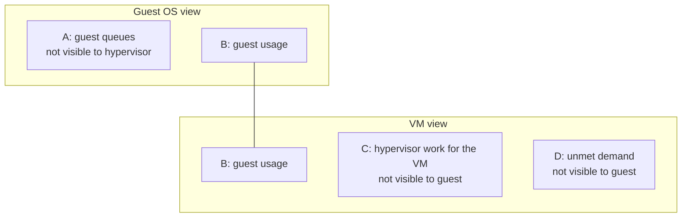

# Visibility layers: Guest OS view vs VM view

## Definition
- Guest OS and VM see different parts of the same resource activity.
- Each layer has visibility the other layer does not have.
- Important: "demand" and "usage" here are plain-English words.
  - They are NOT the vSphere or VCF Operations metrics with the same names.
  - Those metrics were created for different purposes.

## The four areas

| Area | What it is | Visible to Guest OS | Visible to hypervisor |
|---|---|---|---|
| A | Queues inside the Guest OS: CPU run queue, RAM page file, disk queue length, driver queue, network card ring buffer. | Yes | No |
| B | What the Guest OS uses. | Yes | Yes |
| C | Work done by the hypervisor for the VM, outside the guest: CPU System, CPU MKS, CPU VMX, RAM Overhead, Disk Snapshot. [author-correction 2026-11-02: not "overhead" in the strict sense] | No | Yes |
| D | Unmet demand: CPU Ready, CPU Co-Stop, CPU Overlap, CPU VM Wait, RAM Contention, VM Outstanding IO. | No (Guest OS only experiences frozen time or slowness, cannot account for it) | Yes |

## Formula
```text
Guest OS view:  usage  = B
                demand = A + B
VM view:        usage  = B + C
                demand = B + C + D
```



## Area details
- A: these requests have not been sent to the hypervisor yet.
  - Example: Oracle sends IO to Windows. The Windows storage subsystem is full. Windows does not pass the IO down.
  - Result: VM-level disk IOPS under-reports demand.
- B: Guest OS CPU utilization roughly translates into VM CPU Run.
  - The two are calculated independently, likely sampled at different times, with different rollup techniques.
- C: VMware Tools adds new metrics inside Windows/Linux for some visibility.
  - Tools does not modify existing Windows/Linux metrics. Those remain unaware of virtualization.
- D: The guest experiences frozen time or slowness, but cannot identify or account for it.

## Consequences for metrics
- You size the Guest OS, but you reclaim the VM.
  - Sizing uses what happens inside the VM.
  - Reclamation uses the footprint on ESXi (outside the VM).
- Normal VM-level metrics do not prove the full IO path is healthy. Area A is invisible to the hypervisor.
- Applications that manage their own resources (Java VM, databases) add another layer not shown here.
- Containers add yet another virtualization layer.

## Traps
- "VM disk IOPS and latency are normal, so storage is not the problem" while the guest disk queue is high → incomplete. The IO may still be queued in area A.
- Equating the plain-English demand/usage above with the vSphere Demand/Usage metrics → wrong.

## Reference
- Detailed scientific treatment: Benjamin Serebrin and Daniel Hecht, https://link.springer.com/chapter/10.1007%2F978-3-642-29737-3_26
