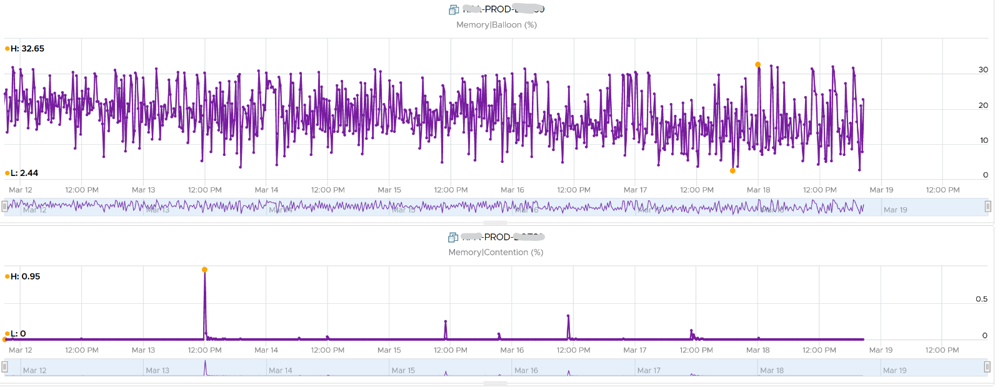

# Ballooning

## Mechanism
- The balloon is a kernel driver inside the Guest OS. It takes instructions from the VMkernel to inflate or deflate.
- Inflate: the driver asks the Guest OS to allocate memory to it. ESXi does not back that memory with physical pages, so other VMs can use it.
- Deflate: when ESXi is no longer under memory pressure, it tells the driver to release its pages inside the Guest OS. The VM Balloon counter returns to 0.
- Purpose: proactive. Reduces the chance of the Guest OS paging.
- The Guest OS initiates the reallocation. So Balloon Target can be 0 while Ballooned is still above 0.
- Balloon Target above 0: the hypervisor has asked this VM to give back memory through the balloon driver.
- A 1 GB balloon does not free 1 GB in ESXi when the pages were shared (TPS). It can be less.
- The Guest OS allocates to the balloon from Free pages first, then Cache, then Modified, then In Use.
- The Guest OS must have enough swap space configured for ballooning.
- How much is requested depends on the Idle Memory Tax. The book advises against changing it.

## Performance impact
- Ballooning by itself does not cause a performance problem.
- A problem occurs when Windows or Linux requests a ballooned page again.
- The more ballooned, swapped and compressed, the higher the chance of a future performance hit.
- Severity depends on VM shares, reservation, limit and configured RAM. 10 MB ballooned hurts a 4 GB VM more than a 512 GB VM.
- Example: a 16 GB VM with 10,430 MB ballooned (63.66%) for 4 weeks, flat. The Guest OS never requested those pages; it worked within the remaining 6 GB. Granted + Swapped + Compressed was a flat line.


## Capacity impact
- A balloon is a request from ESXi, not from the application. Exclude it from Guest OS sizing.
- It distorts Guest OS sizing, and there is no way to measure the distortion.
- Guest OS In Use rises when the balloon allocates: the driver is treated like any process.
- Pages taken from Free: deduct the balloon from In Use.
- Pages taken from In Use: In Use does not change; the Guest OS pages out. Add Page Out or Cache back.

## Ballooned vs compressed and swapped
- ESXi knows nothing of free memory inside the guest. Compression and swapping pick pages at random. Ballooning lets the guest choose.
- Balloon can be 0 while Compressed or Swapped are above 0, although ballooning comes first in the reclamation order.
- Reason: past pressure. Compressed and swapped data is not brought back until requested (it costs CPU). The balloon deflates proactively when pressure ends.

## Traps
- "Ballooned 10 GB, so the guest is slow" → only requested pages cause a hit. Check Latency.
- "Balloon frees exactly its size in ESXi" → shared pages free less.
- "Include ballooned memory in Guest OS sizing" → exclude it.

## Metadata
```yaml
id: vsphere/memory/concepts/ballooning
retriever_guide: how-it-works
scope: vsphere
technology:
- memory
pillar:
- performance
- capacity
product:
- vsphere
object:
- VirtualMachine
internal_derive:
- vsphere/memory/concepts/memory-layers
- vsphere/memory/concepts/overcommit-techniques
related:
- vsphere/memory/metrics/virtual-machine/ballooned
- vsphere/memory/metrics/virtual-machine/balloon-target
- vsphere/memory/concepts/swap-and-compression
- vsphere/memory/metrics/virtual-machine/latency
source:
  document: PART 3 - Counters.docx
  path: Memory > VM > Contention Metrics > Balloon; Swap + Compress > Balloon
corrections: []
review_notes:
- 'Section ''Mechanism'': Idle Memory Tax is the Mem.IdleTax setting (Claude''s own knowledge).'
status: draft
```
