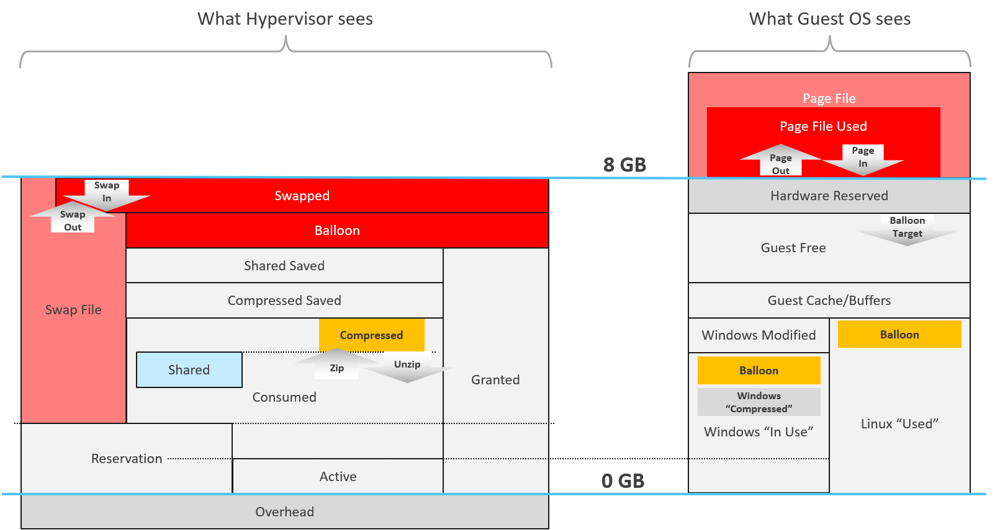
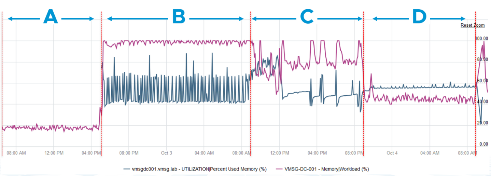
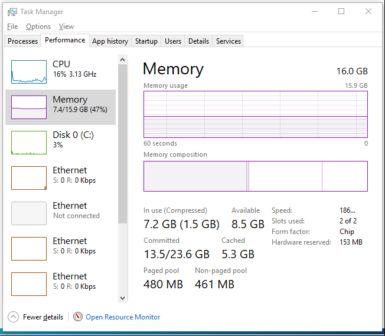

# Guest OS memory vs VM memory

## No mapping
- Guest OS and VM memory metrics do not map to each other.
- Neither the VMkernel nor the Guest OS has full visibility into the other.
- Consumed, Shared and Reservation do not exist in Windows.


| Type | Guest OS metric | VM metric |
|---|---|---|
| Contention | Paging | None |
| Contention | None | Latency |
| Utilization | In Use | None |
| Utilization | Cache | None |
| Utilization | Free | None |
| Utilization | Compressed | None |
| Utilization | None | Swapped or Compressed |

## What ESXi cannot see
- How the Guest OS classifies pages: In Use, Modified, Cache, Free.
- The Guest OS page file.

## What ESXi can see
- Reads and writes by the Guest OS.
- So the main VM metrics are:
  - Active: memory active recently.
  - Consumed: memory that has been active.
- All other VM memory metrics describe ESXi memory management, not VM memory utilization.

## Example: Guest OS more accurate
- Windows Server running Active Directory, 4 GB, light load.


| Period | Event | Observation |
|---|---|---|
| A | Normal running. | vCenter shows 15-20%. vCenter uses Active, not Consumed. |
| B | VCF Operations agent (Telegraf-based) installed. Collects every 5 minutes. | Guest metric spikes every 5 minutes. VM Active jumps to 100% and stays there more than 12 hours. A vCenter alarm fired. |
| C | Windows patching for several hours. | Guest metric and VM Active show no correlation. |
| D | Patching completed. | - |

- Active is based on sampling. The sampling can be wrong.

## Example: VM more accurate
- Idle Windows Server 2016 VM, 16 GB. VM Active: 0 GB. Correct: the guest is idle.
- Windows In Use: 7.2 GB, shown as if constantly in use. 1.5 GB of it compressed by Windows.
- ESXi does the actual reads and writes, so it sees the VM is idle.

- Applications that manage their own memory reserve a contiguous block up front. Example: java.exe holding 26 GB.
- Windows cannot see inside the block. It counts all of it as used and committed.

## Traps
- "Windows In Use = VM Active" → different layers. No mapping.
- "VM Active 100% means the guest is short of memory" → Active is sampled and can stay wrong for hours.
- "Windows In Use high means the VM is busy" → applications reserve memory up front.

## Metadata
```yaml
id: vsphere/memory/concepts/guest-os-vs-vm-memory
retriever_guide: how-it-works
scope: vsphere
technology:
- memory
pillar:
- performance
- capacity
product:
- vsphere
- windows
- linux
- vcf-operations
object:
- VirtualMachine
internal_derive:
- vsphere/foundations/vm-vs-guest-os
related:
- vsphere/memory/concepts/memory-layers
- vsphere/memory/metrics/virtual-motherboard/consumed
- vsphere/memory/metrics/virtual-motherboard/usage
- vsphere/cpu/concepts/guest-os-vs-vm-cpu
images:
  - path: ../images/vm-memory-hypervisor-view-vs-guest-os-view.png
    product: [vsphere]
    object: [VirtualMachine]
    topic: 'Guest OS vs VM'
    image_type: diagram
  - path: ../images/vm-memory-guest-os-used-vs-vm-active-active-directory-server.png
    product: [vsphere, windows]
    object: [VirtualMachine]
    metric: ['Guest OS Memory Used', 'VM Memory Active']
    image_type: timeline
  - path: ../images/windows-memory-in-use-on-idle-vm.png
    product: [windows]
    object: [VirtualMachine]
    metric: ['Guest OS Memory In Use']
    image_type: screenshot
source:
  document: PART 3 - Counters.docx
  path: 'Memory > Architecture > Guest OS vs VM; Example: Guest OS More Accurate; Example: VM More Accurate'
corrections: []
review_notes:
- 'Section ''Example: VM more accurate'': the java.exe example comes from a blog by Manny Sidhu that is no longer available. Image not copied.'
status: draft
```
