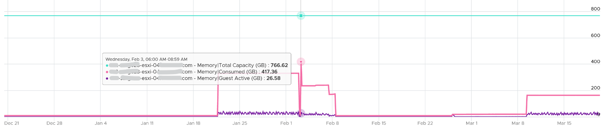
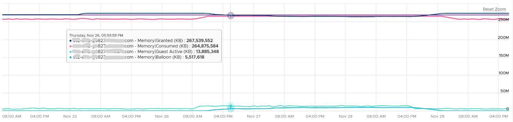

# ESXi memory states and reclamation thresholds

## Mechanism
- ESXi starts reclaiming when free memory runs low.
- The State counter reports one of 5 states. Each is a multiple of Free Memory Minimum (minFree).
- Contention happens at hypervisor level. VMs feel its side effects. The degree per VM depends on shares, reservation and utilization.

## States (example: ESXi with 1 TB RAM, minFree 10.8 GB)
| State | Threshold (% of minFree) | Free memory (1 TB host) | Action |
|---|---|---|---|
| High | 300% | 32.4 GB | None. |
| Clear | 100% | 10.8 GB | None. |
| Soft | 64% | 6.9 GB | Ballooning starts. |
| Hard | 32% | 3.5 GB | Compression and swapping start. |
| Low | 16% | 1.7 GB | VM execution is blocked. |


- Keep hosts in High or Clear. Unless high utilization is the goal, hosts sit in High.

## When ballooning starts
| | 512 GB host | 1 TB host | 1.5 TB host |
|---|---|---|---|
| Balloon threshold (free) | 3.7 GB | 6.9 GB | 10.2 GB |
| Used at threshold | 508.3 GB | 993.1 GB | 1,489.8 GB |
| Used at threshold (%) | 99.3% | 99.3% | 99.3% |

- Ballooning starts only after about 99% of host memory is used.

## HA headroom
- Example: 12 hosts, sized for 11 (one for HA or maintenance).
- Target 99% during HA or maintenance → 99% × 11 / 12 = 90.75% in normal operation.
- At that level hosts do not reach the balloon state, so VMs are not swapped.
- Balloon in such a cluster points to a VM-level cause such as a limit, not host pressure.
- A limit does not cause balloon directly. It causes Compressed or Swapped when Consumed tries to grow beyond it. See `vsphere/memory/metrics/virtual-machine/ballooned`.

## Low Free Threshold
- Counter: Low Free Threshold (KB). The free-memory level below which ESXi reclaims memory from VMs.
- Varies with host RAM. Check it only if ballooning seems to start too early.

## Memory regions
```text
Used   = Active (estimate of recently touched pages)
Cached = Consumed - Active
Free   = Total Capacity - Consumed
```
- Memory is cache: the active part is far smaller and more volatile than the inactive part.
- Example: an ESXi host with low Consumed and lower Active over 3 months, both far below total capacity.

- Overcommitted host at 100%: inactive granted pages cause no ballooning at first. When Active rises, Consumed rises and ballooning starts. When Active falls, ESXi deflates the balloon.


## Traps
- "Ballooning starts at 90% host memory" → about 99%.
- "Host with balloon has VMs in contention" → example: 7 days of constant balloon, worst VM contention below 1%.

## Metadata
```yaml
id: vsphere/memory/concepts/host-memory-states
retriever_guide: how-it-works
scope: vsphere
technology:
- memory
pillar:
- performance
- capacity
product:
- vsphere
object:
- HostSystem
internal_derive: []
related:
- vsphere/memory/concepts/ballooning
- vsphere/memory/concepts/swap-and-compression
- vsphere/memory/metrics/host/ballooned
- vsphere/memory/metrics/host/consumed
- vsphere/memory/configuration/host-level-swapping
images:
  - path: ../images/esxi-memory-state-counter.png
    product: [vsphere]
    object: [HostSystem]
    metric: ['ESXi Memory State']
    image_type: timeline
  - path: ../images/esxi-memory-consumed-vs-guest-active-vs-capacity.png
    product: [vsphere]
    object: [HostSystem]
    metric: ['ESXi Memory Consumed', 'ESXi Memory Active', 'ESXi Memory Total Capacity']
    image_type: timeline
    sample: '1 host, 3 months'
  - path: ../images/esxi-memory-overcommit-balloon-follows-active.png
    product: [vsphere]
    object: [HostSystem]
    metric: ['ESXi Memory Ballooned', 'ESXi Memory Active', 'ESXi Memory Consumed']
    image_type: timeline
source:
  document: PART 3 - Counters.docx
  path: Memory > ESXi > Contention Metrics > Balloon
corrections: []
review_notes:
- 'Section ''States'': minFree for 1 TB = 10.8 GB per the book. Calculator cited by the book: https://blogs.virtualmaestro.in/2020/06/02/vmware-vsphere-7-x-memory-reclamation-part-2-mem-memminfreepct/ (third-party). The minFree rule (899 MB for the first 28 GB, then 1% of the rest) is Claude''s own knowledge; it gives about 10.8 GB for 1 TB.'
- 'Section ''When ballooning starts'': book typo ''993.1 BB'' written as GB.'
- "Section 'HA headroom': author (2026-11-03), Q014: a limit does not cause ballooning directly. The book's phrase that balloon means a limit is imposed is read as a pointer to a VM-level cause."
status: draft
```
